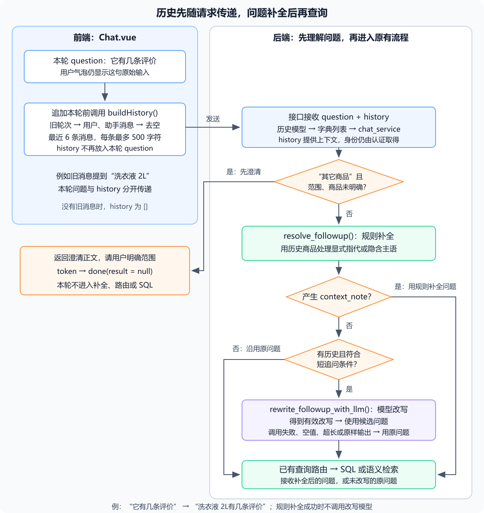
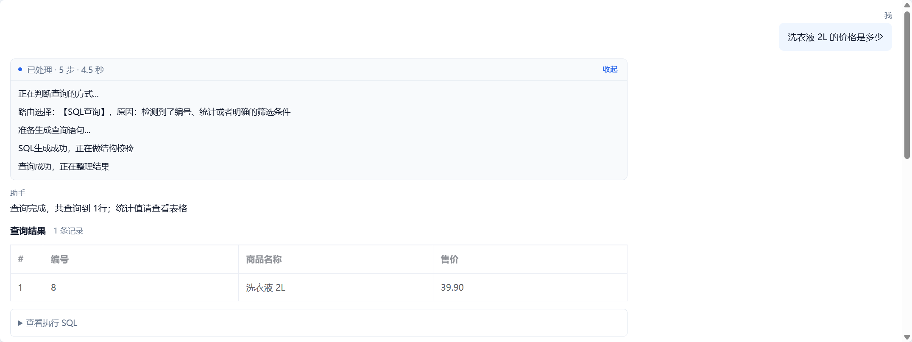
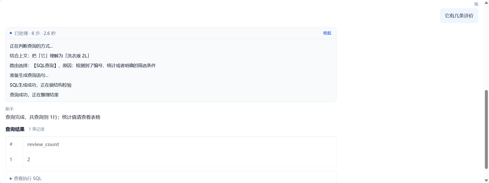
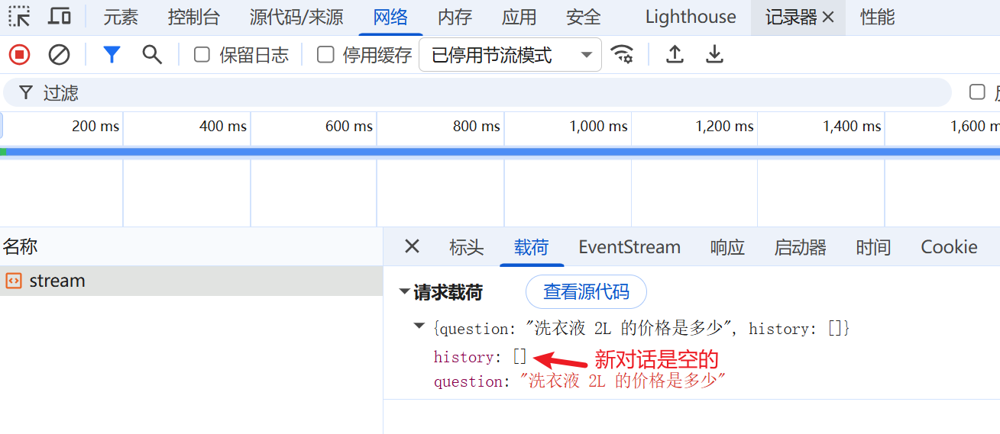
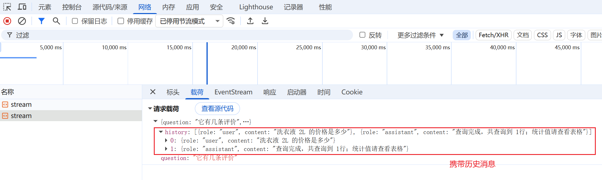
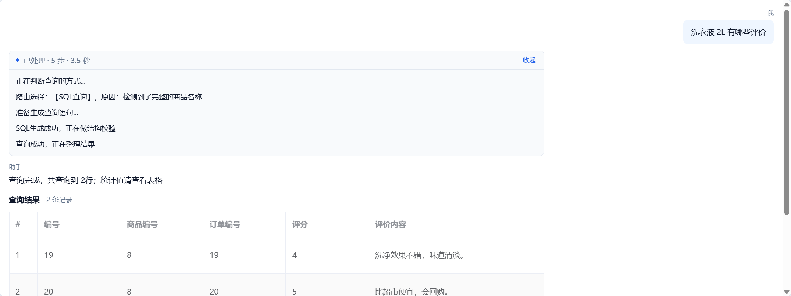
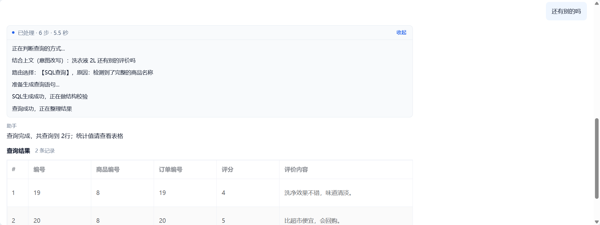

## 1. 从历史消息补全指代与省略

第 10 节可以自动选择 SQL 或语义检索，但请求里只有当前的 `question`。先问“洗衣液 2L 的价格是多少”，再问“它有哪些低分评价”，第二句没有商品名，后端无法仅凭这句话确定对象。

本节采用成品源码的处理方式：**前端提交最近的对话历史，后端先补全问题，再进入已有路由。** 例如将“它有哪些低分评价”改写为“洗衣液 2L有哪些低分评价”。低分沿用第 05 节的 `rating <= 2` 约定，由提示词引导，并在验收时核对生成 SQL 的评分条件；SQL 结构校验不保证筛选条件符合问题，补全函数也不执行查询。

这里的短期记忆就是本次请求携带的近期消息，不是后端长期保存的商品记录。页面刷新、清空对话或截去较早消息后，那部分历史便不再随请求发送；后端重启本身不会清除浏览器中仍保存的消息。

### 1.1 三层处理各负责什么

| 层次 | 示例 | 处理方式 |
| --- | --- | --- |
| 显式指代 | 它有哪些低分评价 | 在近期消息中找商品，替换指定代词 |
| 隐含主语 | 有几条评价 | 短句涉及业务属性且没有新商品或全局范围时，补上上文商品 |
| 模型兜底 | 还有别的吗 | 规则没有补全且像短追问时，将近期对话交给模型改写 |

进入这三层前，先检查“其它商品”是否说明了查询范围或完整商品名；没有说明时，先请用户明确范围。先完成显式指代的往返，再对照隐含主语与模型兜底。模型兜底失败时保留原问题；“保留原问题”不等于已经弄清用户意图，返回的 SQL、商品归属与评价原文仍需核对。

### 1.2 请求与消息的约定

| 字段 | 来源、类型与用途 |
| --- | --- |
| `question` | 本轮输入的字符串，不混入旧回答 |
| `history` | 前端消息列表转换出的对象数组，每项包含 `role` 与 `content` |
| `role` | `user` 或 `assistant`，表示消息来源 |
| `content` | 历史文本；请求模型允许每条最多 2000 字符 |
| `user_id` | 接口从登录认证取得，不从历史或请求体读取 |

接口最多接受 10 条历史消息，本节页面只提交最近 6 条，每条最多 500 字符。规则补全回看这 6 条；模型兜底进一步将每条截为最多 300 字符。它们是不同位置的长度限制，不代表固定的 token 数。

`history` 可省略，旧的单轮请求仍能使用。本节不增加 `conversation_id`、TTL 或服务端会话字典，也不把后续人工确认使用的 `thread_id` 当作跨轮聊天历史。

### 1.3 本次涉及的文件

| 文件 | 本节操作 |
| --- | --- |
| `backend/app/schemas/chat.py` | 新增历史消息模型，为请求增加可选 `history` |
| `backend/app/agent/__init__.py` | 没有该目录时创建空文件，让本节模块有明确归属 |
| `backend/app/agent/router_rules.py` | 加入商品别名函数，供上下文匹配使用 |
| `backend/app/agent/context.py` | 新增规则补全与模型改写 |
| `backend/app/api/chat.py` | 将历史转为字典列表后传给服务 |
| `backend/app/services/chat_service.py` | 在路由前澄清模糊范围，再调用上下文模块 |
| `backend/app/services/query_router_service.py` | 将全店商品列表交给 SQL 查询 |
| `backend/app/services/nl2sql_service.py` | 补充排除商品的规则，提供本月日期区间 |
| `frontend/src/api/chat.js` | 请求体增加历史数组 |
| `frontend/src/views/Chat.vue` | 从旧轮次构造历史，在追加本轮之前截取 |

沿用前面章节的虚拟环境与依赖。本节创建 `agent` 目录不需要安装 LangGraph；状态图放到下一节讲解。

## 2. 为请求增加历史消息

在 `backend/app/schemas/chat.py` 中新增 `ChatTurn`，并用下面的 `ChatRequest` 替换原同名类。保留文件里其他已经存在的请求模型。

```python
from pydantic import BaseModel, Field


class ChatTurn(BaseModel):
    """前端提交的一条历史消息。"""

    role: str = Field(pattern="^(user|assistant)$", description="消息来源")
    content: str = Field(max_length=2000, description="历史文本")


class ChatRequest(BaseModel):
    question: str = Field(min_length=1, max_length=1000, description="用户问题")
    history: list[ChatTurn] = Field(
        default_factory=list, max_length=10, description="最近对话"
    )
```

`default_factory=list` 为未传历史的请求创建空列表。非法角色、超过 10 条消息或单条文本超过 2000 字符时，FastAPI 在进入业务函数之前返回 HTTP 422；服务层仍需要拒绝全空格的本轮问题。

## 3. 补全指代与省略

### 3.1 准备商品别名

在 `backend/app/agent/` 下创建空的 `__init__.py`，再新建 `router_rules.py`。写入以下代码；若目录已使用成品源码，保留其余规则，只核对同名函数，不用覆盖整个文件。

```python
import re


def product_aliases(known_product_names: list[str]) -> dict[str, str]:
    """商品别名表：原名 + 去掉规格后缀的名字（第一个空格前的部分）。

    库里商品名带规格（「洗衣液 2L」「保温杯 500ml」），用户往往只说「洗衣液」。
    只按全名匹配会漏，明明点名了商品却走语义检索，答案只能从评价文本里拼凑。

    刻意不加「尾词」别名（如把「轻云运动跑鞋」缩成「跑鞋」）：那样会把
    「跑鞋脱胶」这类主题型问题也拉去 SQL，丢掉语义检索在措辞无关场景的价值。
    """
    alias: dict[str, str] = {}
    for name in known_product_names or []:
        # 空名称不能作为匹配词，跳过无效数据。
        if not name:
            continue
        alias.setdefault(name, name)
        core = re.split(r"[\s　]+", name)[0].strip()
        # 过短别名容易误命中，仅保留至少两个字符的名称。
        if len(core) >= 2:
            alias.setdefault(core, name)
    return alias
```

例如完整名称“洗衣液 2L”还会得到别名“洗衣液”，但不会任意抽取“轻云运动跑鞋”的尾词“跑鞋”。`setdefault()` 保留首次建立的映射；如果多个商品共享同一个简称，就不能保证简称唯一对应正确商品，查询时应使用完整名称。

### 3.2 编写上下文处理模块

新建 `backend/app/agent/context.py`，写入下面的完整实现。`resolve_followup()` 是规则入口；`rewrite_followup_with_llm()` 只在规则未完成补全时由调用方执行。

```python
import logging
import re

from app.agent import router_rules
from app.services import llm_service

logger = logging.getLogger(__name__)

# 指代词（长的在前，避免「这个」先于「这个商品」命中）
_REFERENCE_WORDS = (
    "这个商品",
    "该商品",
    "此商品",
    "这款商品",
    "这个产品",
    "该产品",
    "它",
    "这个",
    "那个",
    "这款",
    "该款",
)

# 只回看最近这几条消息，避免很久之前提到的商品被误当上下文
_HISTORY_SCAN_TURNS = 6

# 全局范围词：出现说明用户问的是全店/跨商品，不做“承接上文商品”的补全
_GLOBAL_SCOPE_WORDS = (
    "哪些商品", "哪个商品", "各商品", "各个商品", "所有商品", "全部商品",
    "类目", "分类", "品类", "整体", "全店", "全站", "全库",
)

# “承接上文”的判断：问句很短（自己没主语）、没提商品、不问全局、且问的是业务属性
_INHERIT_MAX_LENGTH = 16
# 业务属性词：出现才认为这句是在问“它的某个指标/情况”
_INHERIT_KEYWORDS = (
    "评价", "评论", "评分", "星级", "差评", "好评", "口碑", "销量", "订单",
    "库存", "价格", "金额", "退货", "售后", "表现", "情况", "怎么样", "多少",
)


# 时间词与“其它”内部的代词字样不是商品指代，匹配时保护这些文本区间。
_NON_REFERENCE_PATTERN = re.compile(r"这(?:个)?(?:月|星期|周|季度|年度|年|礼拜)|其它")


def _reference_span(text: str, word: str):
    """返回第一个不落在保护词段内的指代词位置，找不到时返回 None。"""
    protected = [match.span() for match in _NON_REFERENCE_PATTERN.finditer(text)]
    for match in re.finditer(re.escape(word), text):
        # 两个区间有交集就跳过，避免把“这个月”中的“这个”当商品。
        if not any(match.start() < end and match.end() > start for start, end in protected):
            return match.span()
    return None


def _non_reference_without_pronoun(text: str) -> bool:
    """有保护词段但没有真正指代时，阻止继承旧商品及模型再次改写。"""
    return bool(_NON_REFERENCE_PATTERN.search(text)) and not any(
        _reference_span(text, word) for word in _REFERENCE_WORDS
    )


def _find_product_in_history(history: list[dict], aliases: dict[str, str]):
    """从最近的消息往回找商品名：先看用户说过的话，再看助手回复。

    优先用户自己的提问（「洗衣液」），因为助手的长回答里可能提到一堆商品。
    """
    turns = list(history or [])[-_HISTORY_SCAN_TURNS:]
    for role in ("user", "assistant"):
        for turn in reversed(turns):
            # 先扫描用户消息，再用助手消息兜底。
            if str((turn or {}).get("role") or "") != role:
                continue
            text = str((turn or {}).get("content") or "")
            # 空消息没有可匹配的商品，继续向前扫描。
            if not text:
                continue
            hits = [alias for alias in aliases if alias in text]
            # 多个别名命中时取最长名称，减少短别名的干扰。
            if hits:
                alias = max(hits, key=len)
                return alias, aliases[alias]
    return None


def _should_inherit(text: str, aliases: dict[str, str]) -> bool:
    """要不要把上文那个商品"接"到这句问句上。

    适用于「有几条评价」「评价怎么样」这种没有主语、接着上一个商品问的短句；
    问句里自己带了商品名、或问的是全局（哪些商品/类目/整体）时都不接。
    """
    # 长问题按独立问题处理，不强行继承上文主语。
    if len(text) > _INHERIT_MAX_LENGTH:
        return False
    # 全店与跨商品问题不能强行限定为上轮的一个商品。
    if any(word in text for word in _GLOBAL_SCOPE_WORDS):
        return False
    # 问题已有商品名时，保留用户本轮明确给出的对象。
    if any(alias in text for alias in aliases):
        return False
    return any(word in text for word in _INHERIT_KEYWORDS)


def resolve_followup(
    question: str, history: list[dict] | None = None, product_names: list[str] | None = None
) -> tuple[str, str | None]:
    """把指代/隐含主语补成具体商品名。

    两种情形：
    1. 显式指代：问句里有「它 / 这个 / 该商品」→ 替换成上文商品名；
    2. 隐含承前：问句很短、自己没提商品、问的是业务属性（如「有几条评价」）→ 补上商品名。
    没有可指代的对象时原样返回，说明为 None。
    """
    text = (question or "").strip()
    # 无问题或无历史时保留单轮行为，不补出未知对象。
    if not text or not history:
        return question, None

    # 完整时间表达或“其它”中没有真正指代时，原问题不能再继承旧商品。
    if _non_reference_without_pronoun(text):
        return question, None

    aliases = router_rules.product_aliases(product_names or [])
    # 当前没有已知商品时无法建立指代关系。
    if not aliases:
        return question, None

    found = _find_product_in_history(history, aliases)
    # 历史里没找到商品就保留原问题，不伪造商品名。
    if found is None:
        return question, None

    _, canonical = found

    # 1) 显式指代
    for word in _REFERENCE_WORDS:
        # 按位置只替换保护词段之外的指代，保留同句里的时间词和“其它”。
        if (span := _reference_span(text, word)) is not None:
            start, end = span
            rewritten = text[:start] + canonical + text[end:]
            return rewritten, f"结合上文：把「{word}」理解为「{canonical}」"

    # 2) 隐含承前（「有几条评价」→「洗衣液 2L 有几条评价」）
    if _should_inherit(text, aliases):
        return f"{canonical} {text}", f"结合上文：接着上面的「{canonical}」问"

    return question, None


# ---------------------------------------------------------------- 意图改写（兜底）
#
# 规则法处理不了「还有别的吗」「换个角度看看」这类整句省略的追问。
# 这里加一层大模型改写，但**只在明显是短追问时**才调用，正常问题不受影响：
#   - 问句很短（≤20 字）、自己没提商品、也不是在问全局；
#   - 且规则改写没成功时才会走到这里。

_CONTINUATION_WORDS = (
    "还有", "别的", "其他", "其它", "那呢", "然后", "接着", "再来", "再说", "继续", "换个",
)
_LLM_REWRITE_MAX_LENGTH = 20  # 超过这个长度认为是完整问题，不改写
_LLM_REWRITE_MAX_OUTPUT = 60  # 改写结果过长视为异常，丢弃

_REWRITE_SYSTEM_PROMPT = """你是多轮对话的问题改写器。根据最近的对话，把用户新提出的问题改写成一句不依赖上文、可直接检索的完整问题。
规则：
1. 只补全指代与省略，不要新增原文没有的筛选条件
2. **省略式追问优先理解为「同一个商品的同一件事」**：上一轮在看某商品的评价，追问「还有别的吗」应改写为「该商品还有别的评价吗」，不要变成「还有别的商品吗」
3. 只能使用对话里出现过的商品名，不要编造
4. 如果新问题本身已经完整，或你无法确定用户想问什么，就原样输出原问题（不要猜）
5. 只输出改写后的一句话，不要解释、不要引号、不要 Markdown

示例（对话里刚看过「洗衣液 2L」的评价）：
- 「还有别的吗」→「洗衣液 2L 还有别的评价吗」
- 「它的差评呢」→「洗衣液 2L 的差评呢」
- 「换个角度看看」→「洗衣液 2L 的评价还有别的角度吗」
- 「谢谢」→「谢谢」"""


def looks_like_followup(text: str, aliases: dict[str, str]) -> bool:
    """是否值得调用大模型改写：短、自己没提商品、也不是问全局。"""
    # 超过 20 字的问题不进入模型改写，较短问题继续核对范围、商品名和续问特征。
    # 规则已保留的非指代表达不能交给模型重新补入旧商品。
    if _non_reference_without_pronoun(text):
        return False
    if not text or len(text) > _LLM_REWRITE_MAX_LENGTH:
        return False
    # 全店与跨商品问题不能强行限定为上轮的一个商品。
    if any(word in text for word in _GLOBAL_SCOPE_WORDS):
        return False
    # 问题已有商品名时，保留用户本轮明确给出的对象。
    if any(alias in text for alias in aliases):
        return False
    # 前面先排除超过 20 字、有商品名或全局范围的问题；剩余句子中，
    # 含续问词或不超过 8 字就交给模型判断，因此“谢谢”也可能进入，提示词要求原样返回。
    return any(word in text for word in _CONTINUATION_WORDS) or len(text) <= 8


def rewrite_followup_with_llm(
    question: str, history: list[dict] | None = None, product_names: list[str] | None = None
) -> tuple[str, str | None]:
    """规则改写失败时的兜底：让大模型把追问补成完整问题。

    任何异常（超时、模型报错、输出异常）都原样返回，绝不因为这一层让问答失败。
    """
    text = (question or "").strip()
    # 完整时间表达或“其它”中没有真正指代时，原问题不能再继承旧商品。
    if _non_reference_without_pronoun(text):
        return question, None

    aliases = router_rules.product_aliases(product_names or [])
    # 没有历史或不像追问时不调用模型，避免无依据改写。
    if not history or not looks_like_followup(text, aliases):
        return question, None

    lines: list[str] = []
    for turn in list(history)[-_HISTORY_SCAN_TURNS:]:
        role = "用户" if str((turn or {}).get("role") or "") == "user" else "助手"
        content = str((turn or {}).get("content") or "")[:300]
        # 只拼接有内容的消息，避免空占位干扰模型。
        if content:
            lines.append(f"{role}：{content}")
    # 截取后没有有效历史时，没有可交给模型的上下文。
    if not lines:
        return question, None

    user_prompt = "最近对话：\n" + "\n".join(lines) + f"\n\n新问题：{text}\n改写："
    try:
        rewritten = llm_service.complete_text(_REWRITE_SYSTEM_PROMPT, user_prompt).strip()
    except Exception:
        logger.warning("意图改写调用失败，沿用原问题", exc_info=True)
        return question, None

    rewritten = rewritten.strip().strip('"“”').strip()
    # 空结果和异常长结果不能交给路由，回退原问题。
    if not rewritten or len(rewritten) > _LLM_REWRITE_MAX_OUTPUT:
        return question, None
    # 模型未作补全时保持单轮行为，不显示改写成功。
    if rewritten == text:
        return question, None
    return rewritten, f"结合上文（意图改写）：{rewritten}"
```

### 3.3 先看规则的数据流

`_find_product_in_history()` 只看最近 6 条消息，先倒序查找用户消息，再用助手消息兜底。它优先采用用户自己提到的商品，减少助手回答顺带列出多个商品带来的干扰，但仍不是能可靠理解否定、比较和多对象指代的通用解析器。

`resolve_followup()` 返回 `(查询问题, 说明)`。有说明时，调用方把说明显示在过程区；没有说明时，不代表问题错误，只表示这一层没有补全。

显式指代不能只用“字符串里是否包含它”来判断。“其它”也包含“它”，“这个月”也包含“这个”，直接替换会破坏原问题。`_NON_REFERENCE_PATTERN` 先找出这些完整词段；`_reference_span()` 只返回保护词段之外的指代位置，再用 `text[:start] + canonical + text[end:]` 替换。

以历史商品“洗衣液 2L”为例：

| 本轮输入 | 位置判断 | 交给后续查询的问题 |
| --- | --- | --- |
| 这个月销量最高的商品 | “这个月”受保护，没有真正指代 | 保留原问题，不继承旧商品，也不再交给模型补入旧商品 |
| 全店其它商品有哪些 | “其它”受保护，其中的“它”不可替换 | 保留全店范围，交给 SQL 路由 |
| 这个月它有几条评价 | “这个月”占 `[0, 3)`，真正的“它”占 `[3, 4)` | 这个月洗衣液 2L有几条评价 |

两个区间重叠的条件是 `match.start() < end and match.end() > start`。例如“这个”占 `[0, 2)`，与“这个月”的 `[0, 3)` 重叠，所以跳过；后面的“它”从位置 3 开始，与保护词段不重叠，可以替换。

隐含主语仍要求问题短、没有自己的商品名、没有全店范围词，并且包含业务属性词。遇到保护词段且没有真正指代时，规则补全和模型兜底都保留原问题；否则跳过显式替换后，仍可能被隐含主语分支补入旧商品。保护词段只覆盖代码列出的表达，不是通用中文指代解析；多个商品、否定或比较关系仍需写清对象。

### 3.4 模型兜底的输入与边界

`looks_like_followup()` 筛选短追问，避免每个完整问题都增加一次模型请求。提示词要求只补上下文、不新增筛选条件；这属于对生成的引导，不能保证模型一定遵守。

`rewrite_followup_with_llm()` 使用文件顶部导入的 `llm_service` 模块，通过 `llm_service.complete_text(system_prompt, user_prompt)` 调用模型。实现位于 `backend/app/services/llm_service.py`，读取 `backend/.env` 中的 `LLM_BASE_URL`、`LLM_API_KEY`、`LLM_MODEL` 和 `LLM_TIMEOUT_SECONDS`；本节不新增模型调用模块或依赖。

调用异常、空结果、超长结果或模型原样返回时，都沿用原问题。改写成功只表示得到一段候选问题，不能证明补出的条件符合用户意图；过程区显示改写内容，执行前仍经过已有 SQL 校验与只读连接。历史文本也不具有额外权限，不能改变可查表或执行范围。

## 4. 将历史接到已有查询流程

### 4.1 接口传递历史

在 `backend/app/api/chat.py` 保留原有导入和 `router`，用下面的完整函数替换 `chat_stream()`。变量统一使用 `current_user`。

```python
@router.post("/stream")
def chat_stream(
    body: ChatRequest, current_user: Annotated[User, Depends(get_current_user)]
):
    """认证负责身份，history 只提供本轮查询的上下文。"""
    return StreamingResponse(
        chat_service.stream_chat(
            question=body.question,
            user_id=current_user.id,
            history=[turn.model_dump() for turn in body.history],
        ),
        media_type="text/event-stream",
        headers={
            "Cache-Control": "no-cache",
            "Connection": "keep-alive",
            "X-Accel-Buffering": "no",
        },
    )
```

`body.history` 中的每项是 `ChatTurn` 对象，`model_dump()` 将其转成包含 `role`、`content` 的字典，供上下文函数使用。`user_id` 仍取自认证依赖，历史里的角色不能充当登录身份。

### 4.2 在查询路由之前补全

在 `backend/app/services/chat_service.py` 的导入区域增加：

```python
import re
from app.agent import context
```

将原 `stream_chat()` 的函数声明改为下面三行，保留已有函数体：

```python
def stream_chat(
    question: str, user_id: int | None = None, history: list[dict[str, Any]] | None = None
) -> Generator[str, None, None]:
```

在第 10 节的路由 `try` 块中，找到从 `product_names = query_router_service.load_product_names()` 到 `decision = query_router_service.decide_query_route(question, product_names)` 的部分，替换为以下代码。后面的 `except`、SQL 分支与语义分支全部保留。

```python
        product_names = query_router_service.load_product_names()
        original_question = question.strip()
        # “其它商品”未给出范围或完整商品名时，先澄清，不猜测要排除的历史商品。
        has_other_products = re.search(r"(?:其它|其他)商品", original_question)
        has_global_scope = re.search(r"全店|全站|全库|所有|全部", original_question)
        has_named_product = any(
            name and name in original_question for name in product_names
        )
        if has_other_products and not has_global_scope and not has_named_product:
            yield _sse("token", {
                "content": "请明确查询范围：是全店商品，还是排除某个商品？请写出范围或完整商品名。"
            })
            # 澄清不是查询结果；正常结束本轮，不显示空表格或查询失败。
            yield _sse("done", {"result": None})
            return
        # 先用规则补全商品指代，避免仅因缺少商品名就走错查询路径。
        question, context_note = context.resolve_followup(
            original_question, history=history, product_names=product_names
        )
        # 规则未完成补全时，才考虑为短追问发起一次模型改写。
        if context_note is None:
            question, context_note = context.rewrite_followup_with_llm(
                original_question, history=history, product_names=product_names
            )
        # 只在补全过程产生说明时展示，方便核对程序理解的查询对象。
        if context_note:
            yield _sse("status", {"message": context_note})
        decision = query_router_service.decide_query_route(question, product_names)
```



前端用户气泡仍显示原始输入；后端的路由、SQL 生成与语义检索接收补全后的问题。有查询结果时，`done.result` 的表格结构不变，不把历史或上下文状态混进查询结果。

“其它商品的价格是多少”没有说明“其它”相对什么，不能自动理解为排除上轮商品。此时发送澄清文字的 `token`，再发送 `done`，其中 `result` 为 `None`；前端解析后是 `null`，只显示澄清文字，不显示空表格。它不是数据库故障，因此不发送 `error`。用户可以接着明确说“全店所有商品的价格是多少”，或“除洗衣液 2L 以外，其它商品的价格是多少”；新请求重新检查其范围，不建立服务端等待状态。

“全店其它商品有哪些”已明确全店范围，本节不凭历史再附加排除条件；需要排除某商品时，必须在本轮问题中给出对象。

规则与模型均未形成改写时，原问题继续进入第 10 节的路由。规则没有找到商品时，仍可能由模型结合近期消息完成改写；没有历史时两层都不改写。这与“无法指代就报错”的方案不同：语义检索可能返回相近候选，不能将候选当成已正确识别的商品。查询具体商品时，应补充完整商品名。

### 4.3 明确全店范围时使用 SQL

在 `backend/app/services/query_router_service.py` 中，保留 `re`、`STRUCTURED_PATTERN` 和 `load_product_names()`，用下面代码替换 `decide_query_route()`：

```python
def decide_query_route(question: str, product_names: list[str]) -> dict[str, str]:
    """接收问题和已知的商品名，返回 查询方式、语义类型和选择理由"""
    question = question.strip()
    if not question:
        raise ValueError("对话的内容不能为空")

    # 全店范围要查数据库，不能把语义Top K候选当作全店商品列表。
    if re.search(r"(?:全店|全站|全库|所有|全部).*(?:商品|产品)", question):
        return {
            "route": "sql",
            "kind": "",
            "reason": "明确要求查询全店商品范围",
        }

    if STRUCTURED_PATTERN.search(question):
        return {
            "route": "sql",
            "kind": "",
            "reason": "检测到了编号、统计或者明确的筛选条件",
        }

    if any(name and name in question for name in product_names):
        return {
            "route": "sql",
            "kind": "",
            "reason": "检测到了完整的商品名称",
        }

    if "评价" in question or "评论" in question:
        return {
            "route": "semantic",
            "kind": "review",
            "reason": "按评价内容含义进行语义检索",
        }

    if "商品" in question or "产品" in question:
        return {
            "route": "semantic",
            "kind": "product",
            "reason": "按商品描述含义进行语义检索",
        }

    return {
        "route": "semantic",
        "kind": "review",
        "reason": "未识别到明确的条件，默认按语义进行检索",
    }
```

“全店其它商品有哪些”没有价格、数量等词，也没点名具体商品；只用原有规则会走商品语义检索，最多返回 5 条相似候选。新增判断先识别全店商品范围，再交给 SQL 查询。它只改变路由，不负责生成 SQL，也不表示可以返回无限条记录。生成 SQL 前，还会把没有排除表达的“全店其它商品”统一写成“全店商品”；只有“其它商品”而没有全店范围的输入仍先澄清，不能套用这一步。

SQL 明细仍默认最多展示 20 行；若结果标记 `truncated=True`，不能仅凭展示结果声称覆盖全店。没有明确全店范围的“适合旅行的商品”等描述，仍可走语义检索。

### 4.4 为本月查询提供具体日期

在 `backend/app/services/nl2sql_service.py` 的导入区增加：

```python
from datetime import date
```

在已有 `SYSTEM_PROMPT` 的商品名称匹配规则后增加以下两条，保留其余规则与表结构：

```text
明确要求排除某商品时按 name <> 指定名称，不得误写为 name =。
全店商品列表从 products 查询；未明确指定排除名称或编号时，不擅自附加商品排除条件。
```

然后用下面代码替换 `generate_sql()`，其余 SQL 校验和执行函数保留：

```python
def generate_sql(question: str) -> str:
    """提供当前月日期范围，生成只读 SQL；查询意图不明确时拒绝。"""
    # 明确全店范围且没有排除表达时，“全店其它商品”按全店商品查询，不让模型再次猜排除对象。
    sql_question = question
    if not re.search(r"排除|除了?|不含|不包括", question):
        sql_question = re.sub(
            r"((?:全店|全站|全库)(?:的)?)(?:其它|其他)(商品|产品)",
            r"\1\2",
            question,
        )
    # 为“本月/这个月”提供含起点、不含终点的日期区间，沿用原SQL函数白名单。
    today = date.today()
    start = today.replace(day=1)
    # 12 月的下一月是次年 1 月；其他月份只将月份加一。
    end = date(start.year + (start.month == 12), start.month % 12 + 1, 1)
    month_bounds = (
        f"当前日期：{today.isoformat()}。本月/这个月指业务时间 >= '{start}' 且 < '{end}'。"
        "按问题选择时间列：销量或订单统计用 orders.create_time，评价用 reviews.create_time；明确查询商品建档时用 products.create_time。"
        "查询本月/这个月时必须使用以上日期字面量比较，不使用 DATE_FORMAT、NOW、CURRENT_DATE、YEAR、MONTH 等日期函数。"
    )
    sql = llm_service.complete_text(SYSTEM_PROMPT + "\n" + month_bounds, sql_question)
    # 对象或条件不明确时不执行模型输出，避免把猜测当查询依据。
    if sql == "UNSUPPORTED":
        raise ValueError("现有的业务表无法支持该查询，请修正查询对象和条件")
    return sql
```

`date.today()` 读取应用服务器本地日期，`replace(day=1)` 得到本月第一天。例如服务器日期为 `2026-10-24`，则 `start` 是 `2026-10-01`、`end` 是 `2026-11-01`；12 月则把年份加一、月份回到 1。`>= start`、`< end` 保留本月全部时间，不需要猜最后一天有几天，也不会遗漏月底最后一秒之后的小数秒记录。

“这个月销量最高的商品”应按订单的 `create_time` 筛选，并对 `quantity` 求和；商品的建档时间不能代表订单发生时间。若明确问“本月新建的商品”，则使用 `products.create_time`；评价时间用 `reviews.create_time`。以上述日期为例，查询可写为：

```sql
SELECT p.id, p.name, SUM(o.quantity) AS total_quantity
FROM orders AS o
JOIN products AS p ON p.id = o.product_id
WHERE o.create_time >= '2026-10-01'
    AND o.create_time < '2026-11-01'
    AND o.status <> 'cancelled'
GROUP BY p.id, p.name
ORDER BY total_quantity DESC, p.id ASC
LIMIT 1
```

日期区间随服务器日期计算，不把示例月份固定到程序中。这里仅为“本月/这个月”提供范围，没有实现任意自然语言时间解析；部署时服务器日期与业务日期应一致。提示词引导模型直接使用日期字面量，原有 SQL 函数白名单保持不变，`DATE_FORMAT`、`NOW` 等函数不会因此获得执行权限。模型仍可能生成不符合规则的 SQL，必须继续经过原有校验。

## 5. 前端构造最近的历史

### 5.1 请求体提交历史

在 `frontend/src/api/chat.js` 中，保留现有 `chatStream(question, handlers = {})` 声明，将 `fetch()` 中原来的 `body: JSON.stringify({ question }),` 替换为：

```javascript
body: JSON.stringify({ question, history: handlers.history || [] }),
```

历史作为 `handlers.history` 传入，原有认证头、四类事件解析和 `onFinish` 均继续使用。没有传历史时仍发空列表。

### 5.2 在追加本轮之前截取

当前页面的 `messages` 每项代表一轮，包含 `question`、`answer` 等字段。在 `frontend/src/views/Chat.vue` 的 `<script setup>` 内、`handleSend()` 前增加：

```javascript
function buildHistory(endIndex) {
  return messages.value
    // 只取本轮追加前的旧轮次，再展开为用户、助手两条消息。
    .slice(0, endIndex)
    .flatMap((round) => [
      { role: 'user', content: round.question || '' },
      { role: 'assistant', content: round.answer || '' }
    ])
    // 先排除空消息，再保留最近 6 条消息；这里的 6 不是轮数。
    .filter((turn) => turn.content)
    .slice(-6)
    // 每条最多提交 500 字符，限制随请求发送的历史文本长度。
    .map((turn) => ({ role: turn.role, content: turn.content.slice(0, 500) }))
}
```

`flatMap()` 将每一轮展开成用户、助手两条消息；空回答不会作为空消息发送。先保留最近 6 条，再将每条截为最多 500 字符。成品页将两类消息分开保存，因此不需要这一轮次转换，提交后的 `history` 结构一致。

在 `handleSend()` 判空与 `messages.value.push(round)` 之前增加：

```javascript
// 流尚未收尾时不启动第二次请求，避免两轮消息交错。
if (sending.value) return
// 先取旧消息，再追加当前问题和回答占位，防止本轮被重复发送。
const history = buildHistory(messages.value.length)
```

随后在原有 `chatStream(value, {` 的对象开头增加一项：

```javascript
history,
```

保留 `activeRequest = chatStream(...)` 的请求引用、随后单独调用的 `activeRequest.run()` 与其他回调，组件卸载时仍通过该引用取消请求。将 `onDone` 整体替换为下面内容，仅在已有 `onFinish` 中解除 `sending`：

```javascript
onDone: (payload) => {
  round.result = payload?.result || null
  round.done = true
  round.elapsed = (Date.now() - startedAt) / 1000
  stopTimer()
  scrollToBottom()
},
```

`done` 表示本轮处理完成（包括只返回澄清文字的情况），响应流可能还没有关闭。等 `onFinish` 再允许下一次发送，可避免旧流收尾时把新请求的加载状态提前解除。错误、HTTP 401、HTTP 422 和网络异常也由原有 `onFinish` 收尾。

### 5.3 开始新对话

在 `clearInput()` 附近增加：

```javascript
const startNewConversation = () => {
  // 查询期间保留当前消息容器，防止旧响应写入已经清空的对话。
  if (sending.value) return
  messages.value = []
  question.value = ''
}
```

在模板 `.chat-actions` 内的 `.chat-buttons` 中，原“清空”按钮前增加：

```html
<el-button :disabled="sending" @click="startNewConversation">新对话</el-button>
```

在已有的 `@media (max-width: 640px)` 内，找到 `.chat-buttons`，将它的 `grid-template-columns` 改为：

```css
grid-template-columns: repeat(3, minmax(0, 1fr));
```

原来只有“清空”和“发送”两个按钮，使用两列；加入“新对话”后使用三列。窄屏下三个按钮应完整显示在输入卡片内，字数统计单独一行，不挤占按钮宽度。

“清空”仍只清输入框；“新对话”同时清消息和输入。下一次构造出的 `history` 就是空数组，不需要另发请求删除后端记忆。刷新页面也会丢失当前组件中的消息，本节不持久化聊天记录。

## 6. 验证历史与补全

### 6.1 启动前后端

确认 MySQL 已启动，`backend/.env` 中已有可用的 `DATABASE_URL`、`JWT_SECRET_KEY`、只读连接 `QUERY_DATABASE_URL`，以及 `LLM_BASE_URL`、`LLM_API_KEY`、`LLM_MODEL`。商品表中应有“洗衣液 2L”和“电动牙刷套装”；使用自建数据时，将下面的问句替换为实际完整商品名。

完成本节修改后，若前后端仍在运行，先在对应终端按 `Ctrl+C` 停止旧进程，再重新启动，确保后端加载新增模块。

在项目根目录打开 PowerShell，进入 `backend` 目录，激活项目虚拟环境后启动后端；运行命令如下：

```powershell
cd .\backend
.\.venv\Scripts\Activate.ps1
uvicorn app.main:app
```

在项目根目录另开一个 PowerShell，进入 `frontend` 目录启动前端：

```powershell
cd .\frontend
npm run dev
```

后端终端出现 `Application startup complete`、前端显示访问地址后，打开 `http://127.0.0.1:5173`，刷新页面并登录，进入「数据分析对话」。

### 6.2 查看指代补全结果

点击「新对话」，先提交“洗衣液 2L 的价格是多少”，等待回答结束，再提交“它有几条评价”。展开第二问的处理过程，核对把“它”理解为“洗衣液 2L”的说明，并查看统计结果。





第二问的 `review_count` 为 2，表示该商品有 2 条评价；“查询结果 1 条记录”表示统计查询返回一行，不是评价总数。

### 6.3 核对历史传递

打开浏览器开发者工具的「网络（Network）」面板，保留请求记录，再点击「新对话」。先发送“洗衣液 2L 的价格是多少”，等待回答结束，再发送“它有几条评价”。在网络面板筛选 `/api/chat/stream`，分别选中这两次请求，打开「载荷（Payload）」：

- 第一问的 `question` 是完整商品问题，`history` 为 `[]`。
- 第二问的 `question` 是“它有几条评价”；展开 `history`，应有第一问的 `user` 文本和非空 `assistant` 回答，不能再次包含本轮问题。
- 历史每项都有 `role`、`content`，角色顺序为用户、助手；过程状态和表格数据不单独作为历史消息发送。





页面最多提交最近 6 条消息，每条最多 500 字符；接口允许最多 10 条、每条最多 2000 字符。省略 `history` 时仍按单轮查询处理；非法角色或超出接口限制应返回 HTTP 422，无有效登录凭证时返回 HTTP 401。

继续核对下表中的行为。每行独立操作，开始前先点击「新对话」；每次等待上一问结束后再发送下一问。

| 验证项 | 操作 | 核对内容 |
| --- | --- | --- |
| 显式指代与低分条件 | 问“洗衣液 2L 的价格是多少”，再问“它有哪些低分评价” | 补全对象是洗衣液；展开执行 SQL，核对商品条件与 `rating <= 2`；当前示例数据应返回 0 条低分评价 |
| 隐含主语 | 问“洗衣液 2L 的价格是多少”，再问“有几条评价” | 显示承接洗衣液的说明；读取表格中的统计值，不把结果行数当成评价总数 |
| 全店问题 | 问“洗衣液 2L 的价格是多少”，再问“全店哪些商品销量最高” | 不把全店问题补为洗衣液，SQL 不应额外限定洗衣液 |
| 时间词保护与本月查询 | 问洗衣液价格，再问“这个月销量最高的商品” | 原问题中的“这个月”保留，不能变成洗衣液；SQL 以当前月第一天（含）至下月第一天（不含）筛选订单时间，用 `SUM(quantity)` 统计，默认排除取消订单 |
| 范围澄清 | 问洗衣液价格，再问“其它商品的价格是多少”，随后明确“全店所有商品的价格是多少” | 模糊问题显示澄清文字，不显示空表格或错误；明确范围后才展示 SQL 结果，不自动排除洗衣液 |
| 全店商品列表 | 问洗衣液价格，再问“全店其它商品有哪些” | 走 SQL，不能返回 5 条语义候选代替全店列表；SQL 不附加洗衣液条件，并核对截断标记 |
| 明确排除商品 | 问“除洗衣液 2L 以外，其它商品的价格是多少” | SQL 按商品名称排除洗衣液，显示其余商品及价格；不是只查询洗衣液 |
| 切换商品 | 问洗衣液价格，再问“电动牙刷套装的价格是多少”，最后问“它有哪些评价” | 最后一问补全为电动牙刷套装，SQL 与结果中的商品归属一致 |
| 清空输入 | 问洗衣液价格；在输入框输入文字并点击「清空」，再问“它有几条评价” | 输入被清空，旧问答仍在；最后一问仍携带旧历史并补全为洗衣液 |
| 新对话 | 问洗衣液价格，点击「新对话」后问“它有哪些评价” | 旧问答消失，请求的 `history` 为 `[]`，不出现沿用旧商品的补全说明 |
| 后端重启 | 问洗衣液价格；在后端终端按 `Ctrl+C`，使用 6.1 中的后端命令重启；保留浏览器页面，不刷新，再问“它有几条评价” | 请求仍携带旧问答，补全对象仍为洗衣液；不要停止前端或点击「新对话」 |
| 历史截断 | 问洗衣液价格，随后依次问“全店有多少商品”“全店有多少订单”“全店有多少评价”，最后问“它有几条评价” | 最后一次请求的 `history` 仅包含最近三轮全店问答，共 6 条；洗衣液首轮被截去，本轮问题只在 `question` 中 |

历史截断核对的是请求内容，不以模型是否再次提到旧商品判断是否通过。若全店问答失败、助手没有生成文本，前端不会补入空助手消息，应先排除查询错误，再重新执行。

“新对话”后的无主语评价问题可能进入语义检索。查看检索结果还需要可用的 `EMBEDDING_BASE_URL`、`EMBEDDING_API_KEY`、`EMBEDDING_MODEL` 和 `backend/data/semantic_index.json`。索引未配置时报错，不改变对空历史与未补全旧商品的核对；语义候选也不能作为已识别指代的证明。

### 6.4 查看模型兜底改写

点击「新对话」，先问“洗衣液 2L 有哪些评价”，等待回答结束。



对应的执行 SQL 如下。`WHERE p.name = '洗衣液 2L'` 限定查询对象；结果列未选择 `p.name`，因此表格只显示商品编号，不显示商品名称。

```sql
SELECT /*+ MAX_EXECUTION_TIME(5000) */
    r.id,
    r.product_id,
    r.order_id,
    r.rating,
    r.content,
    r.img,
    r.create_time,
    r.update_time
FROM reviews AS r
JOIN products AS p ON r.product_id = p.id
WHERE p.name = '洗衣液 2L'
ORDER BY r.create_time DESC, r.id DESC
LIMIT 20
```

再问“还有别的吗”。展开第二问的处理过程，查看“结合上文（意图改写）”及其完整问题；核对第二问的执行 SQL，确认商品条件仍对应洗衣液，查询内容仍是评价，结果归属也一致。



第二问对应的执行 SQL：

```sql
SELECT /*+ MAX_EXECUTION_TIME(5000) */
    r.id,
    r.product_id,
    r.order_id,
    r.rating,
    r.content,
    r.img,
    r.create_time
FROM reviews AS r
JOIN products AS p ON r.product_id = p.id
LEFT JOIN orders AS o ON r.order_id = o.id
WHERE p.name = '洗衣液 2L'
    AND (o.id IS NULL OR o.status <> 'cancelled')
ORDER BY r.create_time DESC, r.id DESC
LIMIT 20
```

商品条件仍是“洗衣液 2L”，但这条 SQL 比首问多了订单状态筛选：排除关联已取消订单的评价，保留没有匹配到订单的评价。两次都返回 2 条记录，不代表筛选条件完全一致；商品指代补全正确后，仍需核对模型生成的 SQL 是否符合查询口径。

规则未补全且像短追问时才会调用模型改写。模型可能原样返回或改写失败；没有出现“意图改写”说明时，不能据此判断模型兜底已经成功。改写只补全查询意图，不实现翻页或排除已展示记录，再次返回相同评价是正常现象。

调用异常、空结果、超长结果或模型原样返回时，代码沿用原问题继续查询。一次成功改写不能证明这些异常分支也已运行通过；下游 SQL 或语义检索失败时，仍以 `error` 事件结束，不追加成功摘要或 `done`。

本节没有改变数据查询权限。历史由客户端提交，可能包含错误或伪造的助手内容；它只用于理解问题，不能作为写操作授权或业务事实的证明。多个商品、否定句、复杂条件继承仍需明确询问对象，不应仅凭出现补全说明就认为识别正确。

## 7. 本节代码下载

本节结束代码：[lesson-11-end（Release）](https://github.com/codenice-ai-org/ecom-analysis-agent/releases/tag/lesson-11-end)。在 Release 页面的 **Assets → Source code (zip)** 下载完整项目。

本节解决跨请求的近期上下文：前端传历史，后端补问题，再复用路由。下一节处理一轮请求内部的执行过程：用状态保存问题、路由与结果，用节点和条件边组织 SQL、语义检索和后续证据准备。聊天历史与图内状态分别承担这两项职责。
