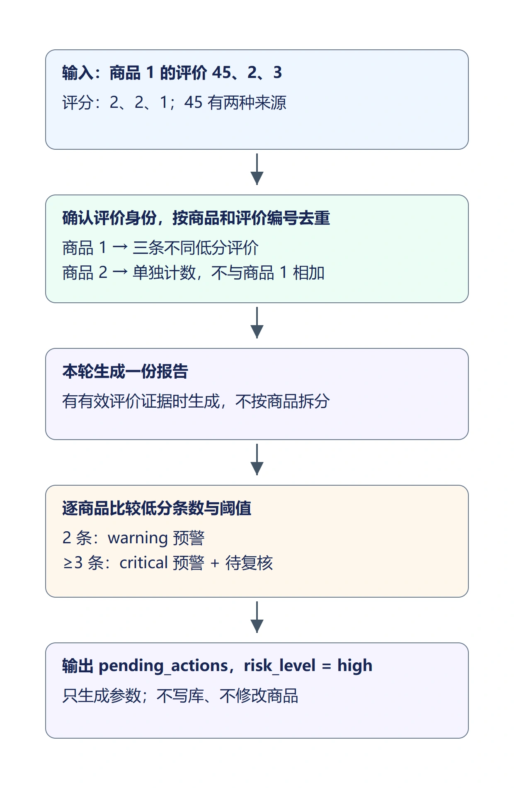

## 1. 回答之后，还需要决定什么

上一节已经将查询结果整理成 `evidence`，并根据同一份证据生成回答。发现低分评价后，还需要决定是否保存诊断报告、发送站内预警，或把商品标为待人工复核。

本节用规则生成动作计划。计划是一组参数字典，例如 `{"type": "send_alert", "product_id": 1, "level": "warning"}`；它描述准备做什么，生成字典不会新增预警，也不会修改商品。

### 1.1 用三条具体评价理解阈值

假设商品 1 有评价 45（2 分）、2（2 分）、3（1 分）。评价 45 同时来自 SQL 和语义检索，仍然只有一条。三个不同评价编号对应三条低分证据：规划一份报告、一条 `critical` 预警和商品 1 的待复核动作，风险为 `high`。

如果只有评价 45、2，就规划报告和 `warning` 预警；只有评价 45，就只有报告，风险为 `low`。商品 1 一条低分、商品 2 一条低分，不能相加后给任一商品预警。



这里统计的是当前相关证据中的低分条数。语义补充不自动继承 SQL 的日期、评分等筛选条件，计划中的条数也不能当成商品全部差评数量。`high` 表示计划涉及预警或商品复核，需要人工确认；不是模型对商品质量的概率判断。

## 2. 按评价身份和商品分组

新建 `backend/app/services/action_decision.py`，完整内容如下。它只接收状态、返回计划，不创建数据库会话。

```python
"""按相关评价证据规划动作；本模块不访问数据库，也不执行动作。"""
from math import isfinite
from typing import Any

# 每个商品达到两条低分评价时预警，达到三条时再标记待复核。
LOW_RATING_ALERT_THRESHOLD = 2
LOW_RATING_REVIEW_THRESHOLD = 3

def decide_actions(state: dict[str, Any]) -> dict[str, Any]:
    grouped: dict[int, dict[int, dict[str, Any]]] = {}
    # 查询失败不能拿残留证据规划；统计行和商品行不具备逐条评价身份。
    for item in ([] if state.get("query_failed") else state.get("evidence", [])):
        if item.get("evidence_type") != "review":
            continue
        sources = item.get("sources", [])
        # SQL 行保留其查询可信度；仅语义候选必须已经通过相关性筛选。
        if "sql" not in sources:
            score = item.get("similarity")
            if ("semantic" not in sources or not isinstance(score, (int, float))
                    or not isfinite(score) or score < 0.35):
                continue
        try:
            pid = int(item["product_id"])
            rid = int(item["review_id"])
            rating = float(item["rating"])
        except (KeyError, TypeError, ValueError, OverflowError):
            continue
        # 编号必须有效，评分必须是1至5的整数，缺失字段不能当成低分。
        if pid <= 0 or rid <= 0 or not isfinite(rating) or rating not in range(1, 6):
            continue
        # 同一商品内按评价编号去重，双来源不增加评价条数。
        grouped.setdefault(pid, {}).setdefault(rid, item)

    actions = []
    counts = {pid: sum(float(row["rating"]) <= 2 for row in rows.values())
              for pid, rows in grouped.items()}
    # 有可归属的评价才规划报告；报告记录的是证据摘要，不代表全店统计。
    if grouped:
        only_product = next(iter(grouped)) if len(grouped) == 1 else None
        actions.append({
            "type": "write_report", "title": "生成诊断报告",
            "product_id": only_product,
            "summary": f"针对问题「{state.get('question', '')[:80]}」，"
                       f"评价证据{sum(len(rows) for rows in grouped.values())}条，"
                       f"其中低分证据{sum(counts.values())}条。",
        })
    for pid, count in sorted(counts.items()):
        # 不跨商品累加：商品1一条、商品2一条均不能触发预警。
        if count < LOW_RATING_ALERT_THRESHOLD:
            continue
        actions.append({
            "type": "send_alert", "title": "触发预警通知",
            "product_id": pid,
            "content": f"该商品有{count}条低分评价相关证据，请关注商品口碑。",
            "level": "critical" if count >= LOW_RATING_REVIEW_THRESHOLD else "warning",
        })
        # 复核是人工检查建议，只规划review_status，不改变价格、库存或上下架。
        if count >= LOW_RATING_REVIEW_THRESHOLD:
            actions.append({"type": "mark_pending_review",
                            "title": "标记商品待人工复核", "product_id": pid})
    # 仅生成报告属于低风险；包含预警或商品复核时需要人工确认。
    # 动作列表为空时，any() 返回 False，同样不需要确认。
    need_confirm = any(a["type"] != "write_report" for a in actions)
    return {
        "pending_actions": actions,
        "risk_level": "high" if need_confirm else "low",
        "need_human_confirm": need_confirm,
        "low_rating_counts": {str(pid): count for pid, count in sorted(counts.items())},
        "decide_reason": "按商品分别计算相关评价证据；低分证据不代表全部差评数量。"
                         if grouped else "没有可归属的相关评价证据，不规划动作。",
    }
```

`grouped` 的外层键是商品编号，内层键是评价编号。例如商品 1 的两条评价形成 `{1: {45: 评价45, 2: 评价2}}`。`setdefault()` 遇到已有评价编号时保留原记录，因此来源数量不会改变评价条数。

只接受 `evidence_type == "review"` 的记录。商品售价行和 `COUNT(*)` 统计行都不能拿来推断单条低分评价。SQL 证据保留数据库查询结果；仅语义证据需要有效相似度且不低于 `0.35`，与上一节过滤标准一致。这里的检查防止不完整证据直接进入动作规则，不会修改 SQL。

每条评价必须具备有效的商品编号、评价编号及 1—5 的整数评分。`counts` 最终得到 `{1: 2}` 这样的字典，再对每个商品分别判断阈值。

报告属于本次分析：证据只涉及一个商品时填写其编号；涉及多个商品时 `product_id` 为 `None`。预警和复核动作始终填写具体商品编号，不能拿报告的空编号代替动作目标。

## 3. 将计划接到图的末尾

在 `backend/app/agent/state.py` 的 `AgentState` 类末尾追加这些字段，缩进与已有字段一致：

```python
    # 动作只保存计划，低分条数按商品分别记录，不代表全库统计。
    pending_actions: list[dict[str, Any]]
    risk_level: str
    need_human_confirm: bool
    low_rating_counts: dict[str, int]
    decide_reason: str
```

`pending_actions` 是动作列表；`need_human_confirm` 表示是否涉及需要确认的动作。`low_rating_counts` 的键转成字符串，便于直接通过 JSON 传给前端。

在 `backend/app/agent/nodes.py` 的文件顶部导入区增加：

```python
from app.services import action_decision
```

在文件末尾新增节点：

```python
def node_decide_actions(state: AgentState) -> dict[str, Any]:
    # 使用整理后的同一份证据，避免直接把未过滤的语义候选送进规则。
    return action_decision.decide_actions(state)
```

在 `backend/app/agent/graph.py` 的 `build_analysis_graph()` 中，注册 `prepare_result` 后追加：

```python
    builder.add_node("decide_actions", nodes.node_decide_actions)
```

将原来的 `builder.add_edge("prepare_result", END)` 及其上方注释替换为：

```python
    # 整理证据后规划动作；图结束后由对话服务生成流式回答。
    builder.add_edge("prepare_result", "decide_actions")
    builder.add_edge("decide_actions", END)
```

图先生成统一证据，再规划动作。已有 SQL、语义、补充检索和去重分支保持原样；动作规则只读取证据，不会反向修改查询条件。

### 3.1 让编号问题进入 SQL 分支

在 `backend/app/services/query_router_service.py` 的 `STRUCTURED_PATTERN` 中，将匹配商品、产品、评价和评论编号的那一行替换为：

```python
    # 编号后允许直接接数字，也支持“为”、冒号或等号。
    r"(?:商品|产品|评价|评论)\s*(?:id|编号)\s*(?:[:：=]|为)?\s*\d+|"
```

`(?:[:：=]|为)?` 表示数字前可以有一个冒号、等号或“为”，也可以没有；两侧的 `\s*` 允许空格。因此“商品编号1”“商品编号为1”和“商品编号为 1”都进入 SQL 分支，其余匹配规则保留。

例如“列出商品编号为1的全部评价”先被路由到 SQL，再由 SQL 生成模型将商品编号写入 `WHERE r.product_id = 1`。路由只选择查询方式，不会自行添加或修改 SQL 条件。

## 4. 随完成事件返回计划

在 `backend/app/services/chat_service.py` 的 `_NODE_MESSAGES` 中增加：

```python
    "decide_actions": "动作计划已生成",
```

在 `stream_chat()` 中，将原来构造 `done_event` 的一行替换为：

```python
        done_event = _sse("done", {
            "result": final_state["result"],
            "plan": {key: final_state[key] for key in (
                "pending_actions", "risk_level", "need_human_confirm",
                "low_rating_counts", "decide_reason",
            )},
        })
```

原有回答流及异常处理继续保留。只有回答完整结束才发送 `done`，前端也只在收到 `done` 后显示计划；流中途失败时不把部分回答标为完整结果。

## 5. 在对话中显示动作计划

修改 `frontend/src/views/Chat.vue`。在每轮 `round` 的 `result` 字段前增加：

```javascript
    plan: null, // 动作计划属于本轮，不影响历史轮次。
```

在 `onDone` 中设置 `round.result` 后增加：

```javascript
      round.plan = payload?.plan || null
```

在模板的 `<QueryResult v-if="m.result" :result="m.result" />` 后增加：

```html
              <div v-if="m.plan" class="action-plan">
                <h4>动作计划 · {{ m.plan.risk_level === 'high' ? '高风险' : '低风险' }}</h4>
                <p>{{ m.plan.decide_reason }}</p>
                <p v-if="!m.plan.pending_actions.length">没有待执行动作</p>
                <ul v-else>
                  <li v-for="(action, index) in m.plan.pending_actions" :key="index">
                    {{ action.title }} · {{ action.product_id ? `商品 ${action.product_id}` : '本次分析' }}
                    <!-- 标签只转换显示文字，不修改动作参数中的预警等级。 -->
                    <el-tag
                      v-if="action.level"
                      class="action-plan__level"
                      size="small"
                      effect="light"
                      :type="{ critical: 'danger', warning: 'warning' }[action.level] || 'info'"
                    >
                      {{ { critical: '严重', warning: '提醒' }[action.level] || '未知等级' }}
                    </el-tag>
                  </li>
                </ul>
                <p>计划尚未执行</p>
              </div>
```

`m.plan` 与当前轮次绑定。页面保留风险、动作目标和预警等级，并明确显示“计划尚未执行”，避免把模型回答与业务执行混为一件事。

预警参数仍使用 `critical` 和 `warning`，显示时分别转换为红色“严重”和黄色“提醒”标签。未识别的等级显示灰色“未知等级”，不冒充已知等级。中文标签只用于展示，不改写发送给后端的动作参数。

在 `Chat.vue` 的 `<style scoped>` 中增加以下样式，将动作列表与查询结果、计划状态分开：

```css
/* 将计划、动作明细和执行状态分区，避免与查询表格连成一段正文。 */
.action-plan {
  margin-top: 20px;
  padding: 16px;
  border: 1px solid var(--app-border);
  border-radius: var(--app-radius-sm);
  background: var(--app-bg);
  font-size: 14px;
  line-height: 1.7;
  overflow-wrap: anywhere;
}

.action-plan h4 {
  margin: 0 0 8px;
  font-size: 15px;
  font-weight: 600;
  color: var(--app-text);
}

.action-plan > p {
  margin: 8px 0;
  color: var(--app-text-secondary);
}

.action-plan ul {
  counter-reset: plan-action;
  display: grid;
  gap: 8px;
  margin: 12px 0;
  padding: 0;
  list-style: none;
}

.action-plan li {
  counter-increment: plan-action;
  position: relative;
  padding: 10px 12px 10px 40px;
  border: 1px solid var(--app-border);
  border-radius: 6px;
  background: var(--app-card-bg);
}

/* 序号留出独立宽度，长动作名称换行后仍与正文对齐。 */
.action-plan li::before {
  content: counter(plan-action);
  position: absolute;
  top: 12px;
  left: 12px;
  width: 20px;
  height: 20px;
  border-radius: 50%;
  background: var(--el-color-primary-light-9);
  color: var(--app-primary);
  font-size: 12px;
  font-weight: 600;
  line-height: 20px;
  text-align: center;
}

.action-plan > p:last-of-type {
  margin: 12px 0 0;
  padding-top: 12px;
  border-top: 1px solid var(--app-border);
  color: var(--app-text);
  font-weight: 500;
}

.action-plan__level {
  margin-left: 8px;
  vertical-align: middle;
}

.action-plan > div {
  display: flex;
  flex-wrap: wrap;
  gap: 10px;
  margin-top: 12px;
}

.action-plan :deep(.el-button + .el-button) {
  margin-left: 0;
}

.msg__foot {
  margin-top: 12px;
}
```

## 6. 核对计划与数据

重启后端，使新增的动作规划节点生效。

提交“列出轻云运动跑鞋评分不超过 2 分的评价，并结合相关评价分析问题”。表格中核对评价编号 45、2、3；如果数据库中仍有这三条低分评价，计划应包含报告、商品 1 的 `critical` 预警和待复核，共三个动作。补充评价是否出现取决于检索相关性，但同一评价不能重复计数。

在浏览器 Network 中打开 `/api/chat/stream` 的响应，查看 `done` 的 `plan`：`low_rating_counts["1"]` 应为 `3`，`risk_level` 为 `high`，`need_human_confirm` 为 `true`。页面应显示三个动作、红色“严重”标签及“计划尚未执行”。

提交“列出商品编号为1的全部评价，并分析评价反映的问题”，核对执行 SQL 限定商品 1，结果中不应出现其他商品的评价。按当前示例数据，评价 45、2、3 仍是三条低分；评价 1 和 4 分别为 5 分和 3 分，保留在证据中，但不计入低分条数，计划仍包含三个动作，整体风险为 `high`。

再提交“洗衣液 2L 的价格是多少”，应返回售价，动作列表为空。商品价格不是评价证据，不能由商品编号推断差评或触发复核。SQL 空结果、统计行或查询失败也不应生成动作。

在 `backend` 目录的 Python 终端中，用以下数据核对分组。两条评价来自不同商品，因此只有报告，不应出现预警：

```python
from app.services import action_decision

rows = [
    {"evidence_type": "review", "review_id": 101, "product_id": 1,
     "rating": 2, "sources": ["sql"]},
    {"evidence_type": "review", "review_id": 102, "product_id": 2,
     "rating": 1, "sources": ["sql"]},
]
plan = action_decision.decide_actions({"question": "分析评价", "evidence": rows})
print(plan["low_rating_counts"])  # {'1': 1, '2': 1}，每个商品分别只有一条。
print([action["type"] for action in plan["pending_actions"]])  # ['write_report']
```

将 `evidence` 改为 `[rows[0], rows[0]]` 再调用，商品 1 的低分条数仍为 1，不能按列表长度算成两条。

到商品列表核对 `review_status`，它保持原值；本节没有新增报告、预警的表或写入接口。

## 7. 本节代码下载

本节结束代码：[lesson-15-end（Release）](https://github.com/codenice-ai-org/ecom-analysis-agent/releases/tag/lesson-15-end)。在 Release 页面的 **Assets → Source code (zip)** 下载完整项目。

下一节将保存待确认状态，接入确认、取消与恢复，让同一份动作计划在人工选择后继续运行。
