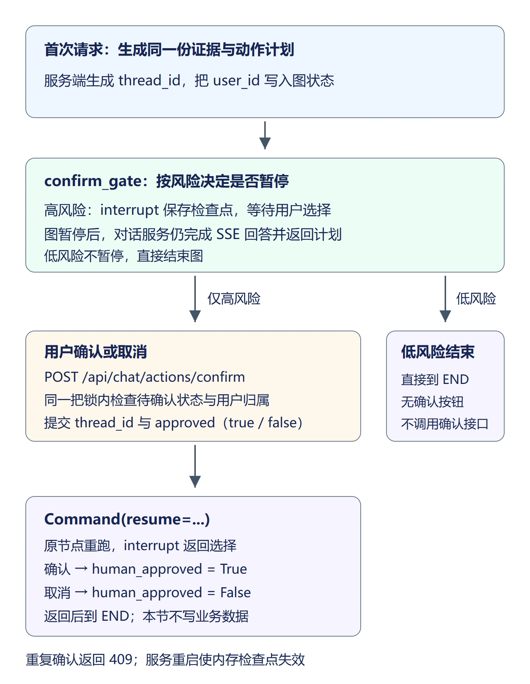

## 1. 保存的是执行位置，不只是问题文本

上一节会生成动作计划。遇到预警、商品待复核等高风险动作，不能收到模型回答就直接执行，需要先让用户选择。

例如商品 1 的三条低分证据已经生成三个动作。图运行到 `confirm_gate` 后暂停，保存问题、证据、计划与用户编号。确认时提交的是 `thread_id` 和布尔选择，而不是重新发送原问题；这样不会因为第二次检索结果变化而执行另一份计划。



本节使用 `InMemorySaver` 保存检查点。它保存在当前后端进程内，重启会丢失；必须使用单进程运行，多个进程没有共享状态。检查点不是聊天记录的数据库存储，也不替代用户鉴权。

## 2. 增加确认节点与共享状态

在 `backend/app/agent/state.py` 的 `AgentState` 中追加：

```python
    # 每次图执行绑定用户；thread_id由调用配置提供，不依靠历史文本鉴权。
    user_id: int
    human_approved: bool
    status_message: str
```

在 `backend/app/agent/nodes.py` 的文件顶部导入区增加：

```python
from langgraph.types import interrupt
```

在文件末尾追加：

```python
def node_confirm_gate(state: AgentState) -> dict[str, Any]:
    # 只有报告或无动作时无需暂停，后续仍使用同一出口接执行节点。
    if not state.get("need_human_confirm"):
        return {"human_approved": True, "status_message": "低风险计划，无需人工确认"}
    # 恢复时节点会从头执行，interrupt之前只组装数据，不能写库或发通知。
    decision = interrupt({
        "message": "请确认是否执行以下动作",
        "risk_level": state["risk_level"],
        "reason": state["decide_reason"],
        "actions": state["pending_actions"],
    })
    approved = isinstance(decision, dict) and decision.get("approved") is True
    return {"human_approved": approved,
            "status_message": "计划已确认，尚未写入业务数据" if approved else "用户已取消，跳过动作"}
```

第一次调用 `interrupt()` 时，图停在此处，函数不会继续返回 `human_approved`。恢复时节点从头执行，`interrupt()` 才返回 `Command` 提供的选择。因此它之前只准备数据，不能写报告或发送预警，否则恢复时可能重复执行。

低风险计划直接返回 `human_approved=True`。高风险选择取消时返回 `False`；后续执行节点需要检查这个字段，不能只检查动作列表是否非空。

## 3. 为编译后的图配置检查点

将 `backend/app/agent/graph.py` 替换为以下内容：

```python
from functools import lru_cache

from langgraph.checkpoint.memory import InMemorySaver
from langgraph.graph import END, START, StateGraph

from app.agent import nodes
from app.agent.state import AgentState

def build_analysis_graph():
    # 节点共享问题、查询结果和证据，不在状态中传递数据库会话。
    builder = StateGraph(AgentState)
    # 绑定节点名称与函数；此时只注册，运行到该节点时才执行函数。
    builder.add_node("route_question", nodes.node_route)
    builder.add_node("structured_query", nodes.node_structured_query)
    builder.add_node("semantic_query", nodes.node_semantic_query)
    builder.add_node("judge_deepen", nodes.node_judge_deepen)
    builder.add_node("deepen_semantic", nodes.node_deepen_semantic)
    builder.add_node("prepare_result", nodes.node_prepare_result)
    builder.add_node("decide_actions", nodes.node_decide_actions)
    builder.add_node("confirm_gate", nodes.node_confirm_gate)
    # 每轮先路由，再按 select_query_branch 返回的 sql 或 semantic 选择分支。
    builder.add_edge(START, "route_question")
    builder.add_conditional_edges(
        "route_question", nodes.select_query_branch,
        {"sql": "structured_query", "semantic": "semantic_query"},
    )
    # SQL 阶段结束后统一判断；失败、统计问题或非评价明细会跳过补充。
    builder.add_edge("structured_query", "judge_deepen")
    # 判断函数只返回分支键，映射决定进入补充检索还是直接整理证据。
    builder.add_conditional_edges(
        "judge_deepen", nodes.select_after_judge,
        {"deepen": "deepen_semantic", "prepare": "prepare_result"},
    )
    # 补充检索和直接语义检索汇入同一节点，统一过滤、去重和合并来源。
    builder.add_edge("deepen_semantic", "prepare_result")
    builder.add_edge("semantic_query", "prepare_result")
    # 整理证据后规划动作并进入确认节点；高风险暂停，低风险直接结束。
    # 图暂停或结束后，由对话服务根据同一份证据生成流式回答。
    builder.add_edge("prepare_result", "decide_actions")
    builder.add_edge("decide_actions", "confirm_gate")
    builder.add_edge("confirm_gate", END)
    # 编译得到可执行图，供对话服务通过 stream() 驱动节点并读取更新。
    return builder.compile(checkpointer=InMemorySaver())

@lru_cache(maxsize=1)
def get_analysis_graph():
    return build_analysis_graph()
```

`get_analysis_graph()` 继续缓存同一张图，因此后续确认请求可以访问首次请求的内存检查点。每轮新问题使用新的线程标识，多轮补全仍使用已有 `history`，不能把线程标识直接当成聊天历史。

## 4. 校验归属后恢复原图

新建 `backend/app/services/confirmation_service.py`：

```python
"""单进程内串行检查归属并恢复检查点，避免重复确认。"""
from threading import Lock
from typing import Any

from langgraph.types import Command

from app.agent import graph
from app.common.exceptions import BusinessException

_confirmation_lock = Lock()

def get_pending_confirmation(thread_id: str, user_id: int) -> dict[str, Any] | None:
    config = {"configurable": {"thread_id": thread_id}}
    snap = graph.get_analysis_graph().get_state(config)
    # next是待运行节点元组；停在confirm_gate才允许用户提交选择。
    # 检查点不存在、已结束或未停在确认节点时，没有可操作的计划。
    if snap.next != ("confirm_gate",):
        return None
    # thread_id只是定位标识，不能代替用户身份；不向其他用户暴露计划。
    if snap.values.get("user_id") != user_id:
        return None
    return {"thread_id": thread_id, "actions": snap.values["pending_actions"],
            "risk_level": snap.values["risk_level"],
            "reason": snap.values["decide_reason"]}

def resume_actions(thread_id: str, approved: bool, user_id: int) -> dict[str, Any]:
    # 检查与恢复必须在同一临界区，否则并发点击可能都通过待确认检查。
    with _confirmation_lock:
        config = {"configurable": {"thread_id": thread_id}}
        analysis_graph = graph.get_analysis_graph()
        snap = analysis_graph.get_state(config)
        if snap.next != ("confirm_gate",):
            raise BusinessException("没有待确认的任务，或服务重启后检查点已失效", code=409)
        if snap.values.get("user_id") != user_id:
            raise BusinessException("无权确认该任务", code=403)
        # Command将选择送回原interrupt调用；不重新查询，也不重新规划。
        analysis_graph.invoke(Command(resume={"approved": approved}), config=config)
        final = analysis_graph.get_state(config).values
        return {"thread_id": thread_id, "approved": final["human_approved"],
                "status_message": final["status_message"]}
```

`get_pending_confirmation()` 只返回当前用户拥有且停在确认节点的计划。暂停时，`snap.next` 为 `("confirm_gate",)`，`snap.values` 保存原问题、用户编号、证据和动作；确认或取消后，`snap.next` 变为 `()`，表示图已结束。

`resume_actions()` 将“检查是否待确认、检查归属、恢复执行”放在同一把锁内。第二个请求拿到锁后重新读取状态，发现图已结束，就返回业务码 `409`，不会再次恢复。

例如线程 A 属于用户 1，用户 2 即使知道 A，也会得到 `403`。这与线程是否由随机数生成是两件事：随机标识负责定位，用户编号负责权限。

在 `backend/app/schemas/chat.py` 中将导入改为 `from pydantic import BaseModel, Field, StrictBool`，然后追加：

```python
class ConfirmRequest(BaseModel):
    # 校验32位小写十六进制格式；存在性与归属由确认服务检查。
    thread_id: str = Field(pattern="^[0-9a-f]{32}$")
    approved: StrictBool
```

`StrictBool` 只接受 JSON 的 `true` 或 `false`，不把字符串 `"false"` 当成有效选择。

在 `backend/app/api/chat.py` 中保留现有流接口，导入 `ConfirmRequest`、`confirmation_service` 与 `Response` 后新增：

```python
from app.schemas.chat import ChatRequest, ConfirmRequest
from app.services import chat_service, confirmation_service
from app.common.response import Response

@router.post("/actions/confirm")
def confirm_actions(
    body: ConfirmRequest, current_user: Annotated[User, Depends(get_current_user)]
):
    result = confirmation_service.resume_actions(
        body.thread_id, body.approved, current_user.id
    )
    return Response.success(data=result)
```

身份来自 `get_current_user`，请求体不能指定其他用户编号。该项目业务错误返回统一响应中的 `code`；前端需要同时检查 HTTP 状态和 `payload.code`。

## 5. 流请求如何带着线程运行

修改 `backend/app/services/chat_service.py`，增加 `from uuid import uuid4`，并将服务导入补充为：

```python
from app.services import llm_service, query_router_service, confirmation_service
```

在 `_NODE_MESSAGES` 中增加 `"confirm_gate": "确认阶段已完成"`。在 `stream_chat()` 中，将创建 `initial` 的语句替换为：

```python
    thread_id = uuid4().hex
    config = {"configurable": {"thread_id": thread_id}}
    initial: AgentState = {"question": question, "product_names": product_names,
                           "user_id": user_id}
```

将 `analysis_graph.stream()` 的参数改为：

```python
            initial, config=config, stream_mode=["updates", "custom"], version="v1"
```

在 `for node_name, delta in payload.items():` 下、`final_state.update(delta)` 之前增加：

```python
                # 中断是控制消息，不是节点返回的字典，不能update到状态。
                if node_name == "__interrupt__":
                    continue
```

`updates` 除了普通节点字典，还可能包含 `__interrupt__` 控制消息。它不含查询字段，不能与普通 `delta` 一起合并到状态。

在构造 `done_event` 的字典中、`result` 后增加：

```python
            "confirmation": confirmation_service.get_pending_confirmation(thread_id, user_id),
```

高风险时它携带线程和待确认计划；低风险时为 `None`。暂停的是图的后续动作，查询已经完成，对话服务仍可根据证据完成流式回答。原有 `error` 收尾与“只有回答完整才发送 done”的处理保留。

## 6. 给本轮计划增加确认与取消按钮

在 `frontend/src/api/chat.js` 末尾增加：

```javascript
/** 确认和取消都恢复原线程，不再发送一次分析问题。 */
export async function confirmActions(threadId, approved) {
  const res = await fetch('/api/chat/actions/confirm', {
    method: 'POST',
    headers: { 'Content-Type': 'application/json', Authorization: `Bearer ${getToken()}` },
    body: JSON.stringify({ thread_id: threadId, approved })
  })
  const payload = await res.json()
  // 业务失败沿用统一响应code，HTTP成功不能代表已确认。
  if (!res.ok || payload.code !== 200) throw new Error(payload.message || '确认失败')
  return payload.data
}
```

在 `frontend/src/views/Chat.vue` 中导入 `confirmActions`：

```javascript
import { chatStream, confirmActions } from '@/api/chat'
```

在创建 `round` 时、`plan` 前增加：

```javascript
    confirmation: null,
    confirming: false,
    actionMessage: '',
```

在 `onDone` 中保存 `round.plan` 后增加 `round.confirmation = payload?.confirmation || null`。在 `handleKeydown` 之前增加：

```javascript
// 请求只更新所属轮次；按钮加载期间阻止同一计划重复提交。
async function handleConfirm(round, approved) {
  if (round.confirming || !round.confirmation) return
  round.confirming = true
  try {
    const result = await confirmActions(round.confirmation.thread_id, approved)
    round.actionMessage = result.status_message
    round.confirmation = null
  } catch (err) {
    ElMessage.error(err.message || '确认失败')
  } finally {
    round.confirming = false
  }
}
```

在动作计划模板中，将 `<p>计划尚未执行</p>` 替换为：

```html
                <p>{{ m.actionMessage || '计划尚未执行' }}</p>
                <div v-if="m.confirmation">
                  <el-button type="primary" :loading="m.confirming" :disabled="m.confirming" @click="handleConfirm(m, true)">确认执行</el-button>
                  <el-button :disabled="m.confirming" @click="handleConfirm(m, false)">取消动作</el-button>
                </div>
```

`confirming` 属于各自轮次，点击一轮的按钮不会改写另一轮的计划。请求失败时保留按钮和原计划；成功后隐藏按钮，显示对应结果。

请求失败不代表选择尚未生效。例如后端已完成确认，但响应在返回途中丢失，前端仍会提示失败；再次提交会得到 `409`，因为原图已经结束，不能再按待确认计划恢复。

## 7. 核对暂停、取消和恢复

后端需要重新编译图，保存代码后重启后端。提交“列出轻云运动跑鞋评分不超过 2 分的评价，并结合相关评价分析问题”，回答结束后应看到高风险计划及两个按钮。

点击“取消动作”，页面应显示“用户已取消，跳过动作”，按钮消失。再次产生一份新计划，点击“确认执行”，应显示“计划已确认，尚未写入业务数据”。本节只完成恢复与选择传递，没有新增业务写入，商品复核状态保持原值。

在 Network 中检查确认请求：`thread_id` 与该轮 `done.confirmation.thread_id` 相同，`approved` 是布尔值。重放同一请求应返回业务码 `409`；更换其他已登录用户的 token 访问仍待确认的线程，应返回 `403`，原用户仍能处理自己的计划。

计划等待确认时重启后端，再点击按钮，应提示检查点已失效。需要重新提交问题生成新计划，不能把旧 `thread_id` 当成可持久保存的任务编号。低风险计划无确认按钮；正常商品查询、追问补全和空结果继续按原流程完成。

## 8. 本节代码下载

本节结束代码：[lesson-16-end（Release）](https://github.com/codenice-ai-org/ecom-analysis-agent/releases/tag/lesson-16-end)。在 Release 页面的 **Assets → Source code (zip)** 下载完整项目。

前置代码为 [第15节结束代码](https://github.com/codenice-ai-org/ecom-analysis-agent/releases/tag/lesson-15-end)。从该版本按本节步骤完成增量，保留其中的编号路由、证据合并和流式异常处理。

下一节将把已通过确认的动作交给白名单执行器，在同一事务内写入报告、预警和商品待复核状态。
