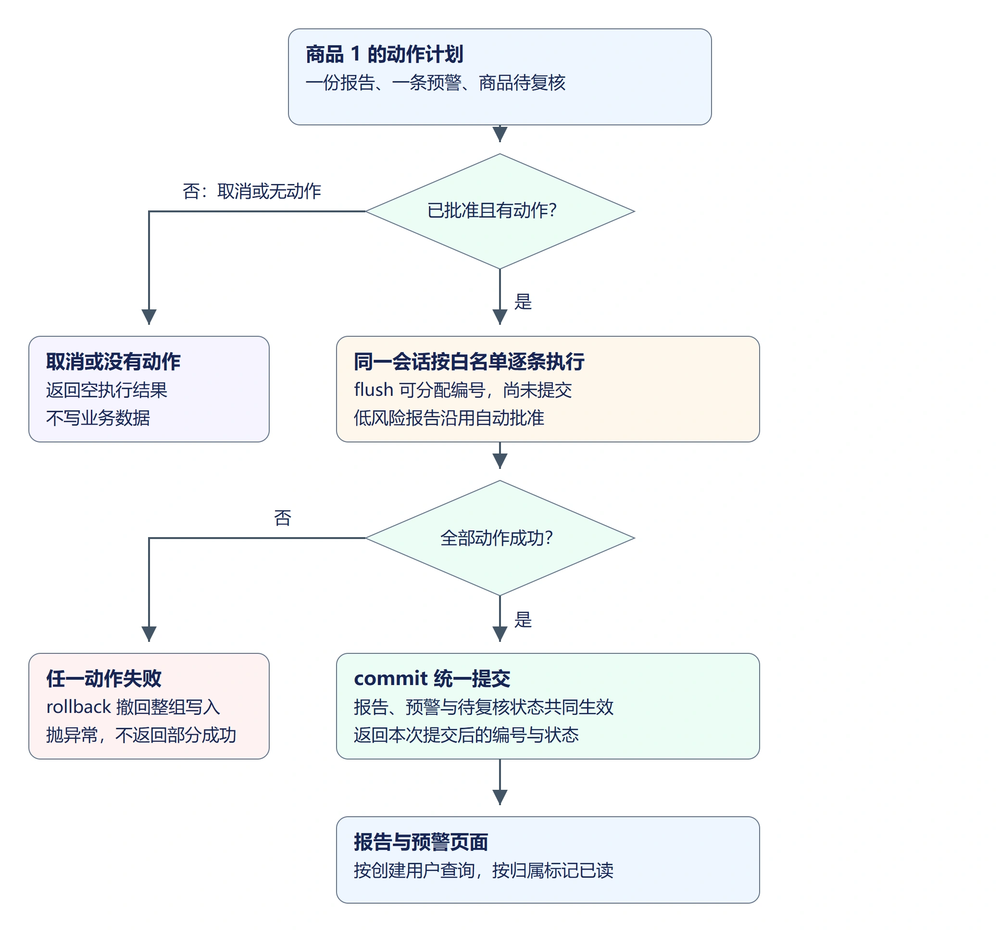
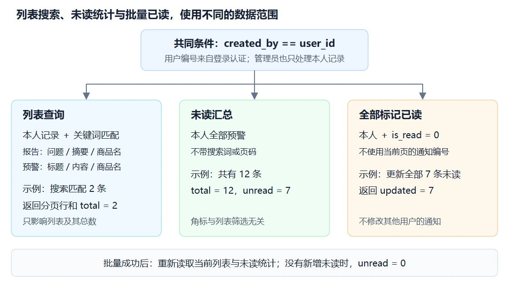
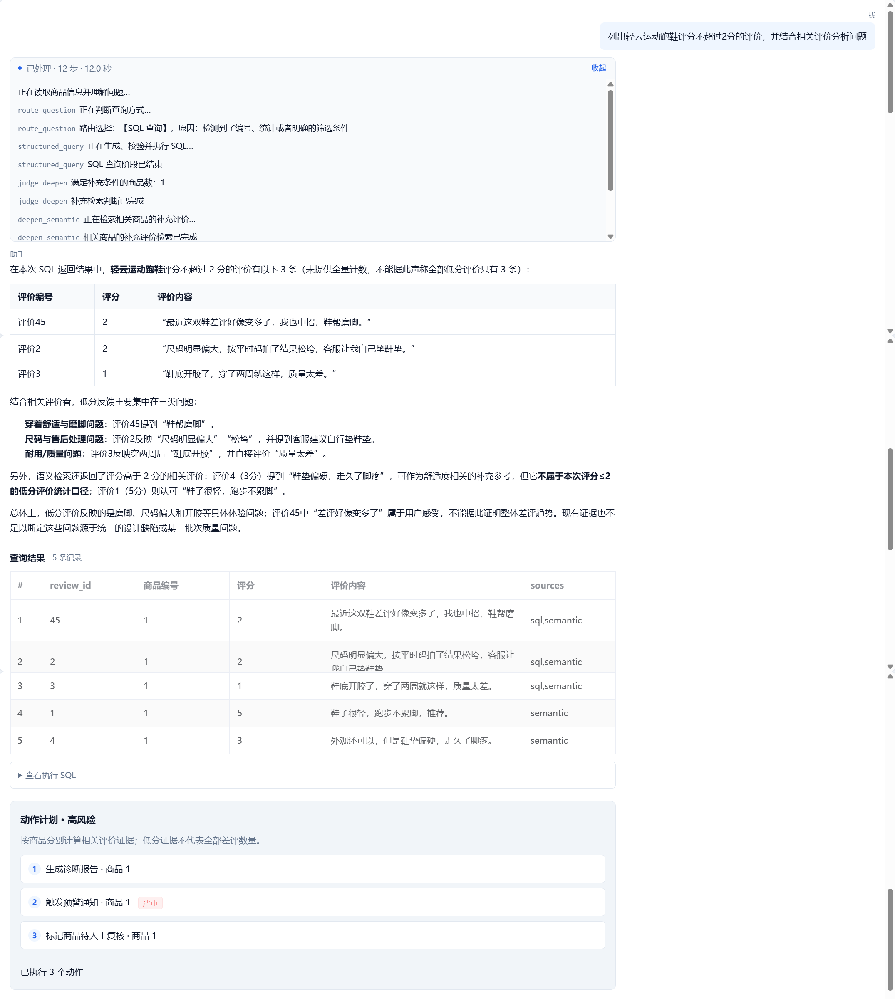
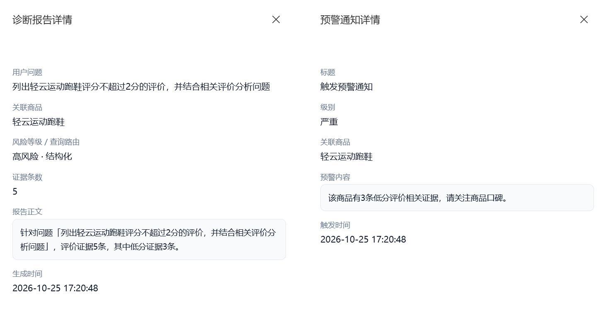
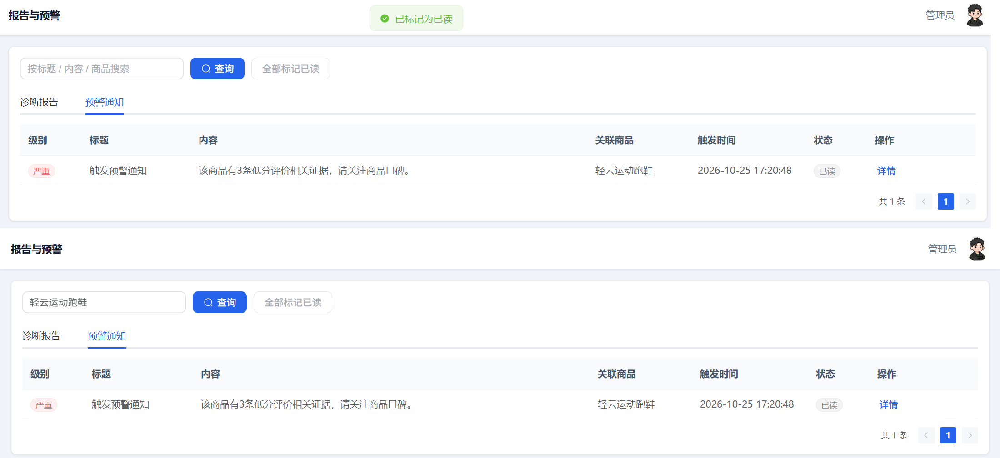

## 1. 让确认后的计划真正产生结果

上一节已经保存计划、暂停并接收人工选择。本节增加执行节点，将 `pending_actions` 交给白名单执行器。

以商品 1 的三条低分证据为例，三个动作分别产生一份诊断报告、一条站内预警和 `products.review_status = "pending_review"`。待复核表示需要人工检查，不等于下架；售价、库存和 `shelf_status` 不在动作范围内。



取消会跳过整组动作，包括报告。只有报告的低风险计划沿用上一节的自动批准规则，无需点击确认。本节的站内预警只写数据库，不发送短信、邮件或其他外部消息。

## 2. 新增报告和预警模型

新建 `backend/app/models/diagnosis_report.py`：

```python
"""诊断报告表：Agent 生成的诊断产物。"""

from sqlalchemy import ForeignKey, Integer, String, Text
from sqlalchemy.orm import Mapped, mapped_column

from app.database import Base


class DiagnosisReport(Base):
    """诊断报告（建议性质，不改动交易数据）。"""

    __tablename__ = "diagnosis_reports"
    __table_args__ = {"comment": "诊断报告表"}

    question: Mapped[str] = mapped_column(
        String(1000), nullable=False, comment="用户问题"
    )
    summary: Mapped[str] = mapped_column(Text, nullable=False, comment="诊断摘要")
    route: Mapped[str | None] = mapped_column(String(20), comment="查询路由")
    risk_level: Mapped[str] = mapped_column(
        String(20), nullable=False, default="low", comment="风险等级 low/high"
    )
    evidence_count: Mapped[int] = mapped_column(
        Integer, nullable=False, default=0, comment="证据条数"
    )
    product_id: Mapped[int | None] = mapped_column(
        ForeignKey("products.id"), nullable=True, comment="关联商品"
    )
    created_by: Mapped[int | None] = mapped_column(
        ForeignKey("users.id"), nullable=True, comment="触发用户"
    )
```

新建 `backend/app/models/alert_notification.py`：

```python
"""站内预警通知：不对接真实短信/邮件，只写本地记录。"""

from sqlalchemy import ForeignKey, Integer, String, Text
from sqlalchemy.orm import Mapped, mapped_column

from app.database import Base


class AlertNotification(Base):
    """预警通知记录。"""

    __tablename__ = "alert_notifications"
    __table_args__ = {"comment": "预警通知表"}

    title: Mapped[str] = mapped_column(String(100), nullable=False, comment="标题")
    content: Mapped[str] = mapped_column(Text, nullable=False, comment="内容")
    level: Mapped[str] = mapped_column(
        String(20), nullable=False, default="warning", comment="warning/critical"
    )
    product_id: Mapped[int | None] = mapped_column(
        ForeignKey("products.id"), nullable=True, comment="关联商品"
    )
    is_read: Mapped[int] = mapped_column(
        Integer, nullable=False, default=0, comment="0未读 1已读"
    )
    created_by: Mapped[int | None] = mapped_column(
        ForeignKey("users.id"), nullable=True, comment="触发用户"
    )
```

报告的 `created_by` 记录触发用户，`product_id` 可以为空，因为同一次分析可能涉及多个商品。预警动作携带具体商品编号，`is_read=0` 表示未读。两表继承 `Base` 的编号及创建、更新时间。

在 `backend/app/main.py` 的模型导入处增加：

```python
from app.models.diagnosis_report import DiagnosisReport
from app.models.alert_notification import AlertNotification
```

保留现有的 `Base.metadata.create_all(bind=engine)`，导入必须在它之前执行。重启后端时 SQLAlchemy 才知道两个新增模型并创建表；只写模型文件但不导入，不会注册到元数据。`create_all()` 不会给已有表补列，本节使用的商品 `review_status` 已经存在，无需修改商品表。

## 3. 白名单与同一事务

新建 `backend/app/services/action_service.py`：

```python
"""Agent 允许的三种业务动作。

严格禁止：改订单状态、库存、价格、上下架。
"""

from typing import Any

from sqlalchemy.orm import Session

from app.common.exceptions import BusinessException
from app.models.alert_notification import AlertNotification
from app.models.diagnosis_report import DiagnosisReport
from app.models.product import Product

# 白名单：只有这些动作名可以被执行
ALLOWED_ACTION_TYPES = {
    "write_report",
    "send_alert",
    "mark_pending_review",
}

# 与 ChatRequest / 表字段对齐，入库前截断防止超长报错
QUESTION_MAX_LEN = 1000


def execute_action(db: Session, action: dict[str, Any], context: dict[str, Any]) -> dict[str, Any]:
    """执行单条动作，返回执行结果摘要。"""
    action_type = action.get("type")
    # 未知动作终止执行，由外层回滚整组写入。
    if action_type not in ALLOWED_ACTION_TYPES:
        raise BusinessException(message=f"不允许的动作类型：{action_type}")

    if action_type == "write_report":
        return _write_report(db, action, context)
    if action_type == "send_alert":
        return _send_alert(db, action, context)
    if action_type == "mark_pending_review":
        return _mark_pending_review(db, action, context)

    raise BusinessException(message=f"未实现的动作：{action_type}")


def execute_actions(
    db: Session, actions: list[dict[str, Any]], context: dict[str, Any]
) -> list[dict[str, Any]]:
    """按顺序执行多条动作（同一事务）；失败时显式回滚。"""
    results: list[dict[str, Any]] = []
    try:
        for action in actions:
            results.append(execute_action(db, action, context))
        db.commit()
        return results
    except Exception:
        db.rollback()
        raise


def _write_report(
    db: Session, action: dict[str, Any], context: dict[str, Any]
) -> dict[str, Any]:
    question = str(context.get("question") or "")[:QUESTION_MAX_LEN]
    report = DiagnosisReport(
        question=question,
        summary=action.get("summary")
        or context.get("summary")
        or "根据查询证据生成的诊断报告",
        route=context.get("route"),
        risk_level=context.get("risk_level") or "low",
        evidence_count=int(context.get("evidence_count") or 0),
        product_id=action.get("product_id") or context.get("product_id"),
        created_by=context.get("user_id"),
    )
    db.add(report)
    db.flush()
    return {"type": "write_report", "ok": True, "report_id": report.id}


def _send_alert(
    db: Session, action: dict[str, Any], context: dict[str, Any]
) -> dict[str, Any]:
    product_id = action.get("product_id") or context.get("product_id")
    title = action.get("title") or "电商数据异常预警"
    content = action.get("content") or context.get("summary") or "检测到可能的质量/口碑风险"
    alert = AlertNotification(
        title=title,
        content=content,
        level=action.get("level")
        or ("critical" if context.get("risk_level") == "high" else "warning"),
        product_id=product_id,
        created_by=context.get("user_id"),
    )
    db.add(alert)
    db.flush()
    return {"type": "send_alert", "ok": True, "alert_id": alert.id}


def _mark_pending_review(
    db: Session, action: dict[str, Any], context: dict[str, Any]
) -> dict[str, Any]:
    """仅修改 review_status，绝不改 shelf_status / price / stock。"""
    product_id = action.get("product_id") or context.get("product_id")
    # 缺少目标时终止整组动作，报告与预警也不能单独提交。
    if not product_id:
        raise BusinessException(message="标记待复核需要指定商品 ID")

    product = db.query(Product).filter(Product.id == int(product_id)).first()
    # 商品不存在同样触发整组回滚，避免留下不完整的处理结果。
    if not product:
        raise BusinessException(message=f"商品不存在：{product_id}")

    product.review_status = "pending_review"
    db.flush()
    return {
        "type": "mark_pending_review",
        "ok": True,
        "product_id": product.id,
        "review_status": product.review_status,
    }
```

三个动作共用 `db`。例如写报告后调用 `flush()`，数据库已经分配报告编号，但还没有提交；预警和商品复核也成功后才统一 `commit()`。第三步失败会进入 `rollback()`，前两步的写入也撤回，不能留下“已有预警但没有对应复核”的半组结果。

`flush()` 不等于 `commit()`。单条动作函数不能自行提交，否则后面的失败无法撤回前面已提交的数据。执行器成功返回的编号才作为已执行结果展示。

动作名称由程序白名单判断，不让模型传入任意函数名、SQL 或商品修改字段。报告摘要来自上节规划中的证据摘要，记录的是本次证据分析范围，不能当成全量差评统计或已经确认的质量原因。

## 4. 在图中接入执行节点

在 `backend/app/agent/state.py` 的类末尾追加：

```python
    # 白名单执行器成功提交后返回的报告/预警编号或复核状态。
    actions_executed: list[dict[str, Any]]
```

在 `backend/app/agent/nodes.py` 的文件顶部导入区增加：

```python
from app.database import SessionLocal
from app.services import action_service
```

在文件末尾增加：

```python
def node_execute_actions(state: AgentState) -> dict[str, Any]:
    actions = state.get("pending_actions", [])
    # 取消时跳过整组动作，包括报告，不能仅跳过其中的预警。
    if not state.get("human_approved") or not actions:
        return {"actions_executed": [], "status_message": "未执行动作"}
    context = {"question": state["question"], "user_id": state["user_id"],
               "route": state["route"], "risk_level": state["risk_level"],
               "evidence_count": len(state["evidence"])}
    # 事务由执行器统一提交/回滚，节点只负责会话的创建与关闭。
    with SessionLocal() as db:
        executed = action_service.execute_actions(db, actions, context)
    return {"actions_executed": executed,
            "status_message": f"已执行 {len(executed)} 个动作"}
```

取消后的 `human_approved` 为 `False`，节点立即返回空列表。高风险尚未选择时仍停在 `confirm_gate`，不会到达执行节点。

在 `backend/app/agent/graph.py` 中注册 `confirm_gate` 后追加：

```python
    builder.add_node("execute_actions", nodes.node_execute_actions)
```

将 `builder.add_edge("confirm_gate", END)` 替换为以下连线，并将图中“高风险暂停，低风险直接结束”的注释改为“高风险暂停等待选择，低风险自动批准；确认节点返回后统一进入执行节点”：

```python
    builder.add_edge("confirm_gate", "execute_actions")
    builder.add_edge("execute_actions", END)
```

在 `backend/app/services/confirmation_service.py` 的返回字典中增加：

```python
                "actions_executed": final.get("actions_executed", [])
```

注意在原有 `status_message` 键值后补逗号。确认接口返回的是原图恢复后的实际执行结果，不是再次返回原始计划。

## 5. 让对话显示执行结果

在 `backend/app/services/chat_service.py` 的 `_NODE_MESSAGES` 中增加 `"execute_actions": "动作阶段已结束"`。在 `done_event` 的 `result` 后追加：

```python
            "action_message": final_state.get("status_message", "计划等待确认"),
            "actions_executed": final_state.get("actions_executed", []),
```

高风险首次请求还没有执行结果，页面等待人工确认。低风险计划已经经过执行节点，`done` 可以直接携带已执行的报告编号。

在 `frontend/src/views/Chat.vue` 的 `onDone` 中，设置 `round.confirmation` 后追加：

```javascript
      round.actionMessage = payload?.action_message || ''
```

已有 `handleConfirm()` 会读取确认响应中的 `status_message`，因此确认成功后同一轮显示“已执行 3 个动作”，取消后显示“未执行动作”。

## 6. 读取自己的报告和预警

新建 `backend/app/services/diagnosis_service.py`：

```python
"""报告与预警按创建用户查询、统计和维护已读状态。"""
from sqlalchemy import select, func, or_, update
from sqlalchemy.orm import Session

from app.common.exceptions import BusinessException
from app.models.diagnosis_report import DiagnosisReport
from app.models.alert_notification import AlertNotification
from app.models.product import Product


def list_records(db: Session, user_id: int, kind: str, page: int, page_size: int,
                 keywords: str | None = None):
    model = DiagnosisReport if kind == "reports" else AlertNotification
    # 外连接保留没有关联商品的记录；用户归属条件同时约束列表和总数。
    query = select(model, Product.name.label("product_name")).outerjoin(
        Product, model.product_id == Product.id
    ).where(model.created_by == user_id)
    keyword = (keywords or "").strip()
    # 空白搜索沿用本人全部记录；有关键词时才增加三个文本字段的匹配条件。
    if keyword:
        like = f"%{keyword}%"
        fields = [model.question, model.summary] if kind == "reports" else [model.title, model.content]
        query = query.where(or_(*(field.ilike(like) for field in [*fields, Product.name])))
    total = db.scalar(select(func.count()).select_from(query.subquery()))
    rows = db.execute(query.order_by(model.id.desc()).offset((page - 1) * page_size).limit(page_size))
    items = [{**{c.name: getattr(row, c.name) for c in model.__table__.columns},
              "product_name": product_name} for row, product_name in rows]
    return {"list": items, "total": total}


def get_alert_summary(db: Session, user_id: int):
    # 统计本人全部预警，不带列表的关键词或分页条件。
    scope = AlertNotification.created_by == user_id
    total = db.scalar(select(func.count()).select_from(AlertNotification).where(scope))
    unread = db.scalar(select(func.count()).select_from(AlertNotification).where(
        scope, AlertNotification.is_read == 0
    ))
    return {"total": total, "unread": unread}


def mark_all_alerts_read(db: Session, user_id: int):
    # 只更新本人的未读通知，重复调用返回0，不触碰其他用户或业务数据。
    result = db.execute(update(AlertNotification).where(
        AlertNotification.created_by == user_id, AlertNotification.is_read == 0
    ).values(is_read=1))
    db.commit()
    return {"updated": result.rowcount}


def mark_alert_read(db: Session, user_id: int, alert_id: int):
    alert = db.scalar(select(AlertNotification).where(
        AlertNotification.id == alert_id, AlertNotification.created_by == user_id
    ))
    # 合并不存在与他人记录的提示，避免向其他用户泄露预警内容。
    if alert is None:
        raise BusinessException("预警不存在或无权访问", code=404)
    alert.is_read = 1
    db.commit()
    return {"id": alert.id, "is_read": alert.is_read}
```

`user_id` 来自登录认证，不从搜索词、地址栏或请求正文取得。列表、总数、未读统计、单条已读和批量已读都以 `created_by == user_id` 为范围，管理员也沿用这一规则。只在列表接口限制归属还不够，其他用户仍可能猜编号调用已读接口，因此写入时同样检查归属。

搜索先保留本人的记录，再在这些记录中匹配关键词。报告匹配问题、摘要或商品名称，预警匹配标题、内容或商品名称。例如搜索“轻云运动跑鞋”，满足条件的是“本人创建，并且三个字段中至少一个包含该词”，不是“本人创建，或者任意用户的商品名包含该词”。`total` 从相同查询条件计算，分页只决定本次返回哪几行。

`outerjoin()` 用 `product_id` 关联商品名称，即使某份报告没有关联商品，也保留报告本身，返回的 `product_name` 为 `None`，页面显示 `-`。商品名称只补充显示信息，不改变报告、预警的用户归属。



以本人有12条预警、其中7条未读为例：搜索后当前列表可能只返回2条，`get_alert_summary()` 仍返回 `{"total": 12, "unread": 7}`。“全部标记已读”按本人编号和 `is_read=0` 更新这7条，返回 `{"updated": 7}`；随后重新读取未读统计应得到0，其他用户的通知不变。若没有新增未读通知，再次调用返回 `{"updated": 0}`。

批量更新不读取当前搜索词或页码，也不逐条使用当前页的编号。它只修改通知的已读状态及继承的更新时间，不改商品价格、库存、上下架状态或报告内容。

在 `backend/app/api/ecommerce.py` 中将服务导入改为：

```python
from app.services import ecommerce_service, diagnosis_service
```

文件末尾增加：

```python
@router.get("/reports")
def list_reports(
    current_user: Annotated[User, Depends(get_current_user)],
    db: Annotated[Session, Depends(get_db)],
    page: Annotated[int, Query(ge=1)] = 1,
    page_size: Annotated[int, Query(ge=1, le=100)] = 10,
    keywords: str | None = None,
):
    return Response.success(data=diagnosis_service.list_records(
        db, current_user.id, "reports", page, page_size, keywords
    ))


@router.get("/alerts")
def list_alerts(
    current_user: Annotated[User, Depends(get_current_user)],
    db: Annotated[Session, Depends(get_db)],
    page: Annotated[int, Query(ge=1)] = 1,
    page_size: Annotated[int, Query(ge=1, le=100)] = 10,
    keywords: str | None = None,
):
    return Response.success(data=diagnosis_service.list_records(
        db, current_user.id, "alerts", page, page_size, keywords
    ))


@router.get("/alerts/summary")
def alert_summary(
    current_user: Annotated[User, Depends(get_current_user)],
    db: Annotated[Session, Depends(get_db)],
):
    return Response.success(data=diagnosis_service.get_alert_summary(db, current_user.id))


@router.post("/alerts/read-all")
def read_all_alerts(
    current_user: Annotated[User, Depends(get_current_user)],
    db: Annotated[Session, Depends(get_db)],
):
    return Response.success(data=diagnosis_service.mark_all_alerts_read(db, current_user.id))


@router.post("/alerts/{alert_id}/read")
def read_alert(
    alert_id: int, current_user: Annotated[User, Depends(get_current_user)],
    db: Annotated[Session, Depends(get_db)],
):
    return Response.success(data=diagnosis_service.mark_alert_read(db, current_user.id, alert_id))
```

分页最多每页 100 条，报告、预警按编号倒序。接口统一返回 `{"code": 200, "data": {"list": [...], "total": 数量}}`，其他用户创建的记录不会混入当前用户的总数。

## 7. 增加报告与预警页面

新建 `frontend/src/views/ReportList.vue`：

```vue
<template>
  <div class="page-container report-page">
    <div class="content-card">
      <div class="toolbar-row">
        <el-input
          class="search-input"
          :placeholder="isReportTab ? '按问题 / 摘要 / 商品搜索' : '按标题 / 内容 / 商品搜索'"
          v-model="params.keywords"
          aria-label="报告与预警搜索"
          clearable
          @keyup.enter="handleSearch"
          @clear="handleSearch"
        />
        <el-button type="primary" :icon="Search" @click="handleSearch">查询</el-button>
        <el-button v-if="!isReportTab" :disabled="reading || summaryLoading || !!summaryError || !alertUnread" @click="handleReadAll">
          全部标记已读
        </el-button>
      </div>

      <el-alert v-if="error" :title="error" type="error" :closable="false" class="report-page__error" />
      <div v-if="summaryError" class="report-page__error">
        <el-alert :title="summaryError" type="warning" :closable="false" />
        <el-button :disabled="summaryLoading" @click="refreshAlertUnread">重试未读统计</el-button>
      </div>
      <el-tabs v-model="activeTab" @tab-change="handleTabChange">
        <el-tab-pane label="诊断报告" name="reports" />
        <el-tab-pane :label="alertTabLabel" name="alerts" />
      </el-tabs>

      <!-- 诊断报告 -->
      <el-table
        v-if="isReportTab"
        :header-cell-style="tableHeaderStyle"
        :data="tableData"
        style="width: 100%"
        v-loading="loading"
      >
        <el-table-column prop="question" label="问题" min-width="200" show-overflow-tooltip />
        <el-table-column prop="product_name" label="关联商品" width="150" show-overflow-tooltip>
          <template #default="{ row }">{{ row.product_name || '-' }}</template>
        </el-table-column>
        <el-table-column prop="risk_level" label="风险" width="100">
          <template #default="{ row }">
            <el-tag
              size="small"
              effect="light"
              round
              :type="{ high: 'danger', low: 'success' }[row.risk_level] || 'info'"
            >
              {{ riskLabel(row.risk_level) }}
            </el-tag>
          </template>
        </el-table-column>
        <el-table-column prop="evidence_count" label="证据数" width="80" />
        <el-table-column prop="summary" label="摘要" min-width="220" show-overflow-tooltip />
        <el-table-column prop="create_time" label="生成时间" width="170"><template #default="{ row }">{{ formatTime(row.create_time) }}</template></el-table-column>
        <el-table-column label="操作" width="90" fixed="right">
          <template #default="{ row }">
            <el-button type="primary" link @click="openDetail(row)">详情</el-button>
          </template>
        </el-table-column>
      </el-table>

      <!-- 预警通知 -->
      <el-table
        v-else
        :header-cell-style="tableHeaderStyle"
        :data="tableData"
        style="width: 100%"
        v-loading="loading"
      >
        <el-table-column prop="level" label="级别" width="90">
          <template #default="{ row }">
            <el-tag
              size="small"
              effect="light"
              round
              :type="{ critical: 'danger', warning: 'warning' }[row.level] || 'info'"
            >
              {{ alertLabel(row.level) }}
            </el-tag>
          </template>
        </el-table-column>
        <el-table-column prop="title" label="标题" width="160" show-overflow-tooltip />
        <el-table-column prop="content" label="内容" min-width="240" show-overflow-tooltip />
        <el-table-column prop="product_name" label="关联商品" width="150" show-overflow-tooltip>
          <template #default="{ row }">{{ row.product_name || '-' }}</template>
        </el-table-column>
        <el-table-column prop="create_time" label="触发时间" width="170"><template #default="{ row }">{{ formatTime(row.create_time) }}</template></el-table-column>
        <el-table-column prop="is_read" label="状态" width="90">
          <template #default="{ row }">
            <el-tag size="small" effect="light" round :type="row.is_read ? 'info' : 'danger'">
              {{ row.is_read ? '已读' : '未读' }}
            </el-tag>
          </template>
        </el-table-column>
        <el-table-column label="操作" width="160" fixed="right">
          <template #default="{ row }">
            <el-button type="primary" link @click="openDetail(row)">详情</el-button>
            <el-button
              v-if="!row.is_read"
              type="primary"
              link
              :loading="reading"
              :disabled="reading"
              @click.stop="handleReadOne(row)"
            >
              标为已读
            </el-button>
          </template>
        </el-table-column>
      </el-table>

      <div class="table-footer">
        <el-pagination
          v-model:current-page="params.page"
          v-model:page-size="params.pageSize"
          :total="total"
          background
          small
          layout="total, prev, pager, next"
          @current-change="load"
        />
      </div>
    </div>

    <!-- 详情抽屉：报告正文 / 预警内容 -->
    <el-drawer
      v-model="drawerVisible"
      :title="detailKind === 'reports' ? '诊断报告详情' : '预警通知详情'"
      size="min(480px, 100vw)"
    >
      <div v-if="detail" class="report-detail">
        <template v-if="detailKind === 'reports'">
          <div class="report-detail__label">用户问题</div>
          <div class="report-detail__value">{{ detail.question }}</div>
          <div class="report-detail__label">关联商品</div>
          <div class="report-detail__value">
            {{ detail.product_name || '-' }}
          </div>
          <div class="report-detail__label">风险等级 / 查询路由</div>
          <div class="report-detail__value">
            {{ riskLabel(detail.risk_level) }} ·
            {{ routeLabel(detail.route) }}
          </div>
          <div class="report-detail__label">证据条数</div>
          <div class="report-detail__value">{{ detail.evidence_count }}</div>
          <div class="report-detail__label">报告正文</div>
          <pre class="report-detail__pre">{{ detail.summary }}</pre>
        </template>
        <template v-else>
          <div class="report-detail__label">标题</div>
          <div class="report-detail__value">{{ detail.title }}</div>
          <div class="report-detail__label">级别</div>
          <div class="report-detail__value">
            {{ alertLabel(detail.level) }}
          </div>
          <div class="report-detail__label">关联商品</div>
          <div class="report-detail__value">
            {{ detail.product_name || '-' }}
          </div>
          <div class="report-detail__label">预警内容</div>
          <pre class="report-detail__pre">{{ detail.content }}</pre>
        </template>
        <div class="report-detail__label">{{ detailKind === 'reports' ? '生成时间' : '触发时间' }}</div>
        <div class="report-detail__value">{{ formatTime(detail.create_time) }}</div>
      </div>
    </el-drawer>
  </div>
</template>

<script setup>
import { computed, onBeforeUnmount, onMounted, reactive, ref, watch } from 'vue'
import { useRoute } from 'vue-router'
import { ElMessage } from 'element-plus'
import { Search } from '@element-plus/icons-vue'
import request from '@/utils/request'

const tableHeaderStyle = { backgroundColor: '#f8fafc', color: '#475569', fontWeight: 600 }
const route = useRoute()
const activeTab = ref(route.query.tab === 'alerts' ? 'alerts' : 'reports')
const isReportTab = computed(() => activeTab.value === 'reports')
const loading = ref(false), reading = ref(false)
const tableData = ref([]), total = ref(0), error = ref('')
const drawerVisible = ref(false), detail = ref(null), detailKind = ref('reports')
const params = reactive({ page: 1, pageSize: 10, keywords: '' })
const alertUnread = ref(null), summaryLoading = ref(false), summaryError = ref('')
let requestId = 0, summaryRequestId = 0, disposed = false
const alertTabLabel = computed(() => alertUnread.value ? `预警通知（${alertUnread.value} 未读）` : '预警通知')

function formatTime(value) { return value ? value.replace('T', ' ') : '—' }
function riskLabel(value) {
  return { high: '高风险', low: '低风险' }[value] || '未知风险'
}
function alertLabel(value) {
  return { critical: '严重', warning: '提醒' }[value] || '未知等级'
}
function routeLabel(value) {
  return { sql: '结构化', structured: '结构化', semantic: '语义检索' }[value] || '—'
}
async function call(url, options) {
  const res = await request({ url, ...options })
  // HTTP成功仍可能返回业务失败，不能把失败响应当作列表或统计数据。
  if (res.code !== 200) throw new Error(res.message || '操作失败')
  return res.data
}
async function load() {
  // 搜索、翻页和切换页签共用序号，迟到响应不能覆盖新结果、总数或加载状态。
  const id = ++requestId
  loading.value = true
  error.value = ''
  try {
    const data = await call(`/api/ecommerce/${activeTab.value}`, { params: {
      page: params.page, page_size: params.pageSize, keywords: params.keywords.trim() || undefined
    } })
    if (id !== requestId) return
    tableData.value = data.list
    total.value = data.total
  } catch (err) {
    if (id === requestId) error.value = err.message || '读取失败'
  } finally {
    if (id === requestId) loading.value = false
  }
}
// 未读汇总使用独立序号，防止标记成功后被更早返回的统计覆盖。
async function refreshAlertUnread() {
  const id = ++summaryRequestId
  summaryLoading.value = true
  summaryError.value = ''
  try {
    const data = await call('/api/ecommerce/alerts/summary')
    if (id === summaryRequestId) alertUnread.value = data.unread
  } catch (err) {
    // 失败不伪装成0条未读，保留已知值并提供重试；批量按钮同时禁用。
    if (id === summaryRequestId) summaryError.value = err.message || '未读统计读取失败'
  } finally {
    if (id === summaryRequestId) summaryLoading.value = false
  }
}
function handleTabChange() {
  params.page = 1
  params.keywords = ''
  tableData.value = []
  total.value = 0
  drawerVisible.value = false
  detail.value = null
  load()
}
watch(() => route.query.tab, (tab) => {
  const next = tab === 'alerts' ? 'alerts' : 'reports'
  // 仅查询参数切换到另一页签时重置列表，避免同一页签重复读取。
  if (next === activeTab.value) return
  activeTab.value = next
  handleTabChange()
})
function handleSearch() {
  params.page = 1
  drawerVisible.value = false
  load()
}
async function markRead(row) {
  // 已有写请求时拒绝再次提交；单条操作必须有编号，null专供批量操作。
  if (reading.value || (!row?.id && row !== null)) return
  const originRequest = requestId
  reading.value = true
  error.value = ''
  try {
    // null表示本人全部未读；不向批量接口传入当前页或搜索词。
    const data = await call(row ? `/api/ecommerce/alerts/${row.id}/read` : '/api/ecommerce/alerts/read-all', { method: 'post' })
    // 离开页面后保留已提交的已读结果，不再刷新已卸载的列表。
    if (disposed) return
    ElMessage.success(row ? '已标记为已读' : `已标记 ${data.updated} 条为已读`)
    await Promise.all([load(), refreshAlertUnread()])
  } catch (err) {
    // 已切换页签或搜索后，不把旧操作的局部错误写到新的列表。
    if (!disposed && originRequest === requestId) error.value = err.message || '标记失败'
  } finally {
    reading.value = false
  }
}
function handleReadOne(row) { return markRead(row) }
function handleReadAll() { return markRead(null) }
function openDetail(row) {
  // 抽屉使用独立快照和页签类型，不随列表刷新变成另一类详情。
  detail.value = { ...row }
  detailKind.value = activeTab.value
  drawerVisible.value = true
}
onBeforeUnmount(() => { disposed = true; requestId++; summaryRequestId++ })
onMounted(() => { refreshAlertUnread(); load() })
</script>

<style scoped>
.report-detail__label {
  margin: 14px 0 4px;
  font-size: 12px;
  color: var(--app-text-secondary);
}

.report-detail__value {
  font-size: 14px;
  line-height: 1.6;
  color: var(--app-text);
  word-break: break-word;
}

.report-detail__pre {
  margin: 0;
  padding: 10px 12px;
  border: 1px solid var(--app-border);
  border-radius: var(--app-radius-sm);
  background: #f8fafc;
  font-family: inherit;
  font-size: 13px;
  line-height: 1.7;
  white-space: pre-wrap;
  word-break: break-word;
}

.report-detail { overflow-wrap: anywhere; }
.report-detail__pre { overflow-wrap: anywhere; }
.report-page__error { margin: 12px 0; }
.report-page :deep(.toolbar-row) { flex-wrap: wrap; }
@media (max-width: 640px) {
  .report-page :deep(.toolbar-row .search-input) { width: 100%; flex-basis: 100%; min-width: 0; }
  .report-page :deep(.toolbar-row > .el-button) { min-height: 44px; margin-left: 0; }
  .report-page :deep(.table-footer) { overflow-x: auto; }
  .report-page :deep(.el-tabs__item) { min-height: 44px; }
}
</style>
```

`activeTab` 决定读取报告还是预警，`params.keywords` 保存搜索内容，`params.page` 保存页码。搜索或清空搜索词时，`handleSearch()` 先回到第1页再读取；切换页签时，`handleTabChange()` 还会清空旧搜索词、旧数据和详情。打开 `/manager/reports?tab=alerts` 会选中预警页签；已经停在这个页面时，`watch()` 继续监听查询参数变化。

`requestId` 防止旧请求覆盖新页签。例如先请求报告，随后切换预警，报告响应即使最后到达，也不能把预警表格替换成报告数据。`catch` 和 `finally` 同样比较编号，避免旧请求把局部错误写入新列表，或提前结束当前加载状态；统一请求拦截器仍可能提示请求失败。

未读角标不从 `tableData` 计数，而是在进入页面时独立读取 `/api/ecommerce/alerts/summary`。`summaryRequestId` 只控制这份汇总，避免标记已读后的新统计被旧响应覆盖。统计失败时显示重试按钮并禁用批量操作，不能把失败显示成“没有未读”。

详情直接使用列表返回的完整字段，不再发起详情请求。`openDetail()` 保存行数据副本和当时的 `detailKind`，所以抽屉不会因列表刷新而换成另一种内容。报告显示问题、商品、中文风险、路由、证据数和完整摘要，预警显示标题、中文等级、商品及完整内容。列表中的省略号只压缩表格显示，不截断接口数据；抽屉用 `<pre>` 保留换行，文本不会作为HTML执行。宽屏抽屉最多480px，窄屏不超过视口宽度。

`markRead(row)` 处理一条通知，`markRead(null)` 处理本人全部未读；`reading` 同时阻止这两类写请求重复提交。成功后，`Promise.all()` 重新读取当前列表和未读汇总，不能只修改角标而保留旧行状态。如果请求失败，按钮恢复可操作；若用户已切换页签或搜索，则不把旧操作的局部错误写到新列表。

例如接口返回 `risk_level="high"`、`level="critical"` 时，页面分别显示“高风险”和红色“严重”标签。映射只改变显示文字，数据库和接口仍保留英文值；未知值显示“未知风险”或“未知等级”，不能默认为低风险。

在 `frontend/src/router/index.js` 的 `children` 中、首页路由之后增加：

```javascript
        { path: 'reports', name: 'ReportList', component: () => import('@/views/ReportList.vue') },
```

在 `frontend/src/layouts/Layout.vue` 的商品菜单前增加：

```html
        <el-menu-item index="/manager/reports">
          <el-icon><DataAnalysis /></el-icon>
          <span>报告与预警</span>
        </el-menu-item>
```

在同一文件的 `TITLE_MAP` 中增加 `'/manager/reports': '报告与预警'`。

## 8. 核对写入、取消与事务边界

重启后端以注册新表和重新编译图。提交“列出轻云运动跑鞋评分不超过 2 分的评价，并结合相关评价分析问题”。先选择取消：本轮执行结果应为空，不新增报告或预警，商品复核状态不因本轮改变。

再产生新计划并确认，核对“已执行 3 个动作”。本例查询合并后有5条评价证据，其中3条评分不超过2分；高风险计划包含生成报告、触发预警和标记商品待复核三个动作。证据条数与动作数量分别计数，不能把补充检索得到的3分、5分评价计入低分证据。



进入“报告与预警”，分别打开新增报告和商品1的预警详情。报告中的证据条数为5，正文说明其中低分证据3条；预警内容也应按这3条低分证据表述。预警列表的红色“严重”标签与详情中的“级别：严重”对应同一个接口值 `critical`。



关闭预警详情，点击“标为已读”，该条应变为“已读”。在商品列表核对其待复核状态；售价、库存和上下架状态保持原值。

在报告页搜索“轻云运动跑鞋”，列表和总数只包含本人的匹配记录；点“详情”核对商品、风险、证据数及完整正文。再搜索一个不存在的名称，应显示空结果，清空搜索后恢复列表。在第2页搜索新词，页码应回到1。

在预警页分别按标题、内容和商品名搜索，未读角标不随搜索词或分页减少。点击“全部标记已读”会更新本人全部未读通知，不只当前筛选结果。重新打开页面核对已读状态和角标；切换到另一账号，其未读记录应保持原状。

将该条预警标为已读后，按商品名“轻云运动跑鞋”搜索，应仍能找到它；已读记录不会从搜索结果中删除。“共1条”是匹配记录数，未读数为0时页签不再显示未读数量。



将窗口缩窄到390px，查询和批量已读按钮应完整显示，表格可横向滚动查看其他列，详情正文应折行且保留完整内容。

提交“列出评价编号 2 的评价内容、评分和商品编号”。如果该条仍为 2 分，只有一条低分证据，应该自动生成报告，不产生预警和商品复核动作。

在 SQL 客户端中核对新增记录，完整字段包括触发用户及商品归属：

```sql
SELECT id, product_id, created_by, risk_level, evidence_count, summary
FROM diagnosis_reports ORDER BY id DESC LIMIT 5;
SELECT id, product_id, created_by, level, is_read, content
FROM alert_notifications ORDER BY id DESC LIMIT 5;
SELECT id, price, stock, shelf_status, review_status
FROM products WHERE id = 1;
```

其他已登录用户访问自己的列表，不应看到上述用户的记录；按他人的预警编号标记已读，应返回“预警不存在或无权访问”。同一确认请求重复提交仍返回业务码 `409`，不会生成第二组报告与预警。单进程锁只保护当前进程；部署多个进程时，需要共享检查点及持久化幂等约束。

事务内任何动作失败都会回滚，接口不会返回部分成功的 `actions_executed`。执行节点失败时，图已通过确认节点，下一步停在 `execute_actions`；原确认入口只接受停在 `confirm_gate` 的计划，继续点击原按钮会返回 `409`。核对报告与预警没有新增记录、商品状态未改变，并排除后端日志中的错误后，重新提交问题生成计划。

低风险报告在生成回答之前提交。若随后回答模型失败，报告不会随回答一起回滚，页面也可能收不到已提交的报告编号。重发问题前先到“报告与预警”核对；重发属于一次新分析，可能新增另一份报告。

## 9. 本节代码下载

本节结束代码：[lesson-17-end（Release）](https://github.com/codenice-ai-org/ecom-analysis-agent/releases/tag/lesson-17-end)。在 Release 页面的 **Assets → Source code (zip)** 下载完整项目。

下一节将按查询分析与报告决策划分节点职责，展示实际执行的角色和阶段切换。
