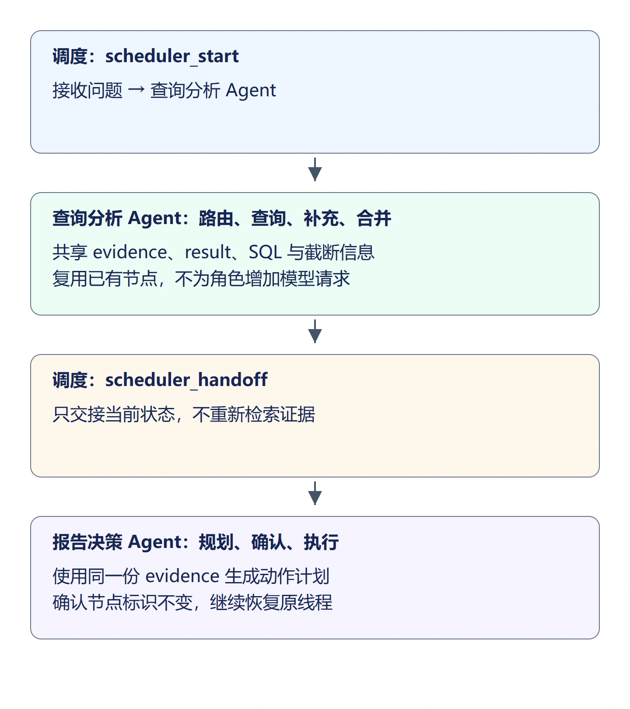
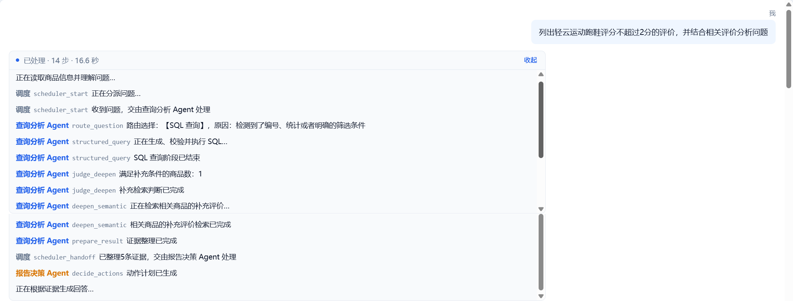
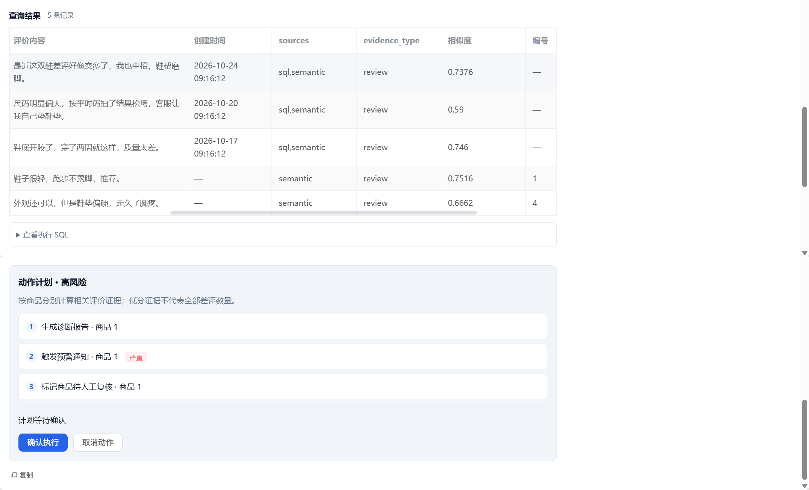

## 1. 区分职责，保持同一条数据链路

前面的节点已经能完成查询、回答、动作规划与确认。本节将它们按职责分为查询分析 Agent 和报告决策 Agent，再用调度节点交接。

这里的 Agent 是一组有明确职责的图节点。两组节点仍运行在同一张 LangGraph 图里，共享 `AgentState`，不是两个各自保存证据、互相发消息的聊天窗口。角色标签也不会增加一次模型调用。



以商品 1 的低分评价为例，查询分析负责取得并合并评价 45、2、3 等证据；报告决策读取这份证据规划报告、预警和复核。调度只说明何时把控制权交给谁，不重新统计低分或生成另一份计划。

## 2. 包装查询分析节点

新建 `backend/app/agent/analysis_agent.py`：

```python
"""按职责包装已有节点，只添加角色标识，不重新查询或规划。"""
from typing import Any
from app.agent import nodes
from app.agent.state import AgentState


def route(state: AgentState) -> dict[str, Any]:
    return {**nodes.node_route(state), "current_agent": "analysis",
            "agent_label": "查询分析 Agent"}


def structured_query(state: AgentState) -> dict[str, Any]:
    return {**nodes.node_structured_query(state), "current_agent": "analysis",
            "agent_label": "查询分析 Agent"}


def semantic_query(state: AgentState) -> dict[str, Any]:
    return {**nodes.node_semantic_query(state), "current_agent": "analysis",
            "agent_label": "查询分析 Agent"}


def judge_deepen(state: AgentState) -> dict[str, Any]:
    return {**nodes.node_judge_deepen(state), "current_agent": "analysis",
            "agent_label": "查询分析 Agent"}


def deepen_semantic(state: AgentState) -> dict[str, Any]:
    return {**nodes.node_deepen_semantic(state), "current_agent": "analysis",
            "agent_label": "查询分析 Agent"}


def prepare_result(state: AgentState) -> dict[str, Any]:
    return {**nodes.node_prepare_result(state), "current_agent": "analysis",
            "agent_label": "查询分析 Agent"}
```

例如 `structured_query()` 先调用已有 `nodes.node_structured_query(state)`，再把 `current_agent` 和 `agent_label` 合到返回字典。原来的 `sql`、`structured_rows`、失败标记都会保留。不能只返回角色字段，否则后续节点读不到查询结果。

## 3. 包装报告决策节点

新建 `backend/app/agent/decision_agent.py`：

```python
"""按职责包装已有节点，只添加角色标识，不重新查询或规划。"""
from typing import Any
from app.agent import nodes
from app.agent.state import AgentState


def decide_actions(state: AgentState) -> dict[str, Any]:
    return {**nodes.node_decide_actions(state), "current_agent": "decision",
            "agent_label": "报告决策 Agent"}


def confirm_gate(state: AgentState) -> dict[str, Any]:
    return {**nodes.node_confirm_gate(state), "current_agent": "decision",
            "agent_label": "报告决策 Agent"}


def execute_actions(state: AgentState) -> dict[str, Any]:
    return {**nodes.node_execute_actions(state), "current_agent": "decision",
            "agent_label": "报告决策 Agent"}
```

`confirm_gate()` 仍然调用原来的 `interrupt()`。暂停时包装函数也不会继续返回；恢复后原函数得到选择，再加上角色字段。因此包装不会改变检查点的暂停位置，也不会绕过用户确认。

## 4. 增加调度与交接节点

新建 `backend/app/agent/scheduler.py`：

```python
"""在查询与决策之间交接同一份共享状态。"""
from typing import Any
from app.agent.state import AgentState


def node_scheduler_start(state: AgentState) -> dict[str, Any]:
    return {"current_agent": "scheduler", "agent_label": "调度",
            "status_message": "收到问题，交由查询分析 Agent 处理"}


def node_scheduler_handoff(state: AgentState) -> dict[str, Any]:
    count = len(state.get("evidence", []))
    return {"current_agent": "scheduler", "agent_label": "调度",
            "status_message": f"已整理{count}条证据，交由报告决策 Agent 处理"}
```

交接消息中的证据条数来自 `len(evidence)`，是当前合并后的记录数，不是 SQL 的全量统计值。调度节点只更新角色和状态文字，不覆盖证据或动作。

在 `backend/app/agent/state.py` 类末尾增加：

```python
    # 角色标识用于过程展示，不是另一个会话或独立数据库。
    current_agent: str
    agent_label: str
```

将 `backend/app/agent/graph.py` 替换为：

```python
from functools import lru_cache

from langgraph.checkpoint.memory import InMemorySaver
from langgraph.graph import END, START, StateGraph

from app.agent import nodes, analysis_agent, decision_agent, scheduler
from app.agent.state import AgentState


def build_analysis_graph():
    # 节点共享问题、查询结果和证据，不在状态中传递数据库会话。
    builder = StateGraph(AgentState)
    builder.add_node("scheduler_start", scheduler.node_scheduler_start)
    builder.add_node("scheduler_handoff", scheduler.node_scheduler_handoff)
    # 绑定节点名称与函数；此时只注册，运行到该节点时才执行函数。
    builder.add_node("route_question", analysis_agent.route)
    builder.add_node("structured_query", analysis_agent.structured_query)
    builder.add_node("semantic_query", analysis_agent.semantic_query)
    builder.add_node("judge_deepen", analysis_agent.judge_deepen)
    builder.add_node("deepen_semantic", analysis_agent.deepen_semantic)
    builder.add_node("prepare_result", analysis_agent.prepare_result)
    builder.add_node("decide_actions", decision_agent.decide_actions)
    builder.add_node("confirm_gate", decision_agent.confirm_gate)
    builder.add_node("execute_actions", decision_agent.execute_actions)
    # 每轮先路由，再按 select_query_branch 返回的 sql 或 semantic 选择分支。
    builder.add_edge(START, "scheduler_start")
    builder.add_edge("scheduler_start", "route_question")
    builder.add_conditional_edges(
        "route_question", nodes.select_query_branch,
        {"sql": "structured_query", "semantic": "semantic_query"},
    )
    # SQL 阶段结束后统一判断；失败、统计问题或非评价明细会跳过补充。
    builder.add_edge("structured_query", "judge_deepen")
    # 判断函数只返回分支键，映射决定进入补充检索还是直接整理证据。
    builder.add_conditional_edges(
        "judge_deepen", nodes.select_after_judge,
        {"deepen": "deepen_semantic", "prepare": "prepare_result"},
    )
    # 补充检索和直接语义检索汇入同一节点，统一过滤、去重和合并来源。
    builder.add_edge("deepen_semantic", "prepare_result")
    builder.add_edge("semantic_query", "prepare_result")
    # 整理证据后交给报告决策，经过规划、确认与执行；高风险在确认节点暂停。
    # 图暂停或结束后，由对话服务根据同一份证据生成流式回答。
    builder.add_edge("prepare_result", "scheduler_handoff")
    builder.add_edge("scheduler_handoff", "decide_actions")
    builder.add_edge("decide_actions", "confirm_gate")
    builder.add_edge("confirm_gate", "execute_actions")
    builder.add_edge("execute_actions", END)
    # 编译得到可执行图，供对话服务通过 stream() 驱动节点并读取更新。
    return builder.compile(checkpointer=InMemorySaver())


@lru_cache(maxsize=1)
def get_analysis_graph():
    return build_analysis_graph()
```

图入口改为 `scheduler_start`；`prepare_result` 完成后经过 `scheduler_handoff` 再进入决策节点。查询条件边继续调用 `nodes` 中原有选择函数；节点注册名称 `confirm_gate` 不变，所以确认服务检查的 `snap.next` 仍然有效。

## 5. 将实际角色发给前端

修改 `backend/app/agent/nodes.py` 的 `_progress()`，将最后的 `writer(...)` 改为：

```python
    writer({"node": node, "role": "查询分析 Agent", "message": message})
```

当前调用 `_progress()` 的都是查询分析节点，所以运行中的进度携带这个角色。完成时的角色则来自节点返回的 `agent_label`，不能统一写成查询分析，否则规划和执行会显示错误归属。

在 `backend/app/services/chat_service.py` 中，将进入图前的状态事件改为：

```python
        yield _sse(
            "status", {"node": "scheduler_start", "role": "调度", "message": "正在分派问题…"}
        )
```

在处理节点 `updates` 的非路由分支中，将读取消息的语句改为：

```python
                    message = delta.get("status_message") or _NODE_MESSAGES.get(node_name, "阶段已完成")
```

随后发送状态的语句改为：

```python
                yield _sse("status", {"node": node_name, "role": delta.get("agent_label", ""), "message": message})
```

调度节点有自己的交接消息，查询节点继续使用已有完成提示。路由节点仍保留实际选择及理由，不因为增加角色而删掉判断依据。

在 `done_event` 的字典中，将 `action_message` 改为：

```python
            # 高风险尚未提交选择时显示等待确认，避免沿用调度交接消息。
            "action_message": "计划等待确认" if final_state.get("need_human_confirm") and "human_approved" not in final_state else final_state.get("status_message", ""),
```

高风险首次运行尚未从 `confirm_gate` 返回，状态里没有 `human_approved`，因此显示“计划等待确认”，不把调度交接消息误当成动作执行结果。

前端 `Chat.vue` 的 `parseStep()` 已优先读取 `payload.role` 和 `payload.node`，并由 `ROLE_RULES` 为三种角色设置样式，本节不需要重新解析消息文本或修改页面。

## 6. 核对角色与行为一致

重启后端以重新编译图。提交“洗衣液 2L 的价格是多少”，展开过程区，应按顺序看到调度、查询分析、交接、报告决策；售价仍来自数据库，动作列表为空。

再提交“列出轻云运动跑鞋评分不超过 2 分的评价，并结合相关评价分析问题”。查询和补充检索属于查询分析 Agent，计划生成属于报告决策 Agent；证据表仍保留 SQL 与 semantic 双来源，计划仍按商品分别计算。

过程区的 `scheduler_handoff` 显示“已整理5条证据，交由报告决策 Agent 处理”，表示查询分析完成后交接同一份证据；随后由报告决策 Agent 的 `decide_actions` 规划动作。



这5条证据中有3条低分评价，同一评价的 `sql,semantic` 表示合并了两个来源，不重复计数。商品1仍规划生成报告、触发预警、标记待复核三个动作；“计划等待确认”表示这些动作尚未执行。



在 Network 的 `status` 事件中核对 `role` 与 `node`，不要只按提示文案猜测角色。选择取消，仍不写报告或预警；重新产生计划并确认，仍只执行一组动作。角色变化不能增加或减少动作数量，也不能改变 SQL 条件、证据顺序或用户归属。

## 7. 本节代码下载

本节结束代码：[lesson-18-end（Release）](https://github.com/codenice-ai-org/ecom-analysis-agent/releases/tag/lesson-18-end)。在 Release 页面的 **Assets → Source code (zip)** 下载完整项目。

下一节将把运行、节点步骤和耗时保存到数据库，增加历史回看、统计看板及用户反馈。
