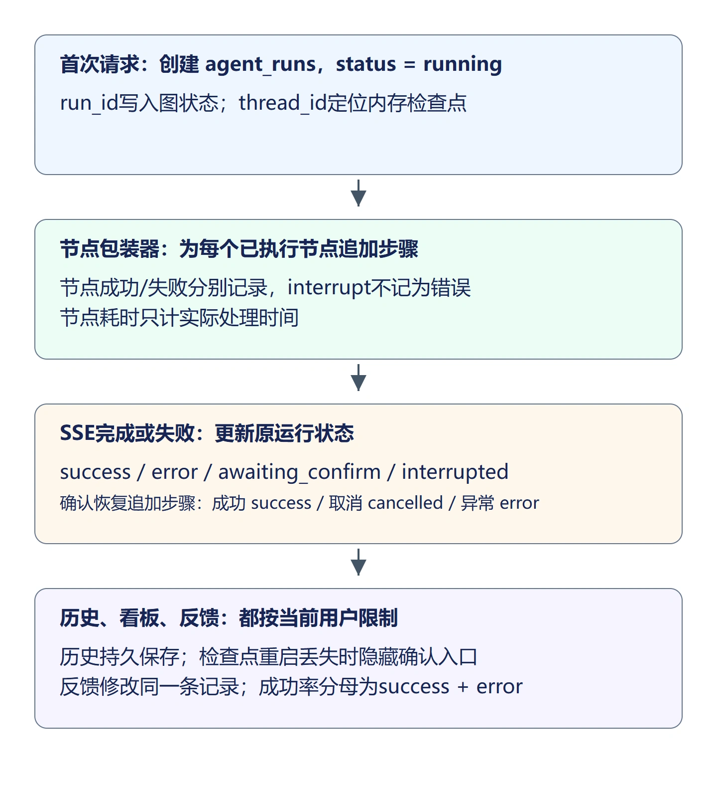
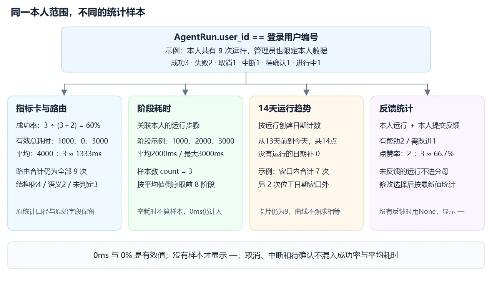
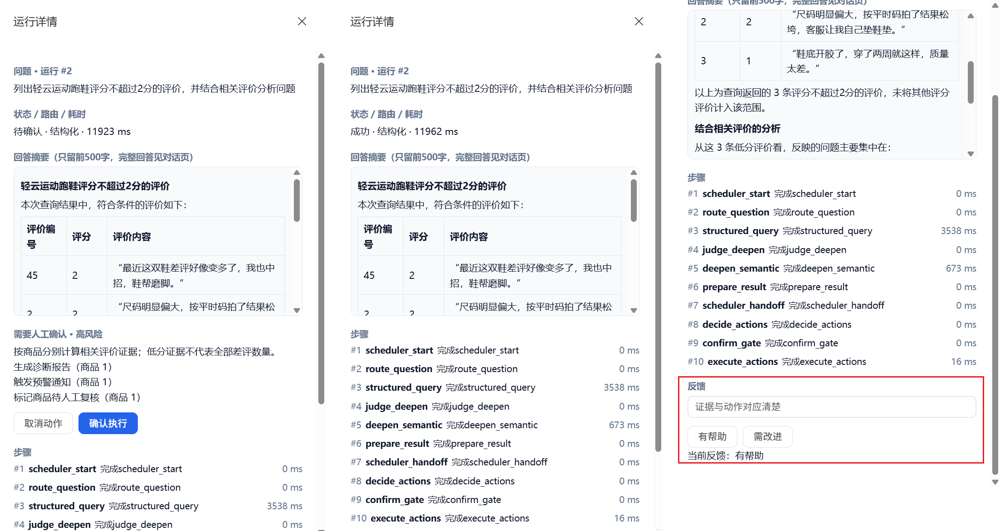
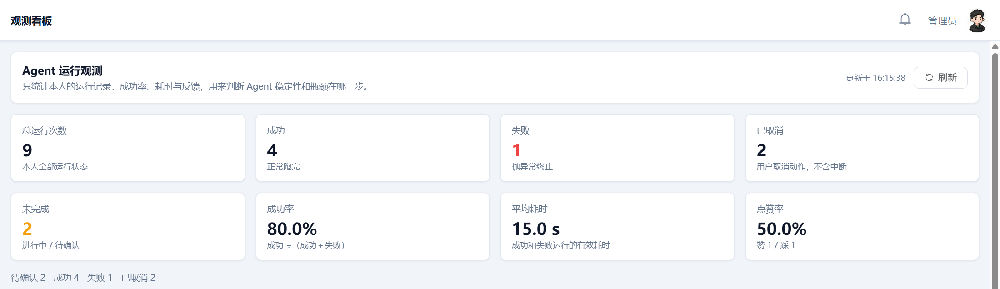
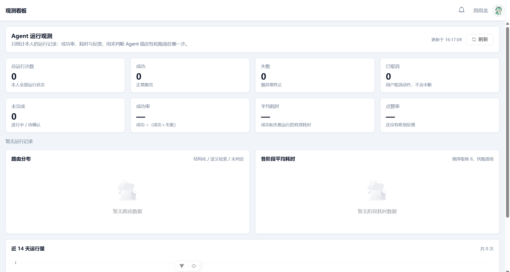

## 1. 先保存一次运行，再记录它经过的步骤

页面上的过程消息在离开页面后就不方便回看。本节把一次分析保存为运行记录，再保存对应的节点步骤，最后加入统计看板和用户反馈。

三个编号作用不同：`run_id` 是数据库中的运行编号，用于历史、步骤和反馈；`thread_id` 定位图的内存检查点；`user_id` 决定谁能读取和操作。确认恢复继续使用原线程和原运行编号，不再创建一次分析。



例如查询洗衣液价格得到运行 1，完成后状态为 `success`。查询跑鞋低分评价得到运行 2，首次回答完成但动作待确认时为 `awaiting_confirm`；选择取消后运行 2 改成 `cancelled`，不是另加运行 3。

## 2. 建立运行、步骤与反馈模型

新建目录 `backend/app/observability`，其中 `__init__.py` 留空。新建 `models.py`：

```python
"""观测相关表：一次对话运行、步骤明细、点赞点踩。"""

from sqlalchemy import ForeignKey, Integer, String, Text, UniqueConstraint
from sqlalchemy.orm import Mapped, mapped_column

from app.database import Base

class AgentRun(Base):
    """一次对话分析的运行总览。"""

    __tablename__ = "agent_runs"
    __table_args__ = {"comment": "Agent 运行记录"}

    thread_id: Mapped[str] = mapped_column(
        String(64), nullable=False, index=True, comment="LangGraph 会话 ID"
    )
    question: Mapped[str] = mapped_column(
        String(1000), nullable=False, comment="用户问题"
    )
    user_id: Mapped[int | None] = mapped_column(
        ForeignKey("users.id"), nullable=True, comment="提问用户"
    )
    route: Mapped[str | None] = mapped_column(
        String(20), nullable=True, comment="sql / semantic"
    )
    evidence_source: Mapped[str | None] = mapped_column(
        String(20), nullable=True, comment="证据来源"
    )
    # running / success / error / awaiting_confirm / cancelled / interrupted
    status: Mapped[str] = mapped_column(
        String(20), nullable=False, default="running", comment="运行状态"
    )
    elapsed_ms: Mapped[int | None] = mapped_column(
        Integer, nullable=True, comment="总耗时毫秒"
    )
    error_message: Mapped[str | None] = mapped_column(
        String(500), nullable=True, comment="失败原因（对用户可见的简短文案）"
    )
    answer_preview: Mapped[str | None] = mapped_column(
        Text, nullable=True, comment="回答摘要（截断）"
    )

class AgentRunStep(Base):
    """一次运行中的某一步（路由、查询、深挖、决策等）。"""

    __tablename__ = "agent_run_steps"
    __table_args__ = {"comment": "Agent 运行步骤明细"}

    run_id: Mapped[int] = mapped_column(
        ForeignKey("agent_runs.id"), nullable=False, index=True, comment="所属运行"
    )
    step_order: Mapped[int] = mapped_column(
        Integer, nullable=False, comment="步骤序号，从 1 开始"
    )
    step_name: Mapped[str] = mapped_column(
        String(50), nullable=False, comment="阶段名，如 routing / querying"
    )
    summary: Mapped[str] = mapped_column(
        String(500), nullable=False, comment="步骤摘要（给前端/历史页看）"
    )
    success: Mapped[int] = mapped_column(
        Integer, nullable=False, default=1, comment="1成功 0失败"
    )
    elapsed_ms: Mapped[int | None] = mapped_column(
        Integer, nullable=True, comment="本步耗时毫秒"
    )
    detail: Mapped[str | None] = mapped_column(
        Text, nullable=True, comment="可选细节 JSON 文本"
    )

class AgentFeedback(Base):
    """对某次运行回答的点赞 / 点踩。"""

    __tablename__ = "agent_feedbacks"
    __table_args__ = (UniqueConstraint("run_id", "user_id", name="uq_feedback_run_user"), {"comment": "Agent 回答反馈"})

    run_id: Mapped[int] = mapped_column(
        ForeignKey("agent_runs.id"), nullable=False, index=True, comment="关联运行"
    )
    user_id: Mapped[int] = mapped_column(
        ForeignKey("users.id"), nullable=False, comment="反馈用户"
    )
    # 1=点赞，-1=点踩
    rating: Mapped[int] = mapped_column(
        Integer, nullable=False, comment="1赞 / -1踩"
    )
    comment: Mapped[str | None] = mapped_column(
        String(500), nullable=True, comment="可选备注"
    )
```

运行表保存问题、路由、状态、耗时、错误和回答摘要。步骤表通过 `run_id` 关联运行；`step_order` 表示本次运行内的执行顺序。反馈表通过唯一约束限制同一用户对同一运行只有一条反馈，后续选择会更新原记录。

在 `backend/app/main.py` 的 `create_all()` 之前导入模型：

```python
from app.observability.models import AgentRun, AgentRunStep, AgentFeedback
```

重启后端会创建三个新增表。运行记录持久保存在数据库，内存检查点仍会在重启后失效；历史里有记录不代表还能恢复确认。

## 3. 保存记录与限制读取范围

新建 `backend/app/observability/service.py`：

```python
"""记录运行与步骤；所有读写接口都核对用户归属。"""
import json
from datetime import date, timedelta
from sqlalchemy import select, func
from sqlalchemy.orm import Session
from app.database import SessionLocal
from app.common.exceptions import BusinessException
from app.observability.models import AgentRun, AgentRunStep, AgentFeedback

def as_dict(row):
    return {c.name: getattr(row, c.name) for c in row.__table__.columns}

def create_run(thread_id: str, question: str, user_id: int) -> int:
    with SessionLocal() as db:
        row = AgentRun(thread_id=thread_id, question=question[:1000], user_id=user_id, status="running")
        db.add(row)
        db.commit()
        return row.id

def record_step(run_id: int, name: str, elapsed_ms: int, success=True, detail=None):
    with SessionLocal() as db:
        # 同一运行的节点串行执行；确认恢复仍在原运行后追加步骤。
        count = db.scalar(select(func.count()).select_from(AgentRunStep).where(AgentRunStep.run_id == run_id))
        db.add(AgentRunStep(run_id=run_id, step_order=count+1, step_name=name[:50],
                           summary=("完成" if success else "失败") + name[:50],
                           success=int(success), elapsed_ms=elapsed_ms,
                           detail=json.dumps(detail, ensure_ascii=False, default=str) if detail else None))
        db.commit()

def finish_run(run_id: int, status: str, **values):
    with SessionLocal() as db:
        row = db.get(AgentRun, run_id)
        if row is None:
            raise BusinessException("运行记录不存在", code=404)
        row.status = status
        # 仅开放运行摘要字段，不能通过外部字典覆盖用户或线程归属。
        for key in ("route", "elapsed_ms", "error_message", "answer_preview"):
            if key in values:
                value = values[key]
                setattr(row, key, value[:500] if isinstance(value, str) else value)
        db.commit()

def owned_run(db: Session, run_id: int, user_id: int, lock=False):
    query = select(AgentRun).where(AgentRun.id == run_id, AgentRun.user_id == user_id)
    # 反馈在行锁内更新，避免同一用户并发提交两条记录。
    row = db.scalar(query.with_for_update() if lock else query)
    if row is None:
        raise BusinessException("运行不存在或无权访问", code=404)
    return row

def list_runs(db: Session, user_id: int, page=1, page_size=10):
    query = select(AgentRun).where(AgentRun.user_id == user_id)
    total = db.scalar(select(func.count()).select_from(query.subquery()))
    rows = db.scalars(query.order_by(AgentRun.id.desc()).offset((page-1)*page_size).limit(page_size))
    return {"list": [as_dict(row) for row in rows], "total": total}

def get_run_detail(db: Session, run_id: int, user_id: int):
    run = owned_run(db, run_id, user_id)
    steps = db.scalars(select(AgentRunStep).where(AgentRunStep.run_id == run_id).order_by(AgentRunStep.step_order))
    feedback = db.scalar(select(AgentFeedback).where(AgentFeedback.run_id == run_id, AgentFeedback.user_id == user_id))
    return {**as_dict(run), "steps": [as_dict(row) for row in steps],
            "feedback": as_dict(feedback) if feedback else None}

def submit_feedback(db: Session, run_id: int, user_id: int, rating: int, comment: str):
    run = owned_run(db, run_id, user_id, lock=True)
    # 运行未产出回答时不接受反馈；等待人工确认仍可能已有完整查询回答。
    if not run.answer_preview:
        raise BusinessException("该运行没有可评价的回答", code=409)
    # 锁定读取获取前一请求提交后的反馈，避免认证时建立的旧快照造成重复插入。
    row = db.scalar(select(AgentFeedback).where(
        AgentFeedback.run_id == run_id, AgentFeedback.user_id == user_id
    ).with_for_update())
    if row is None:
        row = AgentFeedback(run_id=run_id, user_id=user_id, rating=rating)
        db.add(row)
    row.rating, row.comment = rating, comment[:500]
    db.commit()
    return as_dict(row)

def get_stats(db: Session, user_id: int, trend_days: int = 14):
    # 所有卡片和图表固定读取本人的运行，管理员也不能扩大范围。
    runs = list(db.scalars(select(AgentRun).where(AgentRun.user_id == user_id)))
    counts, routes = {}, {}
    buckets = {"结构化": 0, "语义检索": 0, "未判定": 0}
    for row in runs:
        counts[row.status] = counts.get(row.status, 0) + 1
        # 兼容旧routes的原始键；饼图另把SQL别名合并成结构化一类。
        if row.route:
            routes[row.route] = routes.get(row.route, 0) + 1
        label = "结构化" if row.route in ("sql", "structured") else "语义检索" if row.route == "semantic" else "未判定"
        buckets[label] += 1
    # 沿用既有口径：仅success和error进入成功率分母及平均耗时样本。
    terminal = counts.get("success", 0) + counts.get("error", 0)
    rate = counts.get("success", 0) / terminal if terminal else None
    times = [row.elapsed_ms for row in runs
             if row.status in ("success", "error") and row.elapsed_ms is not None]
    average = round(sum(times) / len(times)) if times else None
    stage_rows = db.execute(select(
        AgentRunStep.step_name, func.avg(AgentRunStep.elapsed_ms),
        func.count(AgentRunStep.elapsed_ms), func.max(AgentRunStep.elapsed_ms),
    ).join(AgentRun, AgentRunStep.run_id == AgentRun.id).where(
        AgentRun.user_id == user_id
    ).group_by(AgentRunStep.step_name)).all()
    # 原stages字段保留；图表只取有耗时样本的阶段，倒序展示前8个。
    step_stats = [{"step_name": name, "avg_ms": round(avg_ms),
                   "count": count, "max_ms": max_ms}
                  for name, avg_ms, count, max_ms in stage_rows if count]
    step_stats.sort(key=lambda item: (-item["avg_ms"], item["step_name"]))
    # 反馈和被评价的运行都必须属于本人，排除遗留的他人反馈记录。
    feedback_rows = db.execute(select(AgentFeedback.rating, func.count()).join(
        AgentRun, AgentFeedback.run_id == AgentRun.id
    ).where(AgentRun.user_id == user_id, AgentFeedback.user_id == user_id).group_by(
        AgentFeedback.rating
    )).all()
    feedback = dict(feedback_rows)
    up, down = feedback.get(1, 0), feedback.get(-1, 0)
    rated = up + down
    # 趋势只限制图中的日期范围，不改变全量卡片的统计范围。
    today = date.today()
    start = today - timedelta(days=trend_days - 1)
    day_col = func.date(AgentRun.create_time)
    day_rows = db.execute(select(day_col, func.count()).where(
        AgentRun.user_id == user_id, day_col >= start, day_col <= today
    ).group_by(day_col)).all()
    by_day = {str(day): count for day, count in day_rows}
    trend = [{"date": (start + timedelta(days=i)).isoformat(),
              "count": by_day.get((start + timedelta(days=i)).isoformat(), 0)}
             for i in range(trend_days)]
    cards = {"total_runs": len(runs), "success_runs": counts.get("success", 0),
             "failed_runs": counts.get("error", 0), "cancelled_runs": counts.get("cancelled", 0),
             "unfinished_runs": counts.get("running", 0) + counts.get("awaiting_confirm", 0),
             "interrupted_runs": counts.get("interrupted", 0), "success_rate": rate,
             "avg_elapsed_ms": average, "up_count": up, "down_count": down,
             "up_rate": up / rated if rated else None}
    return {"total": len(runs), "statuses": counts, "routes": routes,
            "success_rate": rate, "average_ms": average,
            "stages": [{"name": name, "average_ms": round(ms or 0)}
                       for name, ms, _, _ in stage_rows],
            "cards": cards,
            "route_distribution": [{"name": name, "count": count}
                                   for name, count in buckets.items() if count],
            "step_stats": step_stats[:8], "run_trend": trend, "trend_days": trend_days}
```

反馈提交先锁定所属运行，使同一运行的反馈按顺序处理；读取反馈本身也使用 `FOR UPDATE`。MySQL 的普通查询可能沿用认证查询建立的旧快照，锁定读取才能看到前一个请求刚提交的反馈，随后更新它，而不是再次插入。

`create_run()` 先提交一条 `running` 记录，再把编号交给图。节点运行后追加步骤；完成时只允许更新状态摘要字段，不能用任意字典覆盖用户归属。

`owned_run()` 同时检查运行编号和用户编号，因此历史详情、步骤和反馈不能仅靠猜测编号访问。反馈先锁定对应运行行再查找或更新，配合唯一约束防止并发生成重复反馈。

看板中的成功率是 `success / (success + error)`。例如成功 1、错误 1、取消 1、等待确认 1，成功率为 50%，不是 25%。没有成功或错误记录时返回 `None`，页面显示占位符 `—`，不显示虚构的 0% 成功率。

## 4. 在节点外记录实际耗时

在 `backend/app/agent/state.py` 的类末尾增加：

```python
    # 持久化运行编号与线程关联，确认恢复继续追加同一运行的步骤。
    run_id: int
```

在 `backend/app/agent/graph.py` 中补充以下导入：

```python
from functools import lru_cache, wraps
from time import perf_counter
from langgraph.errors import GraphInterrupt
from app.observability import service as obs_service
```

在 `build_analysis_graph()` 前增加：

```python
def record_node(name, func):
    @wraps(func)
    def wrapped(state: AgentState):
        started = perf_counter()
        try:
            result = func(state)
        except GraphInterrupt:
            # 暂停是控制流，不是节点失败；恢复后再记录本节点成功耗时。
            raise
        except Exception as exc:
            if state.get("run_id"):
                obs_service.record_step(state["run_id"], name, int((perf_counter()-started)*1000),
                                        success=False, detail={"exception": type(exc).__name__})
            raise
        if state.get("run_id"):
            obs_service.record_step(state["run_id"], name, int((perf_counter()-started)*1000),
                                    detail={"role": result.get("agent_label"), "keys": list(result)})
        return result
    return wrapped
```

`perf_counter()` 只计算实际执行期间的时间差。第一次到达 `interrupt()` 是正常暂停，不应记成失败；恢复时节点重新执行，完成后才记录这一节点的处理耗时，人工等待不计入该步耗时。

在 `build_analysis_graph()` 中，将节点注册部分替换为以下内容，后面的边和 `compile(checkpointer=...)` 保持原样：

```python
    builder.add_node("scheduler_start", record_node("scheduler_start", scheduler.node_scheduler_start))
    builder.add_node("scheduler_handoff", record_node("scheduler_handoff", scheduler.node_scheduler_handoff))
    builder.add_node("route_question", record_node("route_question", analysis_agent.route))
    builder.add_node("structured_query", record_node("structured_query", analysis_agent.structured_query))
    builder.add_node("semantic_query", record_node("semantic_query", analysis_agent.semantic_query))
    builder.add_node("judge_deepen", record_node("judge_deepen", analysis_agent.judge_deepen))
    builder.add_node("deepen_semantic", record_node("deepen_semantic", analysis_agent.deepen_semantic))
    builder.add_node("prepare_result", record_node("prepare_result", analysis_agent.prepare_result))
    builder.add_node("decide_actions", record_node("decide_actions", decision_agent.decide_actions))
    builder.add_node("confirm_gate", record_node("confirm_gate", decision_agent.confirm_gate))
    builder.add_node("execute_actions", record_node("execute_actions", decision_agent.execute_actions))
```

包装器在实际节点调用前计时，所以能记录发生异常的真实节点，不能用“最后一个成功节点”的名字代替出错节点。它不吞掉异常，原来的流式错误处理仍会执行。

## 5. 将整轮状态与流式结果对应起来

修改 `backend/app/services/chat_service.py`。补充导入：

```python
from time import perf_counter
from app.observability import service as obs_service
```

将原来的 `stream_chat()` 更名为 `_stream_chat()`，签名改为：

```python
def _stream_chat(
    question: str,
    user_id: int | None = None,
    history: list[dict[str, Any]] | None = None,
    run_id: int | None = None, thread_id: str | None = None,
) -> Generator[str, None, None]:
```

函数内部将 `thread_id = uuid4().hex` 改为 `thread_id = thread_id or uuid4().hex`，并将 `initial` 改为：

```python
    initial: AgentState = {"question": question, "product_names": product_names,
                           "user_id": user_id, "run_id": run_id}
```

在 `done_event` 字典的 `result` 之前增加：

```python
            "run_id": run_id, "thread_id": thread_id,
            "route": final_state["route"], "query_failed": final_state.get("query_failed", False),
```

处理节点 `updates` 时，在发送 `status` 的字典中增加 `"route": delta.get("route")`。外层由此保存实际路由，后续回答失败时也不会丢失已有的路由结果。

文件末尾新增公开的 `stream_chat()`。API 仍调用这个名字，不需要修改流接口：

```python
def stream_chat(question, user_id=None, history=None):
    thread_id = uuid4().hex
    started = perf_counter()
    try:
        run_id = obs_service.create_run(thread_id, question, user_id)
    except Exception:
        logger.exception("创建运行记录失败")
        yield _sse("error", {"message": "无法保存运行记录，请检查数据库"})
        return
    terminal = False
    answer = ""
    route = None
    try:
        for frame in _stream_chat(question, user_id, history, run_id, thread_id):
            event, data = frame.split("\n", 1)
            payload = json.loads(data.removeprefix("data: ").strip())
            route = payload.get("route") or route
            if event == "event: token":
                answer = (answer + payload.get("content", ""))[:500]
            # 必须在发送完成事件之前写好状态，历史页面才能立即查到最终结果。
            if event in ("event: error", "event: done"):
                failed = event == "event: error" or payload.get("query_failed")
                status = "error" if failed else ("awaiting_confirm" if payload.get("confirmation") else "success")
                obs_service.finish_run(run_id, status, route=route,
                    elapsed_ms=int((perf_counter()-started)*1000), answer_preview=answer,
                    error_message=payload.get("message") if failed else None)
                terminal = True
            yield frame
    finally:
        # 客户端断开导致生成器关闭时，不把部分回答记为成功。
        if not terminal:
            obs_service.finish_run(run_id, "interrupted", elapsed_ms=int((perf_counter()-started)*1000),
                                   answer_preview=answer)
```

外层负责运行生命周期，内层继续处理问题补全、图运行和模型回答。收到 `token` 时只保存最多 500 字符摘要；收到 `error` 或 `done` 时先写最终状态，再把事件发给前端，避免完成后立即打开历史却看到旧的 `running`。

SQL 修复后仍失败时，查询说明可能通过正常的 `done` 返回，但 `query_failed=True` 会把运行记为 `error`，不能因为 HTTP 200 或回答完整就记成查询成功。流没有完整结束时记为 `interrupted`，部分文本不代表完整回答。

## 6. 恢复确认后更新原运行

将 `backend/app/services/confirmation_service.py` 替换为：

```python
"""单进程内串行检查归属并恢复检查点，避免重复确认。"""
from threading import Lock
from time import perf_counter
from app.observability import service as obs_service
from typing import Any

from langgraph.types import Command

from app.agent import graph
from app.common.exceptions import BusinessException
from app.database import SessionLocal
from app.observability.models import AgentRun

_confirmation_lock = Lock()

def get_pending_confirmation(thread_id: str, user_id: int) -> dict[str, Any] | None:
    config = {"configurable": {"thread_id": thread_id}}
    snap = graph.get_analysis_graph().get_state(config)
    # 检查点不存在、已结束或未停在确认节点时，没有可操作的计划。
    if snap.next != ("confirm_gate",):
        return None
    # thread_id只是定位标识，不能代替用户身份；不向其他用户暴露计划。
    if snap.values.get("user_id") != user_id:
        return None
    return {"thread_id": thread_id, "actions": snap.values["pending_actions"],
            "risk_level": snap.values["risk_level"],
            "reason": snap.values["decide_reason"]}

def resume_actions(thread_id: str, approved: bool, user_id: int) -> dict[str, Any]:
    # 检查与恢复必须在同一临界区，否则并发点击可能都通过待确认检查。
    with _confirmation_lock:
        config = {"configurable": {"thread_id": thread_id}}
        analysis_graph = graph.get_analysis_graph()
        snap = analysis_graph.get_state(config)
        if snap.next != ("confirm_gate",):
            raise BusinessException("没有待确认的任务，或服务重启后检查点已失效", code=409)
        if snap.values.get("user_id") != user_id:
            raise BusinessException("无权确认该任务", code=403)
        # Command将选择送回原interrupt调用；不重新查询，也不重新规划。
        run_id = snap.values.get("run_id")
        previous_ms = 0
        if run_id:
            with SessionLocal() as db:
                previous_ms = db.get(AgentRun, run_id).elapsed_ms or 0
        started = perf_counter()
        try:
            analysis_graph.invoke(Command(resume={"approved": approved}), config=config)
        except Exception:
            # 失败保留原运行编号，不能另建一条看似成功的恢复记录。
            if run_id:
                obs_service.finish_run(run_id, "error", error_message="动作执行失败",
                    elapsed_ms=previous_ms + int((perf_counter()-started)*1000))
            raise
        final = analysis_graph.get_state(config).values
        if final.get("run_id"):
            status = "success" if final["human_approved"] else "cancelled"
            # 人工等待时间不计入执行耗时；增加的是本次恢复处理的时间。
            obs_service.finish_run(final["run_id"], status,
                elapsed_ms=previous_ms + int((perf_counter()-started)*1000))
        return {"thread_id": thread_id, "approved": final["human_approved"],
                "status_message": final["status_message"],
                "actions_executed": final.get("actions_executed", [])}
```

确认后执行成功写为 `success`，取消写为 `cancelled`，执行异常写为 `error`。耗时在原处理耗时上增加恢复阶段耗时，不包含用户看计划和等待点击的时间。原来的用户归属、锁和重复确认检查继续保留。

## 7. 提供历史、详情、看板和反馈接口

新建 `backend/app/schemas/observability.py`：

```python
from typing import Literal
from pydantic import BaseModel, Field

class FeedbackRequest(BaseModel):
    rating: Literal[1, -1]
    comment: str = Field(default="", max_length=500)
```

新建 `backend/app/api/observability.py`：

```python
from typing import Annotated
from fastapi import APIRouter, Depends, Query
from sqlalchemy.orm import Session
from app.database import get_db
from app.dependencies.auth import get_current_user
from app.models.user import User
from app.common.response import Response
from app.observability import service as obs_service
from app.services import confirmation_service
from app.schemas.observability import FeedbackRequest

router = APIRouter(prefix="/observability", tags=["运行历史"])
CurrentUser = Annotated[User, Depends(get_current_user)]
Db = Annotated[Session, Depends(get_db)]

@router.get("/runs")
def list_runs(user: CurrentUser, db: Db, page: Annotated[int, Query(ge=1)]=1,
              page_size: Annotated[int, Query(ge=1, le=50)]=10):
    return Response.success(data=obs_service.list_runs(db, user.id, page, page_size))

@router.get("/stats")
def get_stats(user: CurrentUser, db: Db,
              trend_days: Annotated[int, Query(ge=7, le=90)] = 14):
    return Response.success(data=obs_service.get_stats(db, user.id, trend_days))

@router.get("/runs/{run_id}")
def get_run(run_id: int, user: CurrentUser, db: Db):
    data = obs_service.get_run_detail(db, run_id, user.id)
    data["pending_confirmation"] = confirmation_service.get_pending_confirmation(data["thread_id"], user.id)
    return Response.success(data=data)

@router.post("/runs/{run_id}/feedback")
def feedback(run_id: int, body: FeedbackRequest, user: CurrentUser, db: Db):
    return Response.success(data=obs_service.submit_feedback(db, run_id, user.id, body.rating, body.comment))
```

在 `backend/app/api/__init__.py` 末尾注册：

```python
from app.api import observability
api.include_router(observability.router)
```

详情返回的 `pending_confirmation` 来自当前检查点，而不是历史状态字符串。服务重启后历史仍在，但检查点不存在，字段为 `None`，前端不能继续显示失效的确认按钮。

## 8. 历史列表与步骤回看

列表按问题、路由、状态、耗时和时间展示，点击“详情”打开右侧抽屉。例如接口返回 `status="awaiting_confirm"`、`route="sql"` 时，页面显示“待确认”和“结构化”；映射只改变展示文字，确认接口仍使用原来的线程编号和布尔值。

新建 `frontend/src/views/History.vue`：

```vue
<template>
  <div class="page-container history-page">
    <div class="content-card">
      <el-table :data="rows" v-loading="loading" :header-cell-style="tableHeaderStyle">
        <el-table-column prop="question" label="问题" min-width="220" show-overflow-tooltip />
        <el-table-column label="路由" width="110">
          <template #default="{ row }">{{ routeLabel(row.route) }}</template>
        </el-table-column>
        <el-table-column label="状态" width="120">
          <template #default="{ row }">
            <el-tag size="small" effect="light" round :type="statusTag(row.status)">
              {{ statusLabel(row.status) }}
            </el-tag>
          </template>
        </el-table-column>
        <el-table-column prop="elapsed_ms" label="耗时(ms)" width="100" />
        <el-table-column prop="create_time" label="时间" width="180" />
        <el-table-column label="操作" width="100" fixed="right">
          <template #default="{ row }">
            <el-button type="primary" link :disabled="detailLoading || confirming || feedbackLoading" @click="openDetail(row.id)">详情</el-button>
          </template>
        </el-table-column>
      </el-table>
      <div class="table-footer">
        <el-pagination v-model:current-page="page" :page-size="10" :total="total" background small layout="total, prev, pager, next" @current-change="load" />
      </div>
    </div>
    <el-drawer v-model="opened" title="运行详情" size="min(480px, 100vw)">
      <template v-if="detail">
        <div class="history-page__detail-block">
          <div class="history-page__detail-label">问题 · 运行 #{{ detail.id }}</div>
          <div>{{ detail.question }}</div>
        </div>
        <div class="history-page__detail-block">
          <div class="history-page__detail-label">状态 / 路由 / 耗时</div>
          <div>{{ statusLabel(detail.status) }} · {{ routeLabel(detail.route) }} · {{ detail.elapsed_ms ?? '—' }} ms</div>
        </div>
        <div v-if="detail.answer_preview" class="history-page__detail-block">
          <div class="history-page__detail-label">回答摘要（只留前500字，完整回答见对话页）</div>
          <div class="history-page__preview" v-html="renderMarkdown(detail.answer_preview)"></div>
        </div>
        <div v-if="detail.error_message" class="history-page__detail-block">
          <div class="history-page__detail-label">错误</div>
          <el-alert :title="detail.error_message" type="error" :closable="false" />
        </div>
        <div v-if="detail.pending_confirmation" class="history-page__detail-block">
          <div class="history-page__detail-label">需要人工确认 · {{ riskLabel(detail.pending_confirmation.risk_level) }}</div>
          <p>{{ detail.pending_confirmation.reason }}</p>
          <ul>
            <li v-for="(action, index) in detail.pending_confirmation.actions" :key="index">
              {{ action.title || action.type }}<span v-if="action.product_id">（商品 {{ action.product_id }}）</span>
            </li>
          </ul>
          <div class="history-page__buttons">
            <el-button :disabled="confirming" @click="confirm(false)">取消动作</el-button>
            <el-button type="primary" :loading="confirming" :disabled="confirming" @click="confirm(true)">确认执行</el-button>
          </div>
        </div>
        <p v-else-if="detail.status === 'awaiting_confirm'" class="history-page__detail-block">待确认检查点已不可用，请重新提交问题。</p>
        <div class="history-page__detail-block">
          <div class="history-page__detail-label">步骤</div>
          <ul class="history-page__steps">
            <li v-for="step in detail.steps || []" :key="step.id || step.step_order">
              <span class="history-page__step-order">#{{ step.step_order }}</span>
              <span class="history-page__step-name">{{ step.step_name }}</span>
              <span>{{ step.summary }}</span>
              <span v-if="step.elapsed_ms != null" class="history-page__step-ms">{{ step.elapsed_ms }} ms</span>
              <pre v-if="stepSql(step.detail)" class="history-page__step-sql">{{ stepSql(step.detail) }}</pre>
            </li>
          </ul>
        </div>
        <div v-if="detail.answer_preview" class="history-page__detail-block">
          <div class="history-page__detail-label">反馈</div>
          <el-input v-model="comment" aria-label="反馈备注" placeholder="反馈备注（可选）" maxlength="500" />
          <div class="history-page__buttons">
            <el-button :disabled="feedbackLoading" @click="feedback(1)">有帮助</el-button>
            <el-button :disabled="feedbackLoading" @click="feedback(-1)">需改进</el-button>
          </div>
          <p v-if="detail.feedback">当前反馈：{{ detail.feedback.rating === 1 ? '有帮助' : '需改进' }}</p>
        </div>
      </template>
    </el-drawer>
  </div>
</template>

<script setup>
import DOMPurify from 'dompurify'
import { marked } from 'marked'
import { onMounted, ref } from 'vue'
import { ElMessage } from 'element-plus'
import request from '@/utils/request'
import { confirmActions } from '@/api/chat'
const rows = ref([]), total = ref(0), page = ref(1), loading = ref(false)
const detail = ref(null), opened = ref(false), detailLoading = ref(false)
const confirming = ref(false), feedbackLoading = ref(false), comment = ref('')
let listRequest = 0

const tableHeaderStyle = { backgroundColor: '#f8fafc', color: '#475569', fontWeight: 600 }

function routeLabel(value) {
  return { sql: '结构化', structured: '结构化', semantic: '语义检索' }[value] || '—'
}
function statusLabel(value) {
  return { running: '进行中', success: '成功', error: '失败', awaiting_confirm: '待确认', cancelled: '已取消', interrupted: '已中断' }[value] || '未知状态'
}
function statusTag(value) {
  return { running: 'primary', success: 'success', error: 'danger', awaiting_confirm: 'warning', cancelled: 'info', interrupted: 'warning' }[value] || 'info'
}
function riskLabel(value) {
  return { low: '低风险', medium: '中风险', high: '高风险' }[value] || '风险待核对'
}

// 模型摘要按Markdown排版，清理HTML后再交给v-html，避免注入脚本或事件属性。
function renderMarkdown(text) {
  return DOMPurify.sanitize(marked.parse(text || '', { async: false, breaks: true }))
}

// 步骤明细在数据库中是JSON文本；兼容已解析的对象，缺失或损坏时不展示SQL。
function stepSql(value) {
  try {
    const data = typeof value === 'string' ? JSON.parse(value) : value
    return typeof data?.sql === 'string' ? data.sql : ''
  } catch {
    return ''
  }
}
async function call(url, body) {
  const res = body === undefined ? await request.get(url) : await request.post(url, body)
  if (res.code !== 200) throw new Error(res.message)
  return res.data
}
async function load() {
  // 仅允许最后一次翻页请求更新列表、错误提示和加载状态。
  const id = ++listRequest
  loading.value = true
  try {
    const data = await call(`/api/observability/runs?page=${page.value}`)
    if (id === listRequest) { rows.value = data.list; total.value = data.total }
  } catch (err) { if (id === listRequest) ElMessage.error(err.message || '读取失败') }
  finally { if (id === listRequest) loading.value = false }
}
async function openDetail(id) {
  // 详情加载时阻止切换其他运行，避免旧详情覆盖新对象。
  if (detailLoading.value) return
  detailLoading.value = true
  try {
    detail.value = await call(`/api/observability/runs/${id}`)
    comment.value = detail.value.feedback?.comment || ''
    opened.value = true
  } catch (err) { ElMessage.error(err.message || '读取失败') }
  finally { detailLoading.value = false }
}
async function confirm(approved) {
  if (confirming.value || !detail.value?.pending_confirmation) return
  confirming.value = true
  try {
    await confirmActions(detail.value.thread_id, approved)
    await openDetail(detail.value.id)
    await load()
  } catch (err) { ElMessage.error(err.message || '确认失败') }
  finally { confirming.value = false }
}
async function feedback(rating) {
  if (feedbackLoading.value || !detail.value) return
  feedbackLoading.value = true
  try {
    const data = await call(`/api/observability/runs/${detail.value.id}/feedback`, { rating, comment: comment.value })
    detail.value.feedback = data
  } catch (err) { ElMessage.error(err.message || '反馈失败') }
  finally { feedbackLoading.value = false }
}
onMounted(load)
</script>

<style scoped>
.history-page__detail-block {
  margin-bottom: 16px;
  font-size: 14px;
  line-height: 1.6;
  color: var(--app-text);
}

.history-page__detail-label {
  margin-bottom: 4px;
  font-weight: 600;
  font-size: 13px;
  color: var(--app-text-secondary);
}

.history-page__preview {
  word-break: break-word;
  max-height: 220px;
  overflow-y: auto;
  padding: 8px 10px;
  border: 1px solid var(--app-border);
  border-radius: var(--app-radius-sm);
  background: #f8fafc;
}

/* 回答摘要是 Markdown：渲染后压掉默认间距，首尾不留空白 */
.history-page__preview :deep(p) {
  margin: 6px 0;
}

.history-page__preview :deep(p:first-child) {
  margin-top: 0;
}

.history-page__preview :deep(p:last-child) {
  margin-bottom: 0;
}

.history-page__preview :deep(ul),
.history-page__preview :deep(ol) {
  margin: 6px 0;
  padding-left: 20px;
}

.history-page__preview :deep(li) {
  margin: 2px 0;
}

.history-page__preview :deep(h1),
.history-page__preview :deep(h2),
.history-page__preview :deep(h3),
.history-page__preview :deep(h4) {
  margin: 8px 0 4px;
  font-size: 14px;
}

.history-page__preview :deep(strong) {
  font-weight: 600;
}

.history-page__preview :deep(hr) {
  border: none;
  border-top: 1px dashed var(--app-border);
  margin: 8px 0;
}

.history-page__preview :deep(code) {
  padding: 1px 4px;
  border-radius: 4px;
  background: #eef2f7;
  font-size: 12px;
}

.history-page__steps {
  display: flex;
  flex-direction: column;
  gap: 8px;
  margin: 0;
  padding: 0;
  list-style: none;
}

.history-page__steps li {
  display: flex;
  flex-wrap: wrap;
  gap: 6px;
  font-size: 13px;
  line-height: 1.5;
}

.history-page__step-order {
  color: var(--app-text-secondary);
}

.history-page__step-name {
  font-weight: 600;
}

.history-page__step-sql {
  width: 100%;
  margin: 2px 0 4px;
  padding: 6px 8px;
  border: 1px solid var(--app-border);
  border-radius: var(--app-radius-sm);
  background: #f8fafc;
  font-family: Consolas, Menlo, monospace;
  font-size: 12px;
  line-height: 1.6;
  color: var(--app-text);
  white-space: pre-wrap;
  word-break: break-all;
}

.history-page__step-ms {
  color: var(--app-text-secondary);
  margin-left: auto;
}

.history-page__detail-block { overflow-wrap: anywhere; }
.history-page__preview { overflow: auto; }
.history-page__preview :deep(table) { border-collapse: collapse; width: 100%; }
.history-page__preview :deep(th),
.history-page__preview :deep(td) { border: 1px solid var(--app-border); padding: 6px 8px; text-align: left; min-width: 60px; }
.history-page__preview :deep(pre) { white-space: pre-wrap; overflow-wrap: anywhere; }
.history-page__buttons { display: flex; flex-wrap: wrap; gap: 8px; margin-top: 12px; }
.history-page__buttons :deep(.el-button + .el-button) { margin-left: 0; }
@media (max-width: 640px) {
  .history-page__buttons :deep(.el-button) { min-height: 44px; }
}
</style>
```

抽屉按问题、运行信息、回答摘要、人工确认、步骤和反馈分区。宽屏宽度为480px，窄屏最多占满视口；按钮可换行，长SQL在明细框内折行，不能把操作按钮挤出屏幕。

`answer_preview` 是最多500字符的摘要，可能停在句子或Markdown表格中间，不能当作完整回答。`renderMarkdown()` 先把 `##`、`**` 和表格转换为HTML，再用DOMPurify清理脚本和事件属性，最后由 `v-html` 显示。摘要容器单独滚动；错误信息另列一块，已有摘要不能遮住随后发生的执行错误。

`step.detail` 在数据库中保存为JSON文本。例如 `'{"sql":"SELECT id FROM reviews LIMIT 20"}'` 经过 `stepSql()` 解析，取出其中的SQL字符串，再由 `<pre>` 保留换行。若接口已返回对象则直接读取；缺失、格式损坏或没有 `sql` 字段时不显示SQL框。当前节点记录的角色和字段名不能还原成SQL，只有明细实际包含SQL时才展示。

历史详情在确认按钮前展示中文风险、原因和逐项动作，例如商品1的报告、预警与待复核标记；核对目标后再提交选择。`pending_confirmation` 为空时，即使历史状态仍为“待确认”，也不能显示确认按钮。

列表切页用请求编号丢弃迟到响应。加载详情、提交确认或反馈期间，阻止切换到其他运行，避免响应写入错误对象。

在 `frontend/src/router/index.js` 的 `children` 中增加：

```javascript
        { path: 'history', name: 'History', component: () => import('@/views/History.vue') },
        { path: 'metrics', name: 'Metrics', component: () => import('@/views/Metrics.vue') },
```

在 `frontend/src/layouts/Layout.vue` 的报告菜单前增加：

```html
        <el-menu-item index="/manager/history"><el-icon><DataAnalysis /></el-icon><span>运行历史</span></el-menu-item>
        <el-menu-item index="/manager/metrics"><el-icon><DataAnalysis /></el-icon><span>观测看板</span></el-menu-item>
```

在 `TITLE_MAP` 中增加 `'/manager/history': '运行历史'` 和 `'/manager/metrics': '观测看板'`。

## 9. 观测看板

在 `frontend` 目录安装图表依赖，保留变化后的 `package.json` 和 `package-lock.json`：

```powershell
npm install echarts@6.1.0 --save-exact
```

看板读取 `/api/observability/stats?trend_days=14`，用户编号仍来自登录认证。`trend_days` 允许7至90，默认14，只改变趋势图的日期范围，不改变卡片、路由和反馈的统计范围。



以本人有9次运行为例：3次成功、2次失败、1次取消、1次中断、1次待确认、1次进行中。成功率只取成功和失败，得到 `3 / (3 + 2) = 0.6`，接口返回0.6，页面乘100后显示60.0%。取消、中断、待确认和进行中仍计入总运行次数，并在状态分布中分别展示；“未完成”卡片只合计进行中与待确认。

这5次成功或失败运行中，假设只有1000、0、3000毫秒三条非空耗时，另外两条为 `None`，平均值就是 `round((1000 + 0 + 3000) / 3) = 1333` 毫秒。页面以秒显示时为1.3 s。0毫秒是有效样本，不能用 `if (!value)` 把它当成缺失；完全没有有效耗时才返回 `None` 并显示 `—`。

路由分布也读取本人全部运行。`sql` 和历史值 `structured` 在饼图中合为“结构化”，`semantic` 显示“语义检索”，空值或未知值进入“未判定”。例如三类分别有4、2、3次，总和仍为9。原来的 `routes` 字段保留原始路由键，`route_distribution` 专供图表展示，不改变运行记录本身。

阶段耗时先把步骤关联到所属运行，再限定运行用户。以某个阶段的三个样本1000、2000、3000毫秒为例，`avg_ms=2000`、`max_ms=3000`、`count=3`；空耗时不计入样本数，0毫秒仍计入。`step_stats` 按平均耗时倒序取前8个阶段，悬停可看最大耗时与样本数；原来的 `stages` 字段继续保留全部阶段平均值。这些样本来自本人运行的步骤，并非只取成功运行，也不能把所有节点的平均值相加当作一次运行的总耗时。

14天趋势从后端本地日期的13天前开始，包含当天，每天返回一个点，没有运行的日期补0。统计的是 `AgentRun.create_time` 所在日，不是完成时间。例如9次运行中只有7次创建于这14天内，曲线合计就是7，不要求与全量卡片的9相等。窗口外和未来日期不进入曲线。

反馈同时要求运行属于本人、反馈也由本人提交。两次“有帮助”、一次“需改进”时，`up_rate=2/3`，页面显示66.7%；未反馈的运行不进入分母。只有点踩时是0.0%，完全没有反馈时为 `None`，显示 `—`。在历史详情修改已有反馈后，再刷新看板，统计按最后保存的选择变化，同一次运行不会因为修改选择而多算一条。

新建 `frontend/src/composables/useEchart.js`：

```javascript
/**
 * ECharts 组合式封装：只注册用到的图表与组件，避免整包引入。
 * 组件里只要拿到容器 ref，然后在数据到位时调用 render(option) 即可。
 */
import { nextTick, onBeforeUnmount, ref } from 'vue'
import * as echarts from 'echarts/core'
import { BarChart, LineChart, PieChart } from 'echarts/charts'
import { GridComponent, LegendComponent, TooltipComponent } from 'echarts/components'
import { CanvasRenderer } from 'echarts/renderers'

echarts.use([
  LineChart,
  BarChart,
  PieChart,
  GridComponent,
  LegendComponent,
  TooltipComponent,
  CanvasRenderer
])

export const CHART_COLORS = ['#2563eb', '#38bdf8', '#f59e0b', '#ef4444', '#10b981', '#8b5cf6']

/** 图表里统一的字体与文字色，页面按需覆盖 */
export const CHART_TEXT_STYLE = {
  color: '#64748b',
  fontFamily: 'inherit'
}

export function useEchart(elRef) {
  const ready = ref(false)
  let chart = null
  let observer = null
  let disposed = false

  async function render(option) {
    // 数据晚于挂载到达时容器才刚渲染出来，等一次 DOM 再初始化
    await nextTick()
    const el = elRef.value
    // 离页后的异步渲染不得重新创建实例和观察器。
    if (disposed || !el) return
    if (!chart) {
      chart = echarts.init(el)
      // 窗口或侧栏改变宽度时，通过ResizeObserver调整图表尺寸
      observer = new ResizeObserver(() => chart && chart.resize())
      observer.observe(el)
      ready.value = true
    }
    chart.setOption(option, true)
  }

  onBeforeUnmount(() => {
    disposed = true
    if (observer) observer.disconnect()
    if (chart) chart.dispose()
    observer = null
    chart = null
  })

  return { render, ready }
}
```

`useEchart(elRef)` 接收图表容器的Vue引用，返回用于更新图表的 `render(option)`。`option` 描述坐标轴、图例和数据，例如饼图的数据点是 `{ name: '结构化', value: 4 }`。代码只注册本页用到的饼图、条形图和折线图等组件，由Canvas绘制。

数据返回后，Vue还可能没有把容器更新到页面，`await nextTick()` 等待这次DOM更新完成；首次调用才用 `echarts.init()` 创建实例，后续 `setOption(option, true)` 替换配置，避免保留旧数据。容器需要明确高度，`ResizeObserver` 在窗口或侧栏改变宽度时调用 `resize()`。离开页面时解除观察并 `dispose()`；`disposed` 阻止晚到的异步渲染重新创建实例。

新建 `frontend/src/views/Metrics.vue`：

```vue
<template>
  <div class="page-container metrics" v-loading="loading">
    <div class="content-card metrics__head">
      <div>
        <div class="metrics__title">Agent 运行观测</div>
        <div class="metrics__sub">
          只统计本人的运行记录：成功率、耗时与反馈，用来判断 Agent
          稳定性和瓶颈在哪一步。
        </div>
      </div>
      <div class="metrics__side">
        <span v-if="updatedAt" class="metrics__time">更新于 {{ updatedAt }}</span>
        <el-button :icon="Refresh" @click="load">刷新</el-button>
      </div>
    </div>

    <el-alert v-if="error" :title="error" type="error" :closable="false" />

    <div class="stat-grid">
      <div
        v-for="card in cards"
        :key="card.label"
        class="stat-card"
        :class="card.tone ? `stat-card--${card.tone}` : ''"
      >
        <div class="stat-card__label">{{ card.label }}</div>
        <div class="stat-card__value">{{ card.value }}</div>
        <div class="stat-card__hint">{{ card.hint }}</div>
      </div>
    </div>

    <div v-if="stats" class="metrics__statuses" aria-label="运行状态分布">
      <span v-if="!stats.total">暂无运行记录</span>
      <span v-for="(count, status) in stats.statuses" :key="status">{{ STATUS_LABELS[status] || status }} {{ count }}</span>
    </div>
    <div class="metrics__row">
      <div class="content-card">
        <div class="panel-head">
          <span class="panel-title">路由分布</span>
          <span class="panel-sub">结构化 / 语义检索 / 未判定</span>
        </div>
        <el-empty v-if="!stats?.route_distribution?.length" description="暂无路由数据" :image-size="60" />
        <div v-show="stats?.route_distribution?.length" ref="routeEl" class="chart" role="img" :aria-label="routeSummary"></div>
      </div>

      <div class="content-card">
        <div class="panel-head">
          <span class="panel-title">各阶段平均耗时</span>
          <span class="panel-sub">倒序取前 8，找瓶颈用</span>
        </div>
        <el-empty v-if="!stats?.step_stats?.length" description="暂无阶段耗时数据" :image-size="60" />
        <div v-show="stats?.step_stats?.length" ref="stepEl" class="chart" role="img" aria-label="阶段平均耗时，按平均值排序"></div>
      </div>
    </div>

    <div class="content-card">
      <div class="panel-head">
        <span class="panel-title">近 {{ stats?.trend_days || 14 }} 天运行量</span>
        <span class="panel-sub">共 {{ trendTotal }} 次</span>
      </div>
      <div ref="runEl" class="chart chart--line" role="img" :aria-label="`近${stats?.trend_days || 14}天运行量，共${trendTotal}次`"></div>
    </div>
  </div>
</template>

<script setup>
import { computed, onBeforeUnmount, onMounted, ref } from 'vue'
import { Refresh } from '@element-plus/icons-vue'
import request from '@/utils/request'
import { CHART_COLORS, CHART_TEXT_STYLE, useEchart } from '@/composables/useEchart'

defineOptions({ name: 'Metrics' })

const loading = ref(false)
const stats = ref(null)
const updatedAt = ref('')
const error = ref('')
let requestId = 0, disposed = false

const routeEl = ref(null)
const stepEl = ref(null)
const runEl = ref(null)
const { render: renderRoute } = useEchart(routeEl)
const { render: renderStep } = useEchart(stepEl)
const { render: renderRun } = useEchart(runEl)

// 兼容当前节点名和历史阶段名；原始分组保持不变，只替换显示名称。
const STATUS_LABELS = {
  running: '进行中',
  success: '成功',
  error: '失败',
  awaiting_confirm: '待确认',
  cancelled: '已取消',
  interrupted: '已中断'
}
const STEP_LABELS = {
  scheduler_start: '调度开始',
  route_question: '问题路由',
  structured_query: 'SQL查询',
  semantic_query: '语义查询',
  judge_deepen: '补充检索判断',
  deepen_semantic: '补充评价检索',
  prepare_result: '证据整理',
  recent_logs: '读取历史摘要',
  scheduler_handoff: '调度交接',
  decide_actions: '动作决策',
  confirm_gate: '人工确认',
  execute_actions: '执行动作',
  starting: '启动',
  context: '多轮上下文',
  routing: '意图路由',
  route: '意图路由',
  scheduling: '任务调度',
  'agent:scheduler': '调度（子图）',
  'agent:analysis': '多角色分析',
  'agent:decision': '动作决策',
  querying: '数据查询',
  deepening: '语义深挖',
  preparing: '证据整合',
  judging: '风险判断',
  deciding: '动作决策',
  confirming: '人工确认',
  executing: '动作执行',
  answering: '生成回答',
  action_pending: '等待确认',
  cancelled: '已取消'
}

const cards = computed(() => {
  const c = stats.value?.cards
  // 首次请求尚未返回时不编造零值卡片。
  if (!c) return []
  const rated = c.up_count + c.down_count
  return [
    { label: '总运行次数', value: c.total_runs, hint: '本人全部运行状态' },
    { label: '成功', value: c.success_runs, hint: '正常跑完' },
    {
      label: '失败',
      value: c.failed_runs,
      hint: '抛异常终止',
      tone: c.failed_runs ? 'danger' : ''
    },
    { label: '已取消', value: c.cancelled_runs, hint: '用户取消动作，不含中断' },
    {
      label: '未完成',
      value: c.unfinished_runs,
      hint: '进行中 / 待确认',
      tone: c.unfinished_runs ? 'warning' : ''
    },
    {
      label: '成功率',
      value: formatPercent(c.success_rate),
      hint: '成功 ÷（成功＋失败）'
    },
    { label: '平均耗时', value: formatMs(c.avg_elapsed_ms), hint: '成功和失败运行的有效耗时' },
    {
      label: '点赞率',
      value: formatPercent(c.up_rate),
      hint: rated ? `赞 ${c.up_count} / 踩 ${c.down_count}` : '还没有收到反馈'
    }
  ]
})

const routeSummary = computed(() => (stats.value?.route_distribution || []).map(row => `${row.name}${row.count}次`).join('，') || '暂无路由数据')
const trendPoints = computed(() => stats.value?.run_trend || [])
const trendTotal = computed(() => trendPoints.value.reduce((sum, p) => sum + p.count, 0))

function formatPercent(value) { return value == null ? '—' : `${(value * 100).toFixed(1)}%` }

function formatMs(ms) {
  // 0ms是有效样本，只有缺少耗时时才显示占位符。
  if (ms == null) return '—'
  const value = Number(ms)
  return value >= 1000 ? `${(value / 1000).toFixed(1)} s` : `${value} ms`
}

function stepLabel(name) {
  return STEP_LABELS[name] || name
}

function drawRoute() {
  // 空数据由el-empty展示，不在隐藏容器里创建饼图。
  if (!stats.value?.route_distribution?.length) return
  const buckets = stats.value?.route_distribution || []
  return renderRoute({
    color: CHART_COLORS,
    textStyle: CHART_TEXT_STYLE,
    tooltip: { trigger: 'item', formatter: '{b}：{c} 次（{d}%）' },
    legend: { bottom: 0, itemWidth: 10, itemHeight: 10, textStyle: CHART_TEXT_STYLE },
    series: [
      {
        name: '路由分布',
        type: 'pie',
        radius: ['42%', '66%'],
        center: ['50%', '44%'],
        avoidLabelOverlap: true,
        label: { formatter: '{b} {c}' },
        data: buckets.map((b) => ({ name: b.name, value: b.count }))
      }
    ]
  })
}

function drawStep() {
  // 没有耗时样本时显示空态，不能画成零耗时阶段。
  if (!stats.value?.step_stats?.length) return
  const rows = [...(stats.value?.step_stats || [])].reverse()
  return renderStep({
    color: [CHART_COLORS[0]],
    textStyle: CHART_TEXT_STYLE,
    grid: { left: 8, right: 64, top: 16, bottom: 8, containLabel: true },
    tooltip: {
      renderMode: 'richText',
      trigger: 'axis',
      axisPointer: { type: 'shadow' },
      formatter: (params) => {
        const row = rows[params[0].dataIndex]
        return `${stepLabel(row.step_name)}\n平均 ${formatMs(row.avg_ms)} · 最大 ${formatMs(
          row.max_ms
        )}\n样本 ${row.count} 次`
      }
    },
    xAxis: {
      type: 'value',
      axisLabel: { formatter: (value) => formatMs(value) },
      splitLine: { lineStyle: { color: '#f1f5f9' } }
    },
    yAxis: {
      type: 'category',
      data: rows.map((r) => stepLabel(r.step_name)),
      axisLabel: { width: 110, overflow: 'truncate' },
      axisLine: { lineStyle: { color: '#e2e8f0' } },
      axisTick: { show: false }
    },
    series: [
      {
        name: '平均耗时',
        type: 'bar',
        barMaxWidth: 16,
        data: rows.map((r) => r.avg_ms),
        itemStyle: { borderRadius: [0, 4, 4, 0] },
        label: {
          show: true,
          position: 'right',
          formatter: (params) => formatMs(params.value),
          color: '#64748b',
          fontSize: 12
        }
      }
    ]
  })
}

function drawRunTrend() {
  const points = trendPoints.value
  return renderRun({
    color: [CHART_COLORS[4]],
    textStyle: CHART_TEXT_STYLE,
    grid: { left: 8, right: 16, top: 24, bottom: 8, containLabel: true },
    tooltip: { trigger: 'axis', valueFormatter: (value) => `${value} 次` },
    xAxis: {
      type: 'category',
      boundaryGap: false,
      data: points.map((p) => p.date.slice(5)),
      axisLine: { lineStyle: { color: '#e2e8f0' } },
      axisTick: { show: false }
    },
    yAxis: {
      type: 'value',
      minInterval: 1,
      splitLine: { lineStyle: { color: '#f1f5f9' } }
    },
    series: [
      {
        name: '运行量',
        type: 'line',
        smooth: true,
        symbolSize: 6,
        data: points.map((p) => p.count),
        areaStyle: { opacity: 0.12 }
      }
    ]
  })
}

async function load() {
  // 刷新共用请求序号，只有最后一次请求能更新卡片、图表、错误和加载状态。
  const id = ++requestId
  loading.value = true
  error.value = ''
  try {
    const res = await request.get('/api/observability/stats', { params: { trend_days: 14 } })
    if (disposed || id !== requestId) return
    if (res.code !== 200) throw new Error(res.message || '读取失败')
    stats.value = res.data
    updatedAt.value = new Date().toLocaleTimeString('zh-CN', { hour12: false })
    await Promise.all([drawRoute(), drawStep(), drawRunTrend()])
  } catch (err) {
    // 刷新失败保留上次成功数据和更新时间，显示错误后允许重试。
    if (!disposed && id === requestId) error.value = err.message || '读取失败'
  } finally {
    if (id === requestId) loading.value = false
  }
}
onBeforeUnmount(() => { disposed = true; requestId++ })

onMounted(load)
</script>

<style scoped>
.metrics {
  display: flex;
  flex-direction: column;
  gap: var(--app-space-gap);
}

.metrics__head {
  display: flex;
  align-items: center;
  justify-content: space-between;
  gap: 16px;
}

.metrics__title {
  font-size: 16px;
  font-weight: 600;
  color: var(--app-text);
}

.metrics__sub {
  margin-top: 4px;
  font-size: 13px;
  color: var(--app-text-secondary);
}

.metrics__side {
  display: flex;
  align-items: center;
  gap: 12px;
  flex-shrink: 0;
}

.metrics__time {
  font-size: 12px;
  color: var(--app-text-secondary);
}

.stat-grid {
  display: grid;
  grid-template-columns: repeat(4, minmax(0, 1fr));
  gap: var(--app-space-gap);
}

.stat-card {
  padding: 14px 16px;
  background: var(--app-card-bg);
  border: 1px solid var(--app-border);
  border-radius: var(--app-radius-sm);
  box-shadow: var(--app-shadow);
}

.stat-card__label {
  font-size: 13px;
  color: var(--app-text-secondary);
}

.stat-card__value {
  margin: 6px 0 2px;
  font-size: 24px;
  font-weight: 600;
  color: var(--app-text);
  line-height: 1.2;
}

.stat-card__hint {
  font-size: 12px;
  color: var(--app-text-secondary);
}

.stat-card--warning .stat-card__value {
  color: #f59e0b;
}

.stat-card--danger .stat-card__value {
  color: #ef4444;
}

.metrics__row {
  display: grid;
  grid-template-columns: repeat(2, minmax(0, 1fr));
  gap: var(--app-space-gap);
}

.panel-head {
  display: flex;
  align-items: baseline;
  justify-content: space-between;
  gap: 12px;
  margin-bottom: 8px;
}

.panel-title {
  font-size: 14px;
  font-weight: 600;
  color: var(--app-text);
}

.panel-sub {
  font-size: 12px;
  color: var(--app-text-secondary);
}

.chart {
  width: 100%;
  height: 260px;
}

.chart--line {
  height: 220px;
}

@media (max-width: 1100px) {
  .stat-grid {
    grid-template-columns: repeat(2, minmax(0, 1fr));
  }

  .metrics__row {
    grid-template-columns: minmax(0, 1fr);
  }
}

.metrics__statuses { display: flex; flex-wrap: wrap; gap: 12px; color: var(--app-text-secondary); font-size: 13px; }
.metrics__head, .metrics__side, .panel-head { flex-wrap: wrap; }
.metrics__head > div, .content-card { min-width: 0; }
.stat-card__value { overflow-wrap: anywhere; }
@media (max-width: 640px) {
  .stat-grid { grid-template-columns: minmax(0, 1fr); }
  .metrics__head { align-items: flex-start; }
  .metrics__side { gap: 8px; }
  .metrics__side :deep(.el-button) { min-height: 44px; }
}
</style>
```

`cards` 将接口中的统计值变成八张卡片。`formatPercent()` 区分0和 `None`，`formatMs()` 区分0毫秒和缺失值；不能把“没有样本”显示成0%的成功率或0毫秒的平均耗时。阶段中文名称只用于显示，后台仍按原始节点名分组。

`drawRoute()` 把 `route_distribution` 转成饼图的名称与数量；`drawStep()` 将接口给出的前8个阶段反转排列，使耗时较高的阶段出现在条形图上方；`drawRunTrend()` 使用每日日期与数量绘制趋势。`trendTotal` 只累加曲线中的点。没有路由或阶段样本时显示空态，趋势仍保留14个日期与零值。

刷新请求共用 `requestId`，只有最新请求能更新统计、图表、错误提示和加载状态。刷新失败时保留上次成功的数据与更新时间，显示错误后允许重试；首次读取失败则不能编造零值。页面卸载时使请求编号失效，图表实例和尺寸观察器也随之释放。

## 10. 核对运行状态与反馈

重启后端注册新表。提交“洗衣液 2L 的价格是多少”，打开“运行历史”，查看对应问题的步骤。页面显示“成功”（接口状态为 `success`），可看到路由、查询、结果整理及决策节点，步骤顺序连续，耗时不应为负。

摘要中的标题、加粗和完整表格应正常排版，不能直接显示Markdown分隔符。将窗口缩窄到390px，抽屉、确认按钮和反馈按钮应完整可见。

在详情中先点“有帮助”，再点“需改进”，重新打开仍显示最后一次选择；数据库中同一 `run_id` 和 `user_id` 只有一条反馈。

提交轻云运动跑鞋低分评价问题，完成回答后查看“待确认”状态（`awaiting_confirm`）。从历史详情选择取消，原运行改为 `cancelled`，步骤在同一 `run_id` 后继续追加。重新产生计划并确认成功，原运行改为 `success`，不是新建另一条历史。

从历史详情恢复计划并点击“确认执行”后，运行 #2 由“待确认”变为“成功”，步骤继续追加 `confirm_gate` 和 `execute_actions`，运行编号不变。在同一条记录中填写反馈备注并选择“有帮助”，重新打开后仍显示备注和当前反馈。



进入“观测看板”，核对八张指标卡和单独的运行状态分布。成功率按成功与失败计算，取消、等待确认、进行中和中断不能混入分母；平均耗时只取成功和失败运行中的有效值。

本例9次运行中，成功4次、失败1次、取消2次、待确认2次，成功率为 `4 ÷ (4 + 1) = 80%`。点赞率按已有反馈计算，1赞、1踩对应50%。



核对路由饼图三类数量之和等于本人总运行次数，阶段图按平均耗时展示前8名，悬停查看样本数和最大耗时。趋势图包含连续14天，没有运行的日期为0，窗口内合计可以小于全量运行次数。

在历史详情修改一条已有反馈，回到看板点击“刷新”，点赞与点踩数量应跟随最新选择变化。没有运行或反馈时显示空态或 `—`，已有0毫秒或0%数据不能被占位符替代。将窗口缩窄到390px，卡片、刷新按钮和图表应完整显示；离开页面再进入，图表不能重复叠加。

切换到没有运行记录的账号后，总运行次数为0，成功率、平均耗时和点赞率显示 `—`，路由与阶段图显示空态。



错误请求应留下 `error` 状态和可定位的步骤；回答中途失败后不能保存为 `success`。重启后历史与反馈继续存在，但旧待确认任务不再显示确认按钮。其他用户不能读取本次运行的详情、步骤、反馈或统计，按他人的运行编号访问应返回 `404`。

## 11. 本节代码下载

本节结束代码：[lesson-19-end（Release）](https://github.com/codenice-ai-org/ecom-analysis-agent/releases/tag/lesson-19-end)。在 Release 页面的 **Assets → Source code (zip)** 下载完整项目。

下一节将把已有 SQL、Chroma 和运行日志查询封装成 MCP Server 工具，统一工具参数与返回结构。
