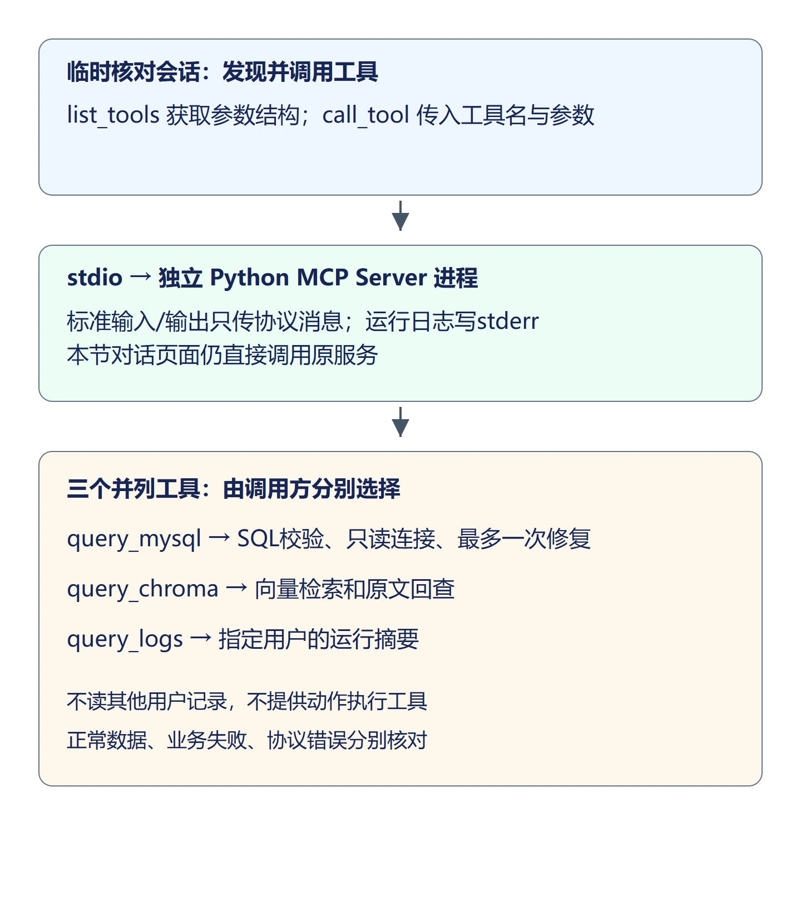

## 1. 把现有查询能力提供成工具

前面的图节点直接调用 Python 服务。本节先把 SQL、Chroma 和运行历史查询注册为 MCP 工具，让调用方能够发现工具名称、参数结构，并通过协议取得结果。图节点暂时继续使用原调用方式，下一节再接入正式 Client。

MCP 不会自动改善 SQL 的正确性，也不会自动选择工具。`query_mysql_tool` 收到问题后仍调用已有 NL2SQL 服务；白名单、只读账号和一次修复都继续生效。这里只改变能力的调用边界。



`stdio` 使用父子进程的标准输入输出通信，不需要新增 HTTP 端口。`stdout` 必须只传协议消息；日志使用 Python logging 默认的 `stderr`，不要在工具或导入模块里加 `print()`。

## 2. 安装兼容的 SDK

本课程成品使用 MCP Python SDK v1 的 `FastMCP`、`ClientSession` 接口，因此本节固定 v1 版本，不使用 v2 的不同导入方式。接口可参考 [官方 v1 文档（英文）](https://py.sdk.modelcontextprotocol.io/v1/)。

在 `backend/requirements.txt` 末尾增加：

```text
mcp==1.30.0
sse-starlette==3.0.3
```

`sse-starlette` 固定到与项目现有 FastAPI、Starlette 版本兼容的依赖，避免单独安装 MCP 时把已有 Web 框架依赖升级到不匹配的版本。在 `backend` 目录执行：

```powershell
pip install -r requirements.txt
pip check
```

`pip check` 应显示没有依赖冲突。数据库、模型、向量模型和 Chroma 配置继续沿用，Server 从后端目录的 `.env` 读取，不把密钥写进工具参数。

## 3. 封装三个工具实现

新建 `backend/app/mcp_server`，`__init__.py` 留空。

### 3.1 SQL 查询

新建 `backend/app/mcp_server/tools_mysql.py`：

```python
"""SQL工具复用只读连接、校验和最多一次修复。"""
from app.services import nl2sql_service

def query_mysql(question: str) -> dict:
    # 单独标记执行失败，使客户端仍能按既有统计失败分支处理。
    try:
        sql, rows, truncated = nl2sql_service.query_by_question(question)
        return {"ok": True, "sql": sql, "rows": rows, "truncated": truncated}
    except nl2sql_service.QueryExecutionError:
        return {"ok": False, "error_type": "query_execution", "error": "SQL修复后仍执行失败"}
```

成功结果保留 `sql`、原始 `rows` 和 `truncated`，不在工具里把查询结果改成回答文本。两次 SQL 执行均失败时返回 `ok=False` 和 `error_type="query_execution"`，供 Client 恢复已有的统计失败处理；配置、模型或输入校验异常继续交给 MCP 的工具错误机制。

### 3.2 Chroma 查询

新建 `backend/app/mcp_server/tools_chroma.py`：

```python
"""语义工具仍回查MySQL原文，保留既有相似度与商品范围契约。"""
from typing import Literal
from app.services import semantic_service

def query_chroma(query: str, kind: Literal["product", "review"], product_ids: list[int] | None = None) -> dict:
    # 空范围代表没有目标商品，不得改成None后扩大为全库。
    if product_ids == []:
        return {"ok": True, "rows": []}
    rows = semantic_service.search_records(query, kind, product_ids=product_ids)
    return {"ok": True, "rows": rows}
```

`kind` 区分商品和评价。`product_ids=None` 表示不限定商品；`[]` 表示没有目标，必须返回空结果。把 `[]` 改成 `None` 会将原本不应查询的补充检索扩大为全库检索。

结果继续使用 MySQL 当前原文与既有 `similarity`，不能把 Chroma 文本快照当成当前业务数据。候选数量沿用 `semantic_service.TOP_K`，不在工具边界另外定义一套排序或阈值。

### 3.3 运行历史查询

新建 `backend/app/mcp_server/tools_logs.py`：

```python
"""读取受信任调用方指定用户的运行摘要，不返回其他用户记录。"""
from sqlalchemy import select
from app.database import SessionLocal
from app.observability.models import AgentRun

def query_logs(user_id: int, keyword: str = "", limit: int = 5) -> dict:
    with SessionLocal() as db:
        query = select(AgentRun).where(AgentRun.user_id == user_id)
        if keyword.strip():
            # contains按字面包含匹配，避免%与_把检索范围扩大。
            query = query.where(AgentRun.question.contains(keyword.strip(), autoescape=True))
        runs = db.scalars(query.order_by(AgentRun.id.desc()).limit(limit))
        return {"ok": True, "runs": [{"run_id": row.id, "question": row.question,
                "status": row.status, "route": row.route, "elapsed_ms": row.elapsed_ms} for row in runs]}
```

日志是用户相关数据，所以查询必须带用户条件。`keyword` 按字面包含匹配，`%` 和 `_` 不作为扩大范围的通配符。工具只返回运行摘要，不向模型暴露其他用户的问题或反馈。

这里的 Server 是由受信任后端启动的私有本机工具进程，`user_id` 由调用方按已认证身份传入，不是公开用户接口的鉴权凭证。下一节的图调用从服务端 `AgentState.user_id` 取值，不能从问题文本或用户请求体指定其他人的编号。

## 4. 注册工具与参数结构

新建 `backend/app/mcp_server/server.py`：

```python
"""私有stdio工具进程；stdout只用于MCP协议，日志走stderr。"""
import logging
from typing import Annotated, Literal, Any
from pydantic import Field
from mcp.server.fastmcp import FastMCP
from app.mcp_server import tools_mysql, tools_chroma, tools_logs

logging.basicConfig(level=logging.INFO)
mcp = FastMCP("ecom-analysis-tools")
Question = Annotated[str, Field(min_length=1, max_length=1000)]

@mcp.tool()
def query_mysql_tool(question: Question) -> dict[str, Any]:
    """将自然语言问题转成校验后的只读SQL，返回原始行与截断标记。"""
    if not question.strip():
        raise ValueError("问题不能为空")
    return tools_mysql.query_mysql(question)

@mcp.tool()
def query_chroma_tool(query: Question, kind: Literal["product", "review"] = "review",
                      product_ids: list[Annotated[int, Field(gt=0)]] | None = None) -> dict[str, Any]:
    """检索指定类型与商品范围的语义候选，并回查当前原文。"""
    if not query.strip():
        raise ValueError("查询内容不能为空")
    return tools_chroma.query_chroma(query, kind, product_ids)

@mcp.tool()
def query_logs_tool(user_id: Annotated[int, Field(gt=0)], keyword: str = "",
                    limit: Annotated[int, Field(ge=1, le=20)] = 5) -> dict[str, Any]:
    """按已认证用户编号查询其运行摘要；调用方负责传入当前用户。"""
    return tools_logs.query_logs(user_id, keyword, limit)

def main():
    mcp.run(transport="stdio")

if __name__ == "__main__":
    main()
```

`@mcp.tool()` 将函数名和类型注解注册为工具描述。调用方通过 `list_tools()` 可以知道 `query_logs_tool` 需要正数 `user_id`、`limit` 只能是 1—20；不是靠读函数源码猜参数。

返回类型写为 `dict[str, Any]`，明确 JSON 对象的字符串键和数据值，让 SDK 提供 `structuredContent`。不能只写普通 `dict` 后就假定总有结构化结果。后续 Client 需要区分协议层 `isError` 和业务数据里的 `ok`：参数校验失败是工具错误，SQL 两次执行失败则是明确的业务失败。

在 `backend` 目录启动 Server 的命令是：

```powershell
python -m app.mcp_server.server
```

进程会等待 MCP 消息，不会出现普通 HTTP 服务首页，也不会监听浏览器端口。核对工具时由临时会话启动该命令，不需要同时手工再开一个 Server。

## 5. 通过协议核对发现和查询

在 `backend` 目录执行以下 PowerShell 命令。它只建立一次临时核对会话，不需要创建项目文件；所有查询通过 `stdio_client` 进入独立 Server 进程：

```powershell
@'
import asyncio
import sys
from pathlib import Path
from mcp import ClientSession, StdioServerParameters
from mcp.client.stdio import stdio_client

async def main():
    params = StdioServerParameters(
        command=sys.executable,
        args=["-m", "app.mcp_server.server"],
        cwd=str(Path.cwd()),
    )
    async with stdio_client(params) as (read, write):
        async with ClientSession(read, write) as session:
            await session.initialize()
            tools = await session.list_tools()
            print([tool.name for tool in tools.tools])
            result = await session.call_tool(
                "query_mysql_tool", {"question": "洗衣液 2L 的价格是多少"}
            )
            print(result.isError, result.structuredContent)
            if result.isError:
                # 工具错误没有正常数据结构，读取文本说明定位参数或配置问题。
                print([item.text for item in result.content if item.type == "text"])

asyncio.run(main())
'@ | python -
```

工具列表应包含 `query_mysql_tool`、`query_chroma_tool`、`query_logs_tool`，顺序不作要求。SQL 工具成功时 `isError=False`、结构化结果 `ok=True`，`rows` 中应有洗衣液 2L 的价格，数值与数据库一致。SQL 排版可以变化，只读限制和查询条件不能变化。

在同一段命令中，将 `session.call_tool()` 的工具名和参数分别替换为以下两组，核对语义和历史工具：

```python
            result = await session.call_tool(
                "query_chroma_tool",
                {"query": "轻云运动跑鞋鞋帮磨脚", "kind": "review", "product_ids": [1]},
            )
```

评价候选都应属于商品 1，并包含 `id`、`product_id`、`rating`、`content` 和 `similarity`。将 `product_ids` 改为 `[]`，应返回空 `rows`，而不是其他商品候选。

```python
            result = await session.call_tool(
                "query_logs_tool", {"user_id": 1, "keyword": "洗衣液", "limit": 5}
            )
```

将 `user_id` 替换为当前要核对的本机用户编号，结果只能来自该用户；没有匹配记录时返回空 `runs`，不能改为读取其他用户记录。这里是受信任本机调用，不是前端传用户编号的示范。

把 `limit` 改成 `0`，或调用不存在的工具名，`isError` 应为 `True`。错误结果没有正常查询结构，不能继续按 `rows` 解包；查看返回的错误文本，核对参数、模型配置或索引。退出临时会话后子进程也应结束；工具结果不应被普通日志污染。

对话页面继续提交价格问题，仍能完成原有查询与回答。本节尚未切换图的服务调用，不能仅凭页面正常就认定已经经过 MCP，应以上面的协议会话结果核对工具。

## 6. 本节代码下载

本节结束代码：[lesson-20-end（Release）](https://github.com/codenice-ai-org/ecom-analysis-agent/releases/tag/lesson-20-end)。在 Release 页面的 **Assets → Source code (zip)** 下载完整项目。

下一节将封装 MCP Client，把图中的 SQL、语义和日志查询接到这些工具，并处理连接失败与资源释放。
