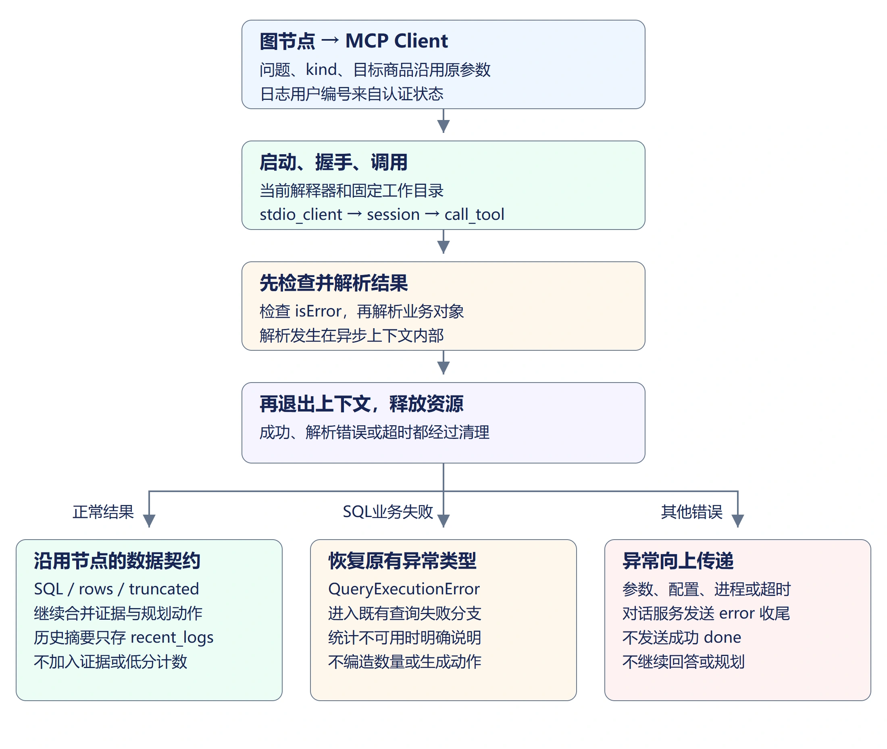
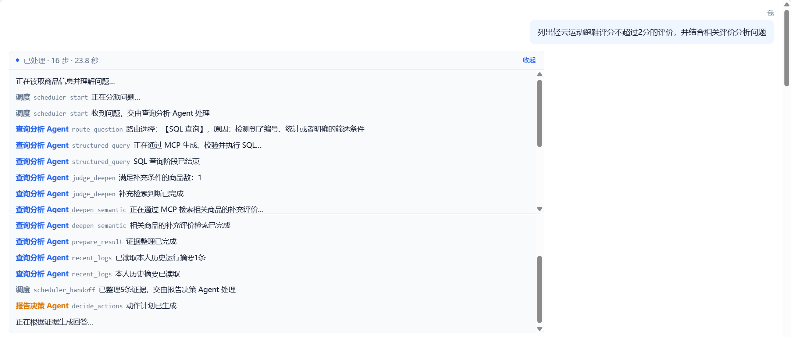
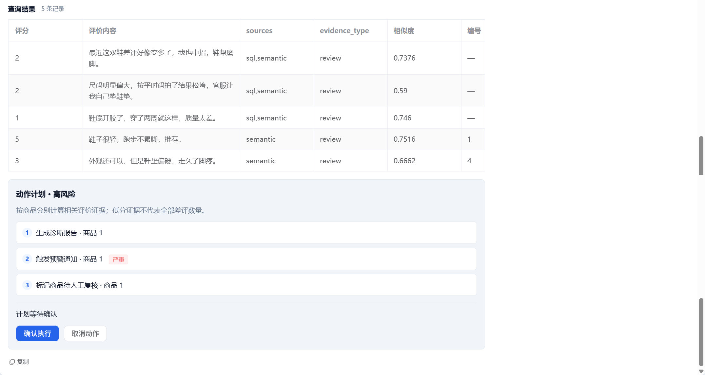
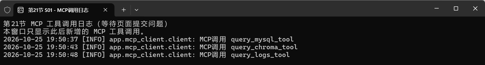

## 1. 从节点调用到跨进程工具调用

上一节已经通过临时会话发现并调用三个工具。本节将 Client 封装到项目中，把图节点原先的 SQL、语义查询切换为 MCP 调用，并接入本人历史摘要查询。

例如 SQL 节点把“洗衣液 2L 的价格是多少”交给 Client，Client 用当前 Python 解释器启动 Server，通过 `query_mysql_tool` 得到 SQL、结果行和截断标记。节点继续使用这些字段，前端不需要知道子进程如何通信。



本节每次工具调用都在上下文中创建和关闭会话、子进程，便于明确资源归属。连续调用多个工具会重复启动进程，耗时会包含这些启动开销；不会因页面还开着就保留一个无法定位归属的子进程。

## 2. 实现 Client 与结果解析

新建 `backend/app/mcp_client`，`__init__.py` 留空。新建 `client.py`：

```python
"""同步图节点调用异步MCP；每次调用的会话和子进程在上下文内关闭。"""
import asyncio
import json
import logging
import os
import sys
from pathlib import Path
from typing import Any
from mcp import ClientSession, StdioServerParameters
from mcp.client.stdio import stdio_client
from app.services import nl2sql_service

logger = logging.getLogger(__name__)
BACKEND_ROOT = Path(__file__).resolve().parents[2]
CALL_TIMEOUT_SECONDS = 120
TOOLS = {"query_mysql_tool", "query_chroma_tool", "query_logs_tool"}


def server_params():
    env = os.environ.copy()
    env["PYTHONIOENCODING"] = "utf-8"
    env["PYTHONPATH"] = str(BACKEND_ROOT) + os.pathsep + env.get("PYTHONPATH", "")
    return StdioServerParameters(command=sys.executable,
        args=["-m", "app.mcp_server.server"], cwd=str(BACKEND_ROOT), env=env)


def parse_result(result) -> dict[str, Any]:
    # 协议错误没有正常业务结构，先判断错误标记，不能直接读取rows。
    if result.isError:
        raise ValueError("MCP工具执行失败，请检查后端日志")
    data = result.structuredContent
    # 对没有结构化内容的兼容响应，只接受能解析为JSON对象的文本块。
    if not isinstance(data, dict):
        texts = [block.text for block in result.content if getattr(block, "type", "") == "text"]
        data = json.loads("\n".join(texts))
    if not isinstance(data, dict) or not isinstance(data.get("ok"), bool):
        raise ValueError("MCP工具返回结构不正确")
    return data


async def _call_async(name, arguments):
    # 超时覆盖启动、握手、查询；无论成功失败都先退出会话并关闭子进程。
    async with asyncio.timeout(CALL_TIMEOUT_SECONDS):
        async with stdio_client(server_params()) as (read, write):
            async with ClientSession(read, write) as session:
                await session.initialize()
                result = await session.call_tool(name, arguments)
                return parse_result(result)


def call_tool(name: str, arguments: dict[str, Any]) -> dict[str, Any]:
    if name not in TOOLS:
        raise ValueError("不支持的MCP工具")
    logger.info("MCP调用 %s", name)
    try:
        return asyncio.run(_call_async(name, arguments))
    except Exception as exc:
        # SDK任务组可能把底层异常包成ExceptionGroup，日志保留原异常链。
        logger.exception("MCP调用失败 tool=%s", name)
        raise ValueError("MCP工具调用失败，请检查解释器、配置与后端日志") from exc


def query_mysql(question):
    data = call_tool("query_mysql_tool", {"question": question})
    # 明确的SQL执行失败还原为原异常类型，让图保留统计失败分支。
    if not data["ok"]:
        if data.get("error_type") == "query_execution":
            raise nl2sql_service.QueryExecutionError(data.get("error", "SQL执行失败"))
        raise ValueError(data.get("error", "SQL工具失败"))
    return data["sql"], data["rows"], data["truncated"]


def query_chroma(query, kind, product_ids=None):
    data = call_tool("query_chroma_tool", {"query": query, "kind": kind, "product_ids": product_ids})
    if not data["ok"]:
        raise ValueError(data.get("error", "语义工具失败"))
    return data["rows"]


def query_logs(user_id, keyword="", limit=5):
    data = call_tool("query_logs_tool", {"user_id": user_id, "keyword": keyword, "limit": limit})
    if not data["ok"]:
        raise ValueError(data.get("error", "日志工具失败"))
    return data["runs"]
```

### 2.1 解释器和工作目录

`sys.executable` 指向运行后端的解释器，使子进程能使用同一虚拟环境中安装的 SDK、数据库和向量依赖。`BACKEND_ROOT` 固定为 `backend`，避免从不同目录启动后找不到 `app` 或 `.env`。

环境沿用父进程，同时补充模块搜索路径与 UTF-8 输出。密钥仍留在环境配置中，不拼接到命令行参数或日志。

### 2.2 同步节点如何调用异步会话

`stdio_client` 和 `ClientSession` 都使用异步上下文，成功、异常或超时都要经过退出处理。`asyncio.timeout()` 覆盖启动、握手与工具调用，不只限制最后一次网络请求。

当前图节点是同步函数，由 FastAPI 在工作线程驱动，因此同步入口用 `asyncio.run()` 执行一次完整会话。不要把这一入口直接嵌入已运行的异步事件循环；如果后续把节点改成异步函数，需要改用 `await`。

### 2.3 保留失败的含义

先检查 `isError`，再解析 `structuredContent`；没有结构化内容的兼容响应才读取文本 JSON。结果必须是带布尔 `ok` 的字典，不能把格式错误当作查询到零条。

SQL 工具的 `error_type="query_execution"` 会还原为现有 `nl2sql_service.QueryExecutionError`。这样两次 SQL 执行失败后，图仍可返回统计不可用说明；解释器、配置或连接错误则抛出 `ValueError`，由对话服务发送 `error` 并结束，不会继续生成回答或发送成功 `done`。

## 3. 切换查询节点，保持证据处理不变

在 `backend/app/agent/nodes.py` 增加模块导入：

```python
from app.mcp_client import client as mcp_client
```

在 `node_structured_query()` 中，将调用查询服务的一行替换为：

```python
        sql, rows, truncated = mcp_client.query_mysql(state["question"])
```

原来的 `except nl2sql_service.QueryExecutionError`、`_review_fields(sql)` 和字段返回保持不变。Client 已经恢复了同一个异常类型和成功三元组，因此不需要另写一套失败或列来源检查。

在 `node_deepen_semantic()` 中，将检索调用替换为：

```python
    rows = mcp_client.query_chroma(
        state["question"], "review", product_ids=targets
    )
```

在 `node_semantic_query()` 中改为：

```python
    rows = mcp_client.query_chroma(state["question"], state["kind"])
```

保留空目标检查、相关性过滤、按评价编号去重、来源合并和统计口径限制。MCP 只负责跨进程调用，不替代这些业务规则。

将上述三个节点的 `_progress()` 消息分别改为“正在通过 MCP 生成、校验并执行 SQL…”“正在通过 MCP 检索相关商品的补充评价…”“正在通过 MCP 进行语义检索并回查原文…”，让过程区能对应实际调用位置。

## 4. 历史摘要独立保存

在 `AgentState` 中追加：

```python
    # 历史摘要只用于过程回看，不混入本轮证据或动作计数。
    recent_logs: list[dict[str, Any]]
```

在 `nodes.py` 末尾追加：

```python
def node_recent_logs(state: AgentState) -> dict[str, Any]:
    # 用户编号来自API认证后写入的状态，不从问题文本中提取。
    rows = mcp_client.query_logs(state["user_id"])
    # 最近摘要可能包含正在执行的本轮，排除后只保留此前运行。
    rows = [row for row in rows if row["run_id"] != state.get("run_id")]
    _progress("recent_logs", f"已读取本人历史运行摘要{len(rows)}条")
    return {"recent_logs": rows, "current_agent": "analysis", "agent_label": "查询分析 Agent"}
```

这里先查询当前用户的最近运行，再排除正在执行的本轮。历史摘要只进入 `recent_logs`，不能合并到 `evidence`：历史中的低分、错误或商品编号都不能当成本次新查到的评价。

在 `graph.py` 的 `build_analysis_graph()` 中增加注册：

```python
    builder.add_node("recent_logs", record_node("recent_logs", nodes.node_recent_logs))
```

将 `builder.add_edge("prepare_result", "scheduler_handoff")` 替换为：

```python
    builder.add_edge("prepare_result", "recent_logs")
    builder.add_edge("recent_logs", "scheduler_handoff")
```

在 `chat_service.py` 的 `_NODE_MESSAGES` 中增加 `"recent_logs": "本人历史摘要已读取"`，并在 `done_event` 字典中增加：

```python
            "recent_logs": final_state.get("recent_logs", []),
```

图中完成消息和数据库步骤可用于核对日志工具实际运行，前端表格继续只显示本次证据。

## 5. 核对完整调用链

重启后端以重新编译图。提交“洗衣液 2L 的价格是多少”，过程区应出现通过 MCP 查询和读取本人历史摘要的消息；回答仍使用数据库价格，`done.result` 仍带 `sql`、`columns`、`rows`、`truncated`。

再提交“列出轻云运动跑鞋评分不超过 2 分的评价，并结合相关评价分析问题”。本轮依次调用 SQL、限定商品 1 的补充语义检索、本人日志；同一评价的 SQL 与 semantic 来源仍合成一条。三条低分证据仍规划三个动作，高风险仍需要确认。



`recent_logs` 的历史摘要不计入本轮5条评价证据。3条低分评价的 `sql,semantic` 表示来源合并；另外2条语义候选不属于评分不超过2分的统计范围。三个动作仍处于待确认状态。



提交“有哪些评价提到鞋帮磨脚”，应进入直接语义分支，经 Chroma 与日志工具完成，不为这个问题额外调用 SQL 工具。候选不足时仍说明证据不足，不编造原因。

在后端日志中查看 `MCP调用 query_mysql_tool`、`query_chroma_tool`、`query_logs_tool`；工具子进程的模型 HTTP 请求日志出现在相应调用期间。仅看到前端表格不能证明走了 MCP，需结合节点消息与工具调用日志核对。



### 5.1 错误与恢复

按第 14 节的 SQL 故障核对方式，只在 `nl2sql_service.generate_sql()` 中临时生成无效字段 SQL，保留模型修复调用。修复成功后页面只显示实际执行成功的 SQL，不能保留原错误 SQL。当初次和修复 SQL 都失败，仍应说明统计不可用，不做补充语义检索，也不生成动作。

还原时保留 `month_bounds` 和 `sql_question`：

```python
    sql = llm_service.complete_text(
        SYSTEM_PROMPT + "\n" + month_bounds, sql_question
    )
```

这里修改的是 Server 复用的查询服务，不是在图节点中直接调用本地服务绕开 MCP。恢复后提交“本月全店有多少个商品”，核对 SQL 包含本月开始及下月开始的半开日期边界。

工具进程启动失败或不可用时，页面应显示 MCP 调用失败，停止计时并恢复输入，不发送成功 `done`；后端日志保留具体异常链。恢复解释器与配置后再提交正常问题，应能重新建立一次会话完成查询，而不是复用之前损坏的连接。

## 6. 本节代码下载

本节结束代码：[lesson-21-end（Release）](https://github.com/codenice-ai-org/ecom-analysis-agent/releases/tag/lesson-21-end)。在 Release 页面的 **Assets → Source code (zip)** 下载完整项目。

下一节将描述买家晒图，把可见的图片内容与评价文字一起加入语义索引，并处理图片描述失败与索引重建。
