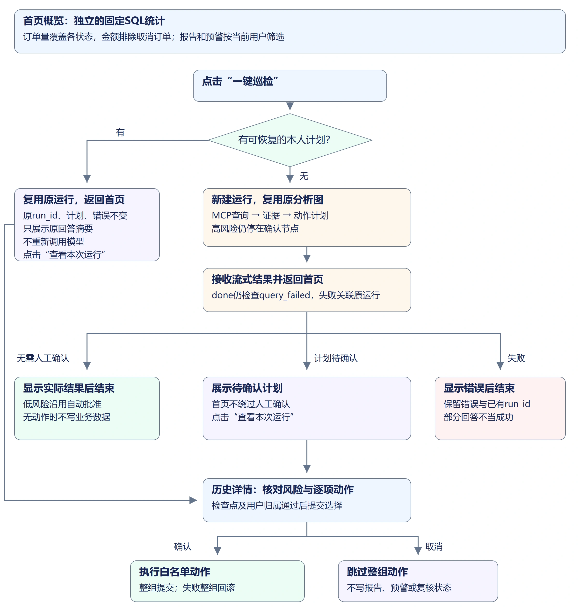
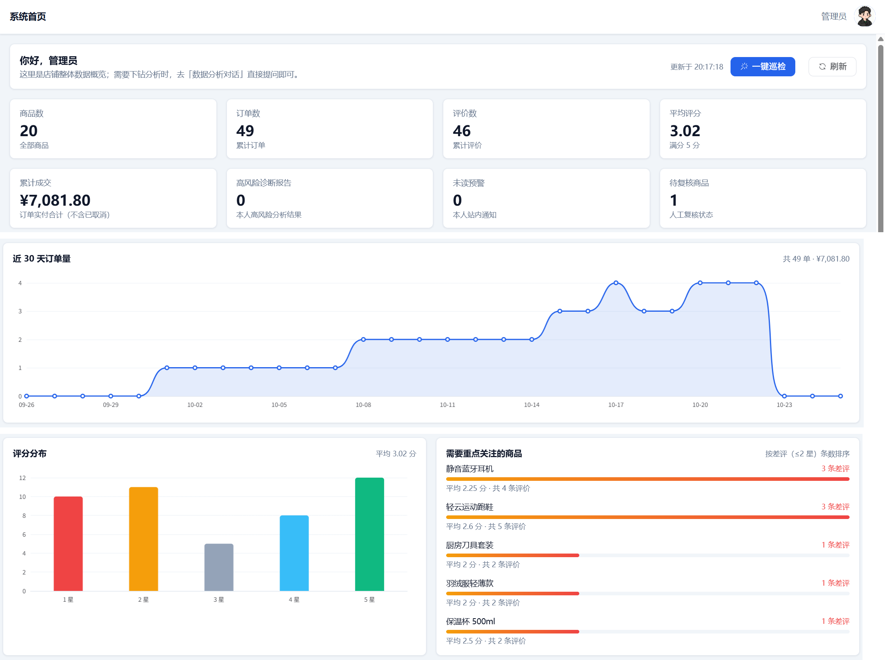
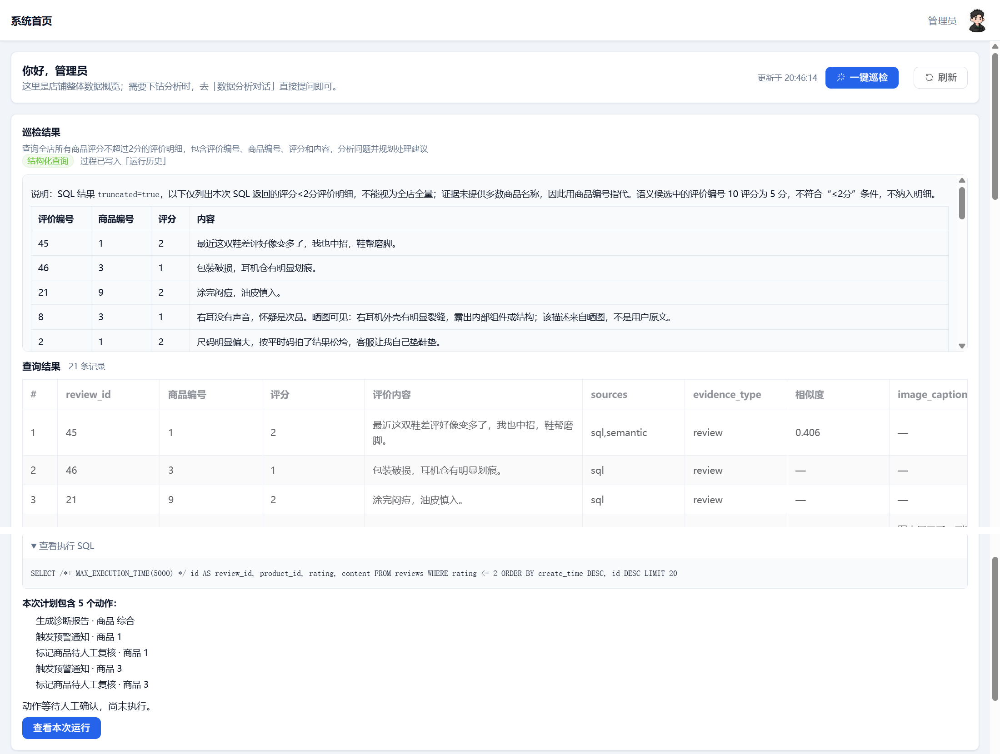
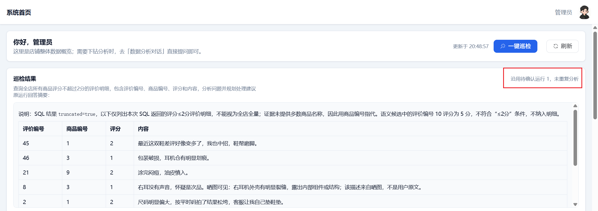
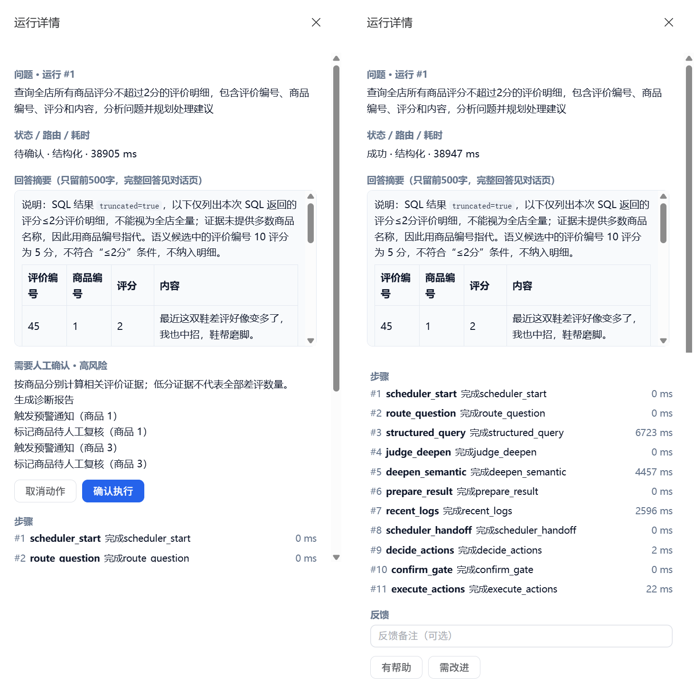

## 1. 首页统计与巡检分别解决什么

首页需要直接展示业务规模、订单趋势、评分分布和口碑较差的商品。这些是确定的统计口径，使用固定 SQL 聚合，不需要每次让模型生成 SQL。

一键巡检则复用已有分析图：查询低分评价明细，组织证据，规划报告、预警和商品复核，再等待人工确认。首页按钮不会绕过确认直接修改商品。



例如点击巡检后得到运行 10 和待确认计划。再次点击时，如果运行 10 的检查点仍可恢复，就继续使用这份计划；到历史中确认后，报告和预警仍关联这次分析，不应出现另一次查询替换原计划。

## 2. 明确首页统计口径

商品数、订单数、评价数覆盖全店业务数据。订单数包含已取消订单；成交额只合计 `status != "cancelled"` 的订单金额，包括已支付、已发货和已完成状态。不能只排除总卡片里的取消金额，却把取消金额加进每日趋势。

平均评分按全部评价计算；低分排行按 1—2 分评价条数倒序、平均评分升序排序，相同时按商品编号稳定排序。没有评价的商品不进入这个口碑排行。报告与预警属于用户分析结果，只显示当前用户自己的记录；商品复核状态属于共享商品数据。

新建 `backend/app/services/overview_service.py`：

```python
"""首页业务规模与口碑统计；金额排除取消订单，个人记录限制用户。"""
from datetime import date, timedelta
from decimal import Decimal
from sqlalchemy import select, func, case
from sqlalchemy.orm import Session
from app.models.product import Product
from app.models.order import Order
from app.models.review import Review
from app.models.diagnosis_report import DiagnosisReport
from app.models.alert_notification import AlertNotification


def get_overview(db: Session, user_id: int, trend_days: int = 30):
    count = lambda model, *where: db.scalar(select(func.count()).select_from(model).where(*where)) or 0
    amount = db.scalar(select(func.sum(Order.amount)).where(Order.status != "cancelled")) or Decimal("0")
    cards = {
        "product_count": count(Product), "order_count": count(Order),
        "review_count": count(Review),
        "avg_rating": round(float(db.scalar(select(func.avg(Review.rating))) or 0), 2),
        "total_amount": str(amount.quantize(Decimal("0.01"))),
        "pending_review_products": count(Product, Product.review_status == "pending_review"),
        "high_risk_reports": count(DiagnosisReport, DiagnosisReport.created_by == user_id, DiagnosisReport.risk_level == "high"),
        "unread_alerts": count(AlertNotification, AlertNotification.created_by == user_id, AlertNotification.is_read == 0),
    }
    today = date.today()
    start = today - timedelta(days=trend_days-1)
    day = func.date(Order.create_time)
    # 订单量包含各状态，金额只合计非取消订单，和总成交额使用同一口径。
    trend_rows = db.execute(select(day, func.count(Order.id),
        func.sum(case((Order.status != "cancelled", Order.amount), else_=0)))
        .where(Order.create_time >= start, Order.create_time < today+timedelta(days=1))
        .group_by(day)).all()
    by_day = {str(d): (n, value) for d, n, value in trend_rows}
    trend = []
    for offset in range(trend_days):
        current = (start+timedelta(days=offset)).isoformat()
        n, value = by_day.get(current, (0, Decimal("0")))
        trend.append({"date": current, "count": n, "amount": str(value.quantize(Decimal("0.01")))})
    rating_counts = dict(db.execute(select(Review.rating, func.count()).group_by(Review.rating)).all())
    ratings = [{"rating": star, "count": rating_counts.get(star, 0)} for star in range(1, 6)]
    bad = func.sum(case((Review.rating.between(1, 2), 1), else_=0))
    worst = db.execute(select(Product.id, Product.name, func.count(Review.id), func.avg(Review.rating), bad)
        .join(Review, Product.id == Review.product_id).group_by(Product.id, Product.name)
        .order_by(bad.desc(), func.avg(Review.rating), Product.id).limit(5)).all()
    alerts = db.scalars(select(AlertNotification).where(AlertNotification.created_by == user_id)
        .order_by(AlertNotification.id.desc()).limit(5))
    return {"cards": cards, "trend_days": trend_days, "order_trend": trend,
        "rating_distribution": ratings,
        "worst_products": [{"product_id": pid, "product_name": name, "review_count": n,
                            "avg_rating": round(float(avg), 2), "bad_count": low} for pid,name,n,avg,low in worst],
        "recent_alerts": [{"id": row.id, "product_id": row.product_id, "content": row.content,
                           "is_read": row.is_read, "level": row.level} for row in alerts]}
```

趋势按今天向前 30 个自然日，包含今天；没有订单的日期补零，不能从有订单的最早日期开始挤掉空白天。查询范围使用开始日到明日零点的半开区间，避免漏掉今天晚上的订单。

金额计算在后端使用数据库 `Numeric` 和 `Decimal`，返回两位小数字符串。前端转成数值只用于图表和展示，不把前端浮点合计当成账务统计结果。

在 `backend/app/api/ecommerce.py` 的服务导入中增加 `overview_service`，文件末尾追加：

```python
@router.get("/overview")
def overview(
    current_user: Annotated[User, Depends(get_current_user)],
    db: Annotated[Session, Depends(get_db)],
    trend_days: Annotated[int, Query(ge=7, le=90)] = 30,
):
    return Response.success(data=overview_service.get_overview(db, current_user.id, trend_days))
```

`trend_days` 限制为 7—90 天，避免无边界查询。用户编号来自认证依赖，个人报告、预警的筛选不接受前端自选用户。

## 3. 为巡检复用同一份待确认计划

新建 `backend/app/services/patrol_service.py`：

```python
"""一键巡检复用对话图，并复用当前用户尚可恢复的同一巡检计划。"""
import json
from threading import Lock
from sqlalchemy import select
from app.database import SessionLocal
from app.observability.models import AgentRun
from app.agent import graph
from app.services import chat_service, confirmation_service

PATROL_QUESTION = "查询全店所有商品评分不超过2分的评价明细，包含评价编号、商品编号、评分和内容，分析问题并规划处理建议"
_patrol_lock = Lock()


def _pending_patrol(user_id):
    with SessionLocal() as db:
        runs = list(db.scalars(select(AgentRun).where(AgentRun.user_id == user_id,
            AgentRun.question == PATROL_QUESTION)
            .order_by(AgentRun.id.desc())))
        # 回答失败或断流后仍可能保留待确认计划，不能只凭运行状态筛掉。
        for run in runs:
            pending = confirmation_service.get_pending_confirmation(run.thread_id, user_id)
            # 历史中有等待记录还不够；必须确认当前检查点仍可恢复。
            if pending is None:
                continue
            state = graph.get_analysis_graph().get_state({"configurable": {"thread_id": run.thread_id}}).values
            return {"run_id": run.id, "thread_id": run.thread_id, "question": run.question,
                    "answer": run.answer_preview, "confirmation": pending, "result": state.get("result"),
                    "plan": {"pending_actions": pending["actions"], "risk_level": pending["risk_level"]},
                    "error": run.error_message, "reused": True}
    return None


def run_patrol(user_id):
    # 单进程下将检查复用与新建巡检放在同一把锁内，避免连点创建重复待确认计划。
    with _patrol_lock:
        existing = _pending_patrol(user_id)
        if existing:
            return existing
        answer = ""
        result = {"question": PATROL_QUESTION, "error": None, "reused": False}
        for frame in chat_service.stream_chat(PATROL_QUESTION, user_id=user_id):
            event, data = frame.split("\n", 1)
            payload = json.loads(data.removeprefix("data: ").strip())
            if event == "event: token":
                answer += payload.get("content", "")
            elif event == "event: done":
                result.update(payload)
                # done只表示流已结束；SQL查询失败仍按巡检失败展示。
                if payload.get("query_failed"):
                    result["error"] = "巡检数据库查询失败，请查看本次运行"
            elif event == "event: error":
                # 保留原运行定位信息，失败详情仍可从历史查看。
                result.update({"error": payload.get("message"), "run_id": payload.get("run_id"),
                               "thread_id": payload.get("thread_id")})
        # 完整回答在当前页面展示；历史表仍按既有规则只保留摘要。
        return {**result, "answer": answer}
```

固定问题要求评价明细并明确四个身份字段，不使用“差评最多有多少”这样的聚合问题规划动作。聚合行不是逐条评价，前面的规则会正确跳过它；不能为了产生动作而把统计行伪装成评价。

巡检仍沿用 SQL 行数限制及补充检索规则。返回证据可能截断，低分条数表示当前证据范围，不是每个商品的全量差评数量；首页排行是全量聚合，两者承担不同用途。

`_pending_patrol()` 查询同一用户、同一固定问题的历史，再逐条检查当前图是否仍有待确认计划。图先暂停、再生成回答，回答失败或断流时运行可能是 `error` 或 `interrupted`，检查点却仍可恢复，因此不能只筛选 `awaiting_confirm`。服务重启后旧历史还在，失效的检查点则会被跳过。

复用时返回原 `run_id`、计划和错误信息，页面将已有回答标为摘要；失败或部分回答不会因重复点击而变成完整成功。只有找不到可恢复计划时才重新分析。

检查与创建放在同一把进程锁内，两个请求不能同时通过“没有待确认任务”的判断后各自新建一份计划。它沿用单进程前提，不替代多进程部署所需的共享状态和幂等约束。

新建 `backend/app/api/patrol.py`：

```python
from typing import Annotated
from fastapi import APIRouter, Depends
from app.common.response import Response
from app.dependencies.auth import get_current_user
from app.models.user import User
from app.services import patrol_service

router = APIRouter(prefix="/patrol", tags=["一键巡检"])


@router.post("/run")
def run_patrol(current_user: Annotated[User, Depends(get_current_user)]):
    # 用户归属始终来自认证，前端不能替换巡检问题或指定其他用户。
    return Response.success(data=patrol_service.run_patrol(current_user.id))
```

在 `backend/app/api/__init__.py` 中追加：

```python
from app.api import patrol
api.include_router(patrol.router)
```

前端只能触发固定巡检，不能提交其他用户编号或改写后台巡检问题。返回值带 `run_id`、计划、证据和待确认信息，复用已有图的用户归属与异常处理。

## 4. 失败也关联原运行

在 `backend/app/services/chat_service.py` 的外层 `stream_chat()` 中，找到记录最终状态后的 `terminal = True`，在其后、`yield frame` 前增加：

```python
                # 巡检失败也返回同一运行的定位信息，历史页可查看错误记录。
                if event == "event: error":
                    frame = _sse("error", {**payload, "run_id": run_id, "thread_id": thread_id})
```

创建运行记录本身失败时还没有 `run_id`，不能编造编号。已经创建运行但查询或回答失败时，巡检可以把错误与实际运行编号一起显示，用户能到历史查看失败位置。

## 5. 首页图表的容器与资源释放

本节沿用第19节引入的 ECharts 6.1.0，为首页新增订单趋势与评分分布。从前置代码继续时，在 `frontend` 目录执行以下命令，确保图表依赖就绪：

```powershell
npm install echarts@6.1.0 --save-exact
```

保留安装后的 `package.json` 和 `package-lock.json`；已经使用该版本时，仍沿用同一版本。

新建 `frontend/src/components/OverviewCharts.vue`：

```vue
<template>
  <div class="overview-charts">
    <div class="content-card">
      <div class="panel-head">
        <span class="panel-title">近 {{ stats.trend_days }} 天订单量</span>
        <span class="panel-sub">共 {{ trendTotal }} 单 · {{ formatMoney(trendAmount) }}</span>
      </div>
      <div ref="trendRef" class="chart" />
    </div>
    <div class="dash-row">
      <div class="content-card">
        <div class="panel-head">
          <span class="panel-title">评分分布</span>
          <span class="panel-sub">平均 {{ stats.cards.avg_rating }} 分</span>
        </div>
        <div ref="ratingRef" class="chart" />
      </div>
      <div class="content-card">
        <div class="panel-head">
          <span class="panel-title">需要重点关注的商品</span>
          <span class="panel-sub">按差评（≤2 星）条数排序</span>
        </div>
        <ul v-if="stats.worst_products.length" class="rank-list">
          <li v-for="item in stats.worst_products" :key="item.product_id" class="rank-item">
            <div class="rank-item__head">
              <span class="rank-item__name">{{ item.product_name }}</span>
              <span class="rank-item__bad">{{ item.bad_count }} 条差评</span>
            </div>
            <div class="rank-item__bar"><span class="rank-item__bar-inner" :style="{ width: badBarWidth(item.bad_count) }" /></div>
            <div class="rank-item__meta">平均 {{ item.avg_rating }} 分 · 共 {{ item.review_count }} 条评价</div>
          </li>
        </ul>
        <el-empty v-else description="暂无评价数据" :image-size="60" />
      </div>
    </div>
  </div>
</template>
<script setup>
import { computed, onMounted, onBeforeUnmount, ref, watch } from 'vue'
import * as echarts from 'echarts'

const props = defineProps({ stats: { type: Object, required: true } })
const trendRef = ref(), ratingRef = ref()
let trendChart, ratingChart, observer
const trendTotal = computed(() => props.stats.order_trend.reduce((sum, row) => sum + row.count, 0))
// 金额由接口返回字符串，先转成分相加，再转回元，避免字符串拼接和小数累积误差。
const trendAmount = computed(() => props.stats.order_trend.reduce(
  (sum, row) => sum + Math.round(Number(row.amount) * 100), 0
) / 100)
const maxBadCount = computed(() => Math.max(1, ...props.stats.worst_products.map(row => row.bad_count)))
function formatMoney(value) {
  return `¥${Number(value || 0).toLocaleString('zh-CN', { minimumFractionDigits: 2, maximumFractionDigits: 2 })}`
}
function badBarWidth(count) {
  // 按当前排行最大低分条数缩放，最短保留6%便于看清，不表示差评率。
  return `${Math.max(6, Math.round(count / maxBadCount.value * 100))}%`
}
function render() {
  // 容器挂载且具有高度后才能初始化，数据变化复用原实例。
  if (!trendRef.value || !ratingRef.value) return
  trendChart ||= echarts.init(trendRef.value)
  ratingChart ||= echarts.init(ratingRef.value)
  const points = props.stats.order_trend
  const textStyle = { color: '#64748b', fontFamily: 'inherit' }
  trendChart.setOption({
    color: ['#2563eb'], textStyle,
    grid: { left: 8, right: 16, top: 24, bottom: 8, containLabel: true },
    tooltip: {
      trigger: 'axis',
      formatter: params => {
        // 使用原始完整日期和同一天的金额，横轴只缩短显示，统计口径不变。
        const point = points[params[0].dataIndex]
        return `${point.date}<br/>订单 ${point.count} 单<br/>成交 ${formatMoney(point.amount)}`
      }
    },
    xAxis: {
      type: 'category', boundaryGap: false, data: points.map(row => row.date.slice(5)),
      axisLine: { lineStyle: { color: '#e2e8f0' } }, axisTick: { show: false },
      axisLabel: { interval: Math.max(0, Math.ceil(points.length / 10) - 1) }
    },
    yAxis: { type: 'value', minInterval: 1, splitLine: { lineStyle: { color: '#f1f5f9' } } },
    series: [{ name: '订单量', type: 'line', smooth: true, symbolSize: 6,
      data: points.map(row => row.count), areaStyle: { opacity: 0.12 } }]
  }, true)
  const colors = { 1: '#ef4444', 2: '#f59e0b', 3: '#94a3b8', 4: '#38bdf8', 5: '#10b981' }
  ratingChart.setOption({
    textStyle, grid: { left: 8, right: 16, top: 24, bottom: 8, containLabel: true },
    tooltip: { trigger: 'axis', valueFormatter: value => `${value} 条` },
    xAxis: { type: 'category', data: props.stats.rating_distribution.map(row => `${row.rating} 星`),
      axisLine: { lineStyle: { color: '#e2e8f0' } }, axisTick: { show: false } },
    yAxis: { type: 'value', minInterval: 1, splitLine: { lineStyle: { color: '#f1f5f9' } } },
    series: [{ name: '评价数', type: 'bar', barMaxWidth: 48,
      data: props.stats.rating_distribution.map(row => ({ value: row.count,
        itemStyle: { color: colors[row.rating] || '#2563eb', borderRadius: [4, 4, 0, 0] } })) }]
  }, true)
}
onMounted(() => {
  render()
  observer = new ResizeObserver(() => { trendChart?.resize(); ratingChart?.resize() })
  observer.observe(trendRef.value)
  observer.observe(ratingRef.value)
})
watch(() => props.stats, render)
onBeforeUnmount(() => {
  // 路由离开后容器会移除，先解除监听再销毁实例。
  observer?.disconnect()
  trendChart?.dispose()
  ratingChart?.dispose()
})
</script>
<style scoped>
.overview-charts { display: flex; flex-direction: column; gap: var(--app-space-gap); }
.dash-row { display: grid; grid-template-columns: repeat(2, minmax(0, 1fr)); gap: var(--app-space-gap); }
.content-card { min-width: 0; }
.panel-head { display: flex; flex-wrap: wrap; align-items: baseline; justify-content: space-between; gap: 12px; margin-bottom: 8px; }
.panel-title { font-size: 14px; font-weight: 600; color: var(--app-text); }
.panel-sub { font-size: 12px; color: var(--app-text-secondary); }
.chart { width: 100%; height: 240px; }
.rank-list { margin: 0; padding: 0; list-style: none; }
.rank-item + .rank-item { margin-top: 14px; }
.rank-item__head { display: flex; align-items: center; justify-content: space-between; gap: 8px; }
.rank-item__name { font-size: 13px; color: var(--app-text); }
.rank-item__bad { font-size: 12px; color: #ef4444; flex-shrink: 0; }
.rank-item__bar { margin: 6px 0 4px; height: 6px; border-radius: 999px; background: #f1f5f9; overflow: hidden; }
.rank-item__bar-inner { display: block; height: 100%; border-radius: 999px; background: linear-gradient(90deg, #f59e0b, #ef4444); }
.rank-item__meta { font-size: 12px; color: var(--app-text-secondary); }
@media (max-width: 1100px) { .dash-row { grid-template-columns: minmax(0, 1fr); } }
</style>
```

图表容器必须有实际高度，挂载后再初始化；接口数据变化时复用实例更新配置。`ResizeObserver` 在侧栏或页面宽度变化时调整尺寸，离开路由时解除监听并 `dispose()`，避免多次进入首页积累实例。相关机制见 [ECharts 图表容器文档（英文）](https://echarts.apache.org/handbook/en/concepts/chart-size/)。

订单趋势通栏显示订单量，横轴只显示月日，悬停时显示完整日期、当天订单量及非取消订单金额。例如接口的金额 `"39.90"` 是字符串，汇总时先转成分再相加，不能用 `+` 直接拼接成另一段文字。评分分布按 1—5 星分别着色，柱高表示该分数的评价条数，不是平均分。

商品排行与评分分布并排展示，条形长度按当前排行中的最大低分条数缩放，辅助比较数量，不表示差评率。例如最大值为 3 条时，3 条对应 100%，1 条约为 33%；实际条数、平均分及全部评价数仍分别显示。

## 6. 展示概览、巡检和历史入口

首页按顶部操作区、八张统计卡片、订单趋势、评分与商品排行、最近预警排列。统计卡片在宽屏为每行四张，窄屏改为两列或单列；“一键巡检”和“刷新”放在顶部，巡检结果出现在操作区下方。布局使用已有主题中的间距、圆角与颜色变量。

将 `frontend/src/views/Home.vue` 替换为：

```vue
<template>
  <div class="page-container dashboard">
    <div class="content-card dash-head">
      <div class="dash-head__text">
        <div class="dash-head__title">你好，{{ userInfo?.name || userInfo?.username || '同学' }}</div>
        <div class="dash-head__sub">这里是店铺整体数据概览；需要下钻分析时，去「数据分析对话」直接提问即可。</div>
      </div>
      <div class="dash-head__side">
        <span v-if="updatedAt" class="dash-head__time">更新于 {{ updatedAt }}</span>
        <el-tooltip placement="bottom" content="按固定问题执行分析，需人工确认的动作仍在运行历史中处理">
          <el-button type="primary" :icon="MagicStick" :loading="patrolling" :disabled="patrolling || loading" @click="runPatrol">一键巡检</el-button>
        </el-tooltip>
        <el-button :icon="Refresh" :loading="loading" :disabled="loading || patrolling" @click="load">刷新</el-button>
      </div>
    </div>
    <el-alert v-if="error" :title="error" type="error" :closable="false" />

    <div v-if="patrol" class="content-card patrol-card">
      <div class="panel-head">
        <span class="panel-title">巡检结果</span>
        <span v-if="patrol.reused" class="panel-sub">沿用待确认运行 {{ patrol.run_id }}，未重复分析</span>
      </div>
      <p class="panel-sub">{{ patrol.question }}</p>
      <!-- 回答失败时也保留摘要、计划与历史入口，不能用错误分支隐藏可恢复计划。 -->
      <el-alert v-if="patrol.error" class="patrol-card__error" :title="patrol.error" type="error" :closable="false" />
      <div v-if="patrol.route" class="patrol-card__meta">
        <el-tag size="small" effect="light" round :type="patrol.route === 'sql' ? 'success' : 'info'">
          {{ patrol.route === 'sql' ? '结构化查询' : '语义检索' }}
        </el-tag>
        <span v-if="patrol.run_id">过程已写入「运行历史」</span>
      </div>
      <p v-if="patrol.reused && patrol.answer" class="panel-sub">原运行回答摘要：</p>
      <div v-if="patrol.answer" class="patrol-card__answer" v-html="renderMarkdown(patrol.answer)"></div>
      <QueryResult v-if="patrol.result" :result="patrol.result" />
      <div class="patrol-card__actions">
        <template v-if="patrol.plan?.pending_actions?.length">
          <div class="patrol-card__actions-title">本次计划包含 {{ patrol.plan.pending_actions.length }} 个动作：</div>
          <ul>
            <li v-for="(action, index) in patrol.plan.pending_actions" :key="index">
              {{ action.title || action.type }} · 商品 {{ action.product_id || '综合' }}
            </li>
          </ul>
        </template>
        <p v-if="patrol.confirmation">动作等待人工确认，尚未执行。</p>
        <span v-else-if="!patrol.error" class="patrol-card__ok">
          {{ patrol.action_message || '本次巡检没有需要确认的动作。' }}
        </span>
        <el-button v-if="patrol.run_id" type="primary" @click="openRun">查看本次运行</el-button>
      </div>
    </div>

    <div v-loading="loading" class="dashboard">
      <template v-if="stats">
        <div class="stat-grid">
          <div v-for="card in cards" :key="card.label" class="stat-card" :class="card.tone ? `stat-card--${card.tone}` : ''">
            <div class="stat-card__label">{{ card.label }}</div>
            <div class="stat-card__value">{{ card.value }}</div>
            <div class="stat-card__hint">{{ card.hint }}</div>
          </div>
        </div>
        <OverviewCharts :stats="stats" />
        <div class="content-card">
          <div class="panel-head">
            <span class="panel-title">最近预警</span>
            <el-button type="primary" link @click="router.push('/manager/reports')">查看全部</el-button>
          </div>
          <ul v-if="stats.recent_alerts.length" class="alert-list">
            <li v-for="alert in stats.recent_alerts" :key="alert.id" class="alert-item">
              <el-tag size="small" effect="light" round :type="alert.level === 'critical' ? 'danger' : 'warning'">
                {{ alert.level === 'critical' ? '严重' : '提醒' }}
              </el-tag>
              <span class="alert-item__content">{{ alert.content }}</span>
              <span class="alert-item__product">{{ alert.product_id ? `商品 ${alert.product_id}` : '全店' }}</span>
            </li>
          </ul>
          <el-empty v-else description="还没有触发过预警" :image-size="60" />
        </div>
      </template>
    </div>
  </div>
</template>
<script setup>
import { computed, onMounted, ref } from 'vue'
import { useRouter } from 'vue-router'
import { ElMessage } from 'element-plus'
import { MagicStick, Refresh } from '@element-plus/icons-vue'
import { marked } from 'marked'
import DOMPurify from 'dompurify'
import request from '@/utils/request'
import { useUser } from '@/utils/user'
import OverviewCharts from '@/components/OverviewCharts.vue'
import QueryResult from '@/components/QueryResult.vue'

const router = useRouter()
const { userInfo } = useUser()
const stats = ref(null), loading = ref(false), error = ref(''), updatedAt = ref('')
const patrol = ref(null), patrolling = ref(false)

function formatMoney(value) {
  return `¥${Number(value || 0).toLocaleString('zh-CN', {
    minimumFractionDigits: 2, maximumFractionDigits: 2
  })}`
}
const cards = computed(() => {
  const c = stats.value?.cards
  if (!c) return []
  return [
    { label: '商品数', value: c.product_count, hint: '全部商品' },
    { label: '订单数', value: c.order_count, hint: '累计订单' },
    { label: '评价数', value: c.review_count, hint: '累计评价' },
    { label: '平均评分', value: c.avg_rating, hint: '满分 5 分' },
    { label: '累计成交', value: formatMoney(c.total_amount), hint: '订单实付合计（不含已取消）' },
    { label: '高风险诊断报告', value: c.high_risk_reports, hint: '本人高风险分析结果', tone: c.high_risk_reports ? 'warning' : '' },
    { label: '未读预警', value: c.unread_alerts, hint: '本人站内通知', tone: c.unread_alerts ? 'danger' : '' },
    { label: '待复核商品', value: c.pending_review_products, hint: '人工复核状态' }
  ]
})
function renderMarkdown(text) {
  // 模型输出先渲染Markdown，再过滤不安全的HTML。
  return DOMPurify.sanitize(marked.parse(text || '', { async: false, breaks: true }))
}
async function load() {
  // 刷新期间禁用按钮，避免较早响应覆盖最新概览。
  if (loading.value) return
  loading.value = true
  error.value = ''
  try {
    const res = await request.get('/api/ecommerce/overview')
    if (res.code !== 200) throw new Error(res.message)
    stats.value = res.data
    updatedAt.value = new Date().toLocaleTimeString('zh-CN', { hour12: false })
  } catch (err) { error.value = err.message || '读取失败' }
  finally { loading.value = false }
}
async function runPatrol() {
  if (patrolling.value || loading.value) return
  patrolling.value = true
  try {
    // 巡检包含模型与多工具调用，保留独立的180秒超时。
    const res = await request.post('/api/patrol/run', {}, { timeout: 180000 })
    if (res.code !== 200) throw new Error(res.message)
    patrol.value = res.data
    await load()
  } catch (err) { ElMessage.error(err.message || '巡检失败') }
  finally { patrolling.value = false }
}
function openRun() {
  // 按返回的运行编号定位原计划，详情接口继续校验当前用户归属。
  router.push({ path: '/manager/history', query: { run_id: patrol.value.run_id } })
}
onMounted(load)
</script>
<style scoped>
.dashboard {
  display: flex;
  flex-direction: column;
  gap: var(--app-space-gap);
}

.dash-head {
  display: flex;
  align-items: center;
  justify-content: space-between;
  gap: 16px;
}

.dash-head__title {
  font-size: 16px;
  font-weight: 600;
  color: var(--app-text);
}

.dash-head__sub {
  margin-top: 4px;
  font-size: 13px;
  color: var(--app-text-secondary);
}

.dash-head__side {
  display: flex;
  align-items: center;
  gap: 12px;
  flex-shrink: 0;
}

.dash-head__time {
  font-size: 12px;
  color: var(--app-text-secondary);
}

.stat-grid {
  display: grid;
  grid-template-columns: repeat(4, minmax(0, 1fr));
  gap: var(--app-space-gap);
}

.stat-card {
  padding: 14px 16px;
  background: var(--app-card-bg);
  border: 1px solid var(--app-border);
  border-radius: var(--app-radius-sm);
  box-shadow: var(--app-shadow);
}

.stat-card__label {
  font-size: 13px;
  color: var(--app-text-secondary);
}

.stat-card__value {
  margin: 6px 0 2px;
  font-size: 24px;
  font-weight: 600;
  color: var(--app-text);
  line-height: 1.2;
}

.stat-card__hint {
  font-size: 12px;
  color: var(--app-text-secondary);
}

.stat-card--warning .stat-card__value {
  color: #f59e0b;
}

.stat-card--danger .stat-card__value {
  color: #ef4444;
}


.panel-head {
  display: flex;
  align-items: baseline;
  justify-content: space-between;
  gap: 12px;
  margin-bottom: 8px;
}

.patrol-card__meta {
  display: flex;
  align-items: center;
  gap: 10px;
  font-size: 12px;
  color: var(--app-text-secondary);
}

.patrol-card__answer {
  margin-top: 10px;
  padding: 10px 12px;
  border: 1px solid var(--app-border);
  border-radius: var(--app-radius-sm);
  background: #f8fafc;
  font-size: 13px;
  line-height: 1.8;
  color: var(--app-text);
  word-break: break-word;
  max-height: 260px;
  overflow-y: auto;
}

/* 巡检回答是 Markdown，压一下标题和段落的默认间距 */
.patrol-card__answer :deep(h1),
.patrol-card__answer :deep(h2),
.patrol-card__answer :deep(h3),
.patrol-card__answer :deep(h4) {
  margin: 12px 0 6px;
  font-size: 14px;
}

.patrol-card__answer :deep(h1:first-child),
.patrol-card__answer :deep(h2:first-child),
.patrol-card__answer :deep(h3:first-child) {
  margin-top: 0;
}

.patrol-card__answer :deep(p) {
  margin: 6px 0;
}

.patrol-card__answer :deep(ul),
.patrol-card__answer :deep(ol) {
  margin: 6px 0;
  padding-left: 20px;
}

.patrol-card__answer :deep(hr) {
  border: none;
  border-top: 1px dashed var(--app-border);
  margin: 10px 0;
}

.patrol-card__actions {
  margin-top: 12px;
}

.patrol-card__actions-title {
  font-size: 13px;
  font-weight: 600;
  color: var(--app-text);
}

.patrol-card__actions ul {
  margin: 6px 0 10px;
  padding-left: 20px;
  font-size: 13px;
  line-height: 1.8;
  color: var(--app-text);
}

.patrol-card__ok {
  font-size: 13px;
  color: var(--app-text-secondary);
}

.patrol-card__error {
  font-size: 13px;
  color: #b91c1c;
}

.panel-title {
  font-size: 14px;
  font-weight: 600;
  color: var(--app-text);
}

.panel-sub {
  font-size: 12px;
  color: var(--app-text-secondary);
}

.alert-item {
  display: flex;
  align-items: center;
  gap: 10px;
  padding: 9px 0;
  font-size: 13px;
  border-bottom: 1px dashed var(--app-border);
}

.alert-item:last-child {
  border-bottom: none;
}

.alert-item__content {
  flex: 1;
  color: var(--app-text);
  overflow: hidden;
  text-overflow: ellipsis;
  white-space: nowrap;
}

.alert-item__product {
  color: var(--app-text-secondary);
  flex-shrink: 0;
}


@media (max-width: 1100px) {
  .stat-grid { grid-template-columns: repeat(2, minmax(0, 1fr)); }
  .dash-head { align-items: flex-start; flex-wrap: wrap; }
  .dash-head__side { flex-wrap: wrap; }
}
@media (max-width: 600px) {
  .stat-grid { grid-template-columns: minmax(0, 1fr); }
  .dash-head__side { width: 100%; }
  .alert-item { flex-wrap: wrap; }
  .alert-item__content { flex-basis: calc(100% - 70px); white-space: normal; }
}
.stat-card, .dash-head__text { min-width: 0; }
.stat-card__value { overflow-wrap: anywhere; }
.panel-head { flex-wrap: wrap; }
.patrol-card__answer { overflow-x: auto; }
.patrol-card__answer :deep(table) { border-collapse: collapse; width: 100%; }
.patrol-card__answer :deep(th), .patrol-card__answer :deep(td) {
  padding: 6px 10px; border: 1px solid var(--app-border); text-align: left;
}
.patrol-card__actions .el-button { margin-top: 8px; }
.patrol-card__error { margin: 10px 0; }

</style>
```

普通概览读取失败会显示错误，不能把失败当成业务数量为零。巡检请求涉及模型和多个工具，单独设置 180 秒等待时间；按钮在请求期间禁用，后端仍保留复用检查，不能只靠前端禁用防止重复任务。

回答继续安全渲染 Markdown，表格继续使用 `QueryResult`。高风险结果只显示“等待人工确认”，通过“查看本次运行”进入历史执行确认，首页不另写一套执行接口。

在 `frontend/src/views/History.vue` 中导入：

```javascript
import { useRoute } from 'vue-router'
```

将原来的 `onMounted(load)` 替换为：

```javascript
const route = useRoute()
onMounted(async () => {
  await load()
  const runId = Number(route.query.run_id)
  // 首页只传运行编号，详情仍由服务端校验当前用户归属。
  if (Number.isInteger(runId) && runId > 0) await openDetail(runId)
})
```

`cards` 把 `stats.cards` 转成八张卡片。例如 `product_count=20` 显示为“商品数 20”，`total_amount="7081.80"` 经金额格式化后显示为“¥7,081.80”；接口刷新后，`computed()` 会重新计算这些展示值。未读预警数来自 `stats.cards.unread_alerts`，预警行用 `product_id` 显示商品编号、用 `level` 显示严重或提醒。

巡检结果读取 `plan.pending_actions`、`confirmation` 和 `error`。即使回答失败，也保留可恢复计划及历史入口；查看运行时，将返回的 `run_id` 传给历史页。

地址栏中的 `run_id` 只用于定位，真正读取仍经过详情接口的用户归属检查。不能因为链接来自首页就省掉服务端校验。

## 7. 核对首页数据

演示 SQL 中的日期是固定的，而首页趋势按本机当天计算最近 30 天。导入时间较晚时，旧订单可能全部落在统计窗口之外。先同步演示日期，再查看趋势。

新建 `backend/scripts/sync_demo_dates.py`：

```python
"""将课程演示数据的历史日期平移到本机当天；默认仅预览。"""
import argparse
import json
from datetime import date, datetime, timedelta
from pathlib import Path
from uuid import uuid4

from sqlalchemy import create_engine, text

from app.config import settings

BACKEND_ROOT = Path(__file__).resolve().parents[1]
TABLES = ("products", "orders", "reviews")


def build_plan(tables, today):
    # 订单和评价决定演示时间范围，商品的人工复核更新时间不能成为日期基准。
    times = [row["create_time"] for table in ("orders", "reviews") for row in tables[table]]
    if not times:
        raise ValueError("没有订单或评价可同步，请先导入课程演示数据")
    anchor = max(times).date()
    days = (today - anchor).days
    offset = timedelta(days=days)
    changes = {}
    for table in TABLES:
        changes[table] = []
        for row in tables[table]:
            # 晚于演示时间范围的新商品不跟随历史数据移动，避免把新数据推到未来。
            if row["create_time"].date() > anchor:
                continue
            created = row["create_time"] + offset
            updated = row["update_time"]
            if updated.date() <= anchor:
                updated += offset
            else:
                # 后续操作的更新时间保留；至少不能早于平移后的创建时间。
                updated = max(updated, created)
            if (created, updated) != (row["create_time"], row["update_time"]):
                changes[table].append({
                    "id": row["id"],
                    "before_create_time": row["create_time"],
                    "before_update_time": row["update_time"],
                    "create_time": created,
                    "update_time": updated,
                })
    return {"reference_day": anchor, "target_day": today, "offset_days": days, "changes": changes}


def sync_dates(engine, *, apply=False, today=None, backup_dir=None):
    today = today or date.today()
    backup_dir = Path(backup_dir or BACKEND_ROOT / "data" / "demo-date-backups")
    backup = None
    # 三张表共用一个事务；任意更新失败都会回滚，不能只移动半组日期。
    with engine.begin() as conn:
        tables = {}
        for table in TABLES:
            # 写入前锁定待同步记录，保证备份与后续更新对应同一份数据。
            suffix = " FOR UPDATE" if apply else ""
            tables[table] = [dict(row) for row in conn.execute(text(
                f"SELECT id, create_time, update_time FROM `{table}` ORDER BY id{suffix}"
            )).mappings()]
        plan = build_plan(tables, today)
        if apply and any(plan["changes"].values()):
            backup_dir.mkdir(parents=True, exist_ok=True)
            backup = backup_dir / f"{datetime.now():%Y%m%d-%H%M%S}-{uuid4().hex[:8]}.json"
            # 备份只保存库名、编号和日期；备份写入失败时不执行数据库更新。
            payload = {"database": engine.url.database, **plan}
            with backup.open("x", encoding="utf8") as file:
                json.dump(payload, file, ensure_ascii=False, default=str, indent=2)
            for table, rows in plan["changes"].items():
                if not rows:
                    continue
                conn.execute(text(
                    f"UPDATE `{table}` SET create_time=:create_time, "
                    "update_time=:update_time WHERE id=:id"
                ), [{key: row[key] for key in ("id", "create_time", "update_time")} for row in rows])
    return {**plan, "applied": apply, "backup": str(backup) if backup else None}


def main():
    parser = argparse.ArgumentParser(description=__doc__)
    parser.add_argument("--apply", action="store_true", help="备份原日期后写入；不加时只预览")
    args = parser.parse_args()

    engine = create_engine(settings.DATABASE_URL)
    try:
        result = sync_dates(engine, apply=args.apply)
    finally:
        engine.dispose()
    print(f"演示日期基准：{result['reference_day']} → {result['target_day']}")
    print(f"统一平移：{result['offset_days']:+d} 天")
    for table, rows in result["changes"].items():
        print(f"{table}：{'已更新' if args.apply else '待更新'} {len(rows)} 条")
    if result["backup"]:
        print(f"原日期备份：{result['backup']}")
    elif not any(result["changes"].values()):
        print("日期已对齐，无需更新。")
    if not args.apply:
        print("当前仅预览；确认使用课程演示库后，加 --apply 执行。")


if __name__ == "__main__":
    main()
```

脚本从 `backend/.env` 的 `DATABASE_URL` 读取业务库连接，以订单和评价中最新的创建日期为基准，将历史日期按相同天数平移。例如最新评价为 10 月 7 日、本机为 10 月 24 日时，统一平移 17 天：10 月 5 日的订单变为 10 月 22 日，与评价相隔两天的关系不变。不是给每条记录都填上今天。

商品的人工复核更新时间不参与基准计算。历史 `update_time` 随创建时间平移；后来操作产生的更新时间保留，并保证不早于新的创建时间。晚于演示基准的新商品保持原日期。编号、金额、评分、数量和状态等业务字段不变。

在 `backend` 目录以模块方式启动，使 Python 能找到 `app` 包。先预览：

```powershell
python -m scripts.sync_demo_dates
```

核对使用的是课程演示库及待更新条数后执行：

```powershell
python -m scripts.sync_demo_dates --apply
```

写入前，原日期会保存到 `backend/data/demo-date-backups/`，终端会显示备份路径；三张表共用一个事务，任意更新失败都会回滚。同一天重复执行应显示平移 0 天，无需更新；日后再运行时，只平移新增加的日期差。这个脚本用于课程演示数据，不用于真实交易库。

同步后点击首页“刷新”。日期由 MySQL 回查，向量索引使用的评价文字、图片描述及编号未变，因此无需仅为日期同步重建索引。趋势末尾允许有真实的零值：最新评价比最新订单晚两天时，同步后仍保留这两天的差距。

重新启动后端使新接口生效。进入“系统首页”，种子数据未新增或删除业务记录时，应显示商品 20、订单 49、评价 46；报告、预警和待复核数量取决于前面是否执行过动作，不能要求它们始终为零。

在 SQL 客户端核对金额与订单状态口径：

```sql
SELECT COUNT(*) AS order_count FROM orders;
SELECT COALESCE(SUM(amount), 0) AS total_amount
FROM orders WHERE status <> 'cancelled';
SELECT rating, COUNT(*) AS review_count
FROM reviews GROUP BY rating ORDER BY rating;
```

评分分布各档条数相加应等于评价总数；金额与非取消订单合计一致。趋势固定显示最近 30 天，有空白日期也要保留零值。调整窗口宽度，图表不应保持旧尺寸或被截断；切换路由后再返回，不能出现重复图表实例。

本例近30天的49单、¥7,081.80与累计值相同；若有更早的订单，趋势合计可以小于累计值。1—5星分别为10、11、5、8、12条，合计46条；商品排行按1—2星评价条数排序，不按评价总数排序。



## 8. 核对完整巡检与确认链路

点击“一键巡检”，等待结果。核对查询是低分评价明细，证据保留来源。高风险时应显示等待确认，报告、预警和商品状态尚未因这份高风险计划发生变化。

本例 SQL 使用 `LIMIT 20`，并标记 `truncated=true`；结果表的21条记录是 SQL 与语义检索合并后的候选，不能当作全店低分评价总数。计划包含一份综合诊断报告，以及商品1、商品3各自的预警和待复核动作，共5个动作。



点击“查看本次运行”，先核对运行编号和“待确认”状态，再返回首页点击“一键巡检”。应显示沿用同一待确认运行，`run_id` 不变，不能再次产生一份报告或重复待确认任务。本例显示“沿用待确认运行1，未重复分析”。



再次点击“查看本次运行”，在详情中选择“确认执行”。原运行由 `awaiting_confirm` 改为 `success`，运行编号仍为1，步骤在原记录后追加 `confirm_gate` 和 `execute_actions`。如果选择“取消动作”，原运行应改为 `cancelled`。



确认成功后到“报告与预警”核对新记录，再到商品列表核对对应商品的待复核状态。只允许报告、站内预警和复核字段变化，价格、库存、上下架及订单状态保持原值。取消不能留下这组动作的写入。

最后逐条核对已有能力：价格与数量走 SQL；主题评价走语义；本月问题带正确日期边界；其它商品范围不明时先澄清；SQL 修复失败不冒充统计；图片描述与原文有明确来源；流式异常不发送成功 `done`；其他用户看不到本人的报告、预警、历史和反馈。

服务重启后历史仍能回看，旧检查点不能继续确认；再次巡检应生成新运行，不复用失效线程。巡检失败应显示错误并关联已有运行。再次点击时，仍可恢复的待确认计划继续沿用原运行并保留错误信息；没有可恢复计划才重新分析，不能把部分回答当成完整结果。

## 9. 本节代码下载

本节结束代码：[lesson-23-end（Release）](https://github.com/codenice-ai-org/ecom-analysis-agent/releases/tag/lesson-23-end)。在 Release 页面的 **Assets → Source code (zip)** 下载完整项目。
