上一节完成了页面交互、边界校验和项目收尾。本节以 [lesson-24-end 结束代码](https://github.com/codenice-ai-org/ecom-analysis-agent/releases/tag/lesson-24-end) 为依据，通过图和表把系统组件、一次提问的处理过程、动作确认以及运行边界串起来，便于对照源码回看。

阅读时可以围绕三个问题：问题为什么走 SQL 或语义检索？回答和动作依据哪些证据？哪些写入必须经过人工确认？下面的源码路径均相对于项目根目录。

## 1. 全景：这个项目由什么组成

**图 1：系统架构——组件之间怎样通信**

前端负责提交问题、展示过程和接收人工选择；FastAPI 负责认证、接口与业务服务；LangGraph 组织查询分析和动作决策。图节点经 MCP Client 调用独立的工具子进程，由工具访问 MySQL 或 Chroma。模型承担 SQL 生成、追问改写、回答、向量化和晒图描述等任务，动作类型与触发阈值则由代码规则确定。

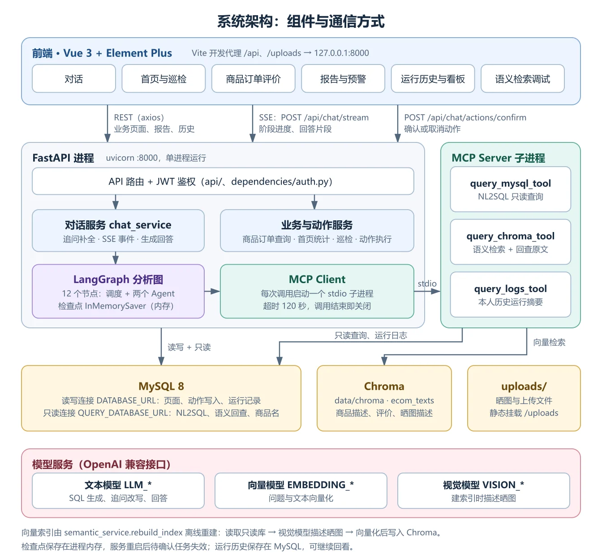

源码：`frontend/src/api/chat.js`；`backend/app/api/chat.py`；`backend/app/agent/graph.py`；`backend/app/mcp_client/client.py`；`backend/app/database.py`。

图中的两条数据库连接承担不同职责。`QUERY_DATABASE_URL` 用于 NL2SQL、语义原文回查和商品名读取；`DATABASE_URL` 用于业务页面、报告与预警写入、运行记录等。SQL 校验限制模型能生成的查询，只读账号再从数据库权限层限制写入。两者需要同时保留，不能因为提示词写了“只读”就让查询工具使用写账号。

MCP 子进程并非只持有只读账号。日志工具 `query_logs_tool` 读取 `agent_runs` 时使用 `DATABASE_URL`，而且子进程启动时继承了主进程的全部环境变量。进程边界不等于权限边界，工具能访问哪些数据，取决于它实际使用的连接和账号。

对话流通过 `POST /api/chat/stream` 返回 SSE（Server-Sent Events，服务端沿同一个 HTTP 连接持续推送事件）；确认或取消走 `POST /api/chat/actions/confirm`，返回普通 JSON。图里的 MCP Server 按调用启动，使用 stdio 通信，每次工具调用结束后关闭会话与子进程。

**图 2：后端分层——从接口找到具体实现**

同一个功能往往跨越多个目录。例如一次 SQL 查询，从 `api/chat.py` 进入对话服务，再进入图节点，由 MCP Client 调用 Server 子进程，最终复用 `nl2sql_service`。查代码时既要看入口，也要看真正执行校验与查询的模块。

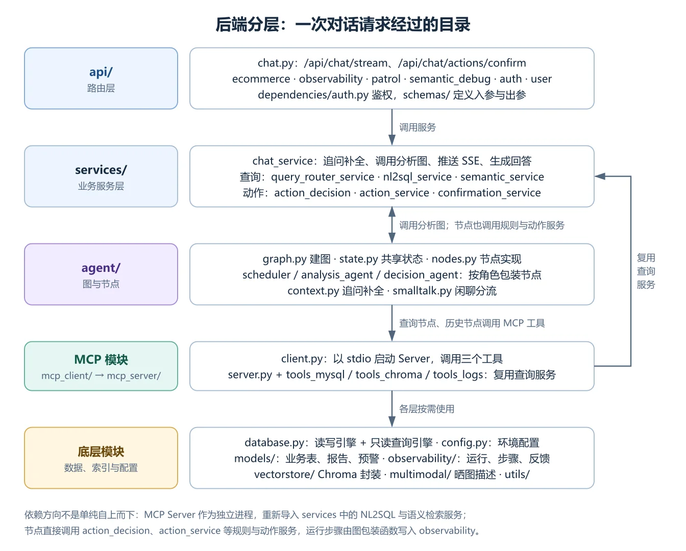

源码：`backend/app/api/chat.py`；`backend/app/services/chat_service.py`；`backend/app/agent/`；`backend/app/mcp_client/`；`backend/app/mcp_server/`。

MCP Server 会重新导入查询服务，因此依赖关系不完全是单向向下。动作节点也会直接调用 `action_decision` 和 `action_service`：前者生成计划，后者通过白名单执行写入。`observability` 记录运行与步骤，`multimodal` 处理晒图描述，它们分别服务于主流程中的相关环节。

在同一进程内直接调用函数也能完成查询。这里使用 MCP，是把查询能力封装成名称、参数和返回结构明确的工具，并通过进程边界调用；代价是每次启动子进程、握手和处理协议结果。MCP 本身不替代 SQL 校验、只读账号或用户归属检查。

**图 3：项目讲解一页图——把业务问题与实现对应起来**

项目不只是让模型回答一句话，还要把查询结果组织成可追溯的证据，再决定是否生成报告、预警或复核建议。讲解时先说明业务问题，再解释查询选择、证据可信度与写入控制如何对应到实现。

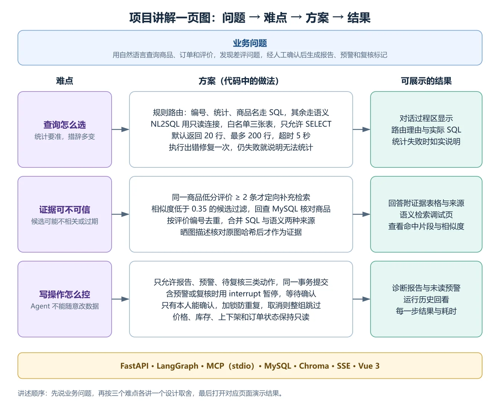

源码：`backend/app/services/query_router_service.py`；`backend/app/agent/nodes.py`；`backend/app/services/action_decision.py`；`backend/app/services/confirmation_service.py`。

项目可以概括为：用户用自然语言查询商品、订单和评价；确定筛选或统计问题走只读 SQL，主题型问题走语义检索并回查当前原文；评价证据经过过滤和去重后用于规划动作，涉及预警或商品复核时暂停，取得本人确认后再执行。页面中的过程 SQL、证据表格、运行历史和确认结果，分别对应这些环节。

## 2. 一次提问的旅程

**图 4：请求预处理——先判断是否具备查询条件**

外层 `chat_service.stream_chat` 先判空，再读取商品名并调用 `smalltalk.classify_input`。寒暄和跑题直接返回引导；信息不足的输入先尝试按历史规则补全并重新分类，通过后才创建运行记录。

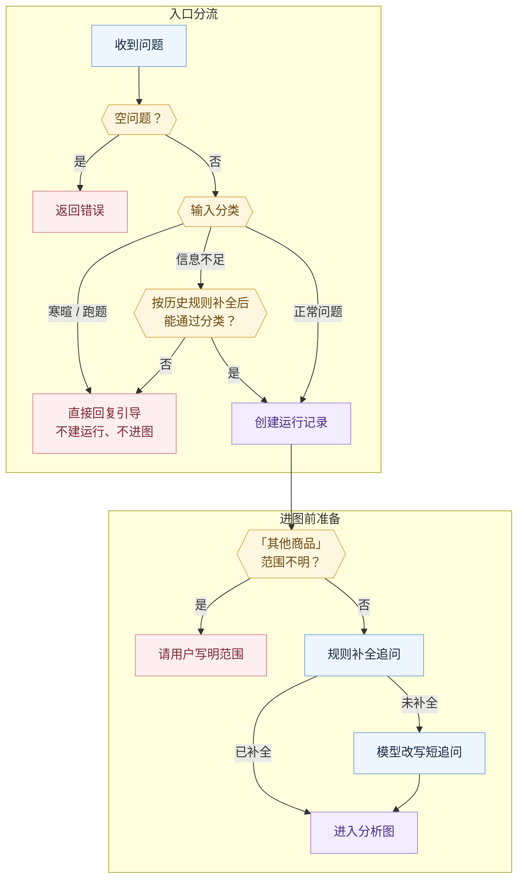

源码：`backend/app/services/chat_service.py`：`stream_chat`、`_stream_chat`；`backend/app/agent/smalltalk.py`：`classify_input`；`backend/app/agent/context.py`：`resolve_followup`、`rewrite_followup_with_llm`。

通过入口后，内层 `_stream_chat` 才处理“其他商品”的范围澄清、规则补全和必要的模型改写。比如“其他商品呢”没有写明全店范围或完整商品名时，会先请用户明确范围；这时已经创建运行，但还没有进入分析图。寒暄等入口引导则连运行都不会创建。

规则没有补全，不代表一定会请求模型：改写函数还会判断是否属于可处理的短追问。补全后的问题用于本轮查询，历史文本只提供上下文，用户身份仍来自接口认证。

**图 5：查询路由——判断顺序决定查询方式**

路由由规则按顺序决定：全店商品范围优先，其次是编号、统计或明确条件，再看商品名及去规格别名；这些都未命中，才按“评价 / 评论”“商品 / 产品”选择语义类型，其余默认检索评价。

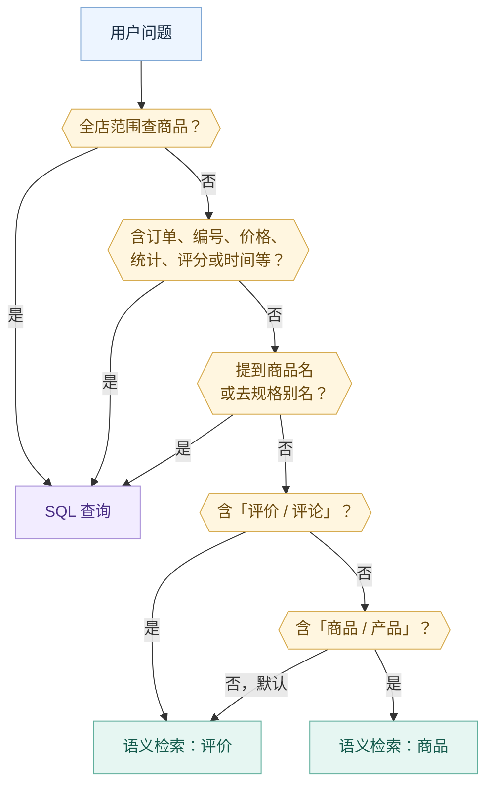

源码：`backend/app/services/query_router_service.py`：`decide_query_route`；`backend/app/agent/router_rules.py`：`product_aliases`。

“洗衣液 2L 的价格是多少”命中价格条件，走 SQL；“洗衣液有哪些评价”命中已知商品名或去规格别名，也走 SQL；“跑鞋脱胶”没有命中前面的明确条件和商品别名时，默认走评价语义检索。因此不能把“提到评价”简单等同于语义查询。

去规格别名是已知商品名第一个空格前的部分，例如“洗衣液 2L”对应“洗衣液”。代码不会自动把“轻云运动跑鞋”扩成“跑鞋”。多个规格共用一个别名时，SQL 问句补全会要求用户提供完整名称，不能随意选一个规格。

统计问题优先 SQL，是因为 Top K 语义候选只反映相关片段。检索到五条评价，不能据此回答全店有多少订单、某商品共售出多少件或平均评分是多少。

**图 6：NL2SQL 安全链路——模型输出经过哪些限制**

模型先根据表结构和问题生成 SQL，服务再解析整棵查询树。只有单条 `SELECT` 可以继续；表限于 `products`、`orders`、`reviews`，函数也受白名单约束，写入、锁、跨库等禁止结构会被拒绝。问题涉及写操作、缺少必要数据或条件不明确时，模型按提示只返回 `UNSUPPORTED`，服务直接报错，不执行查询。

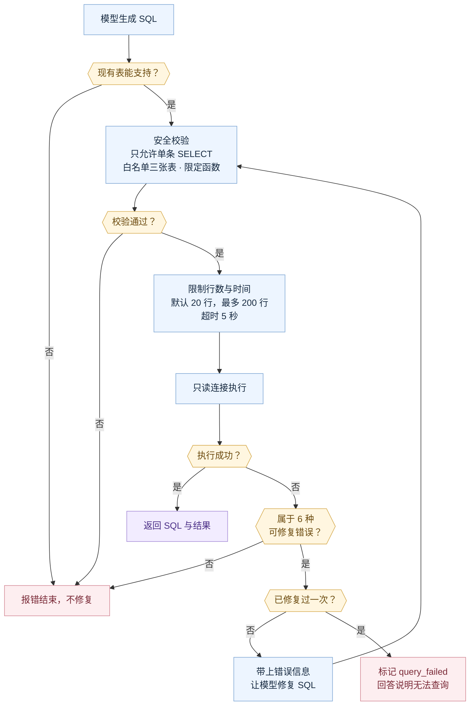

源码：`backend/app/services/nl2sql_service.py`：`generate_sql`、`validate_sql`、`execute_select`、`query_by_question`；`backend/app/agent/nodes.py`：`node_structured_query`。

最外层没有 `LIMIT` 时默认加 20，已有值最多保留 200；执行 SQL 中还会加入 `MAX_EXECUTION_TIME(5000)` 提示，限制 MySQL 的查询执行时间。这个 5 秒不是整个模型请求或 MCP 调用的总超时。返回行数达到上限时，`truncated=true` 表示可能还有未展示的数据，不能据此断言结果完整。

行数限制作用于查询输出，不应先截取 20 条再做全量聚合。提示词要求明细列出具体字段，但 `SELECT *` 并不是校验器单独禁止的结构；提示约束和程序实际拒绝的条件需要区分。

修复也有明确范围：只有数据库错误码 1054、1064、1055、1111、1140、1146 才带错误信息请求一次修复，修复后的 SQL 仍要重新校验。第二次仍为这类执行错误时抛出 `QueryExecutionError`，节点置 `query_failed`；配置、模型调用、校验失败和其他数据库错误直接向外报错。SQL 失败后没有改走语义检索的兜底边。这些直接报错的情况都发生在 MCP 子进程中，经 MCP 返回后，页面只统一提示工具调用失败，具体原因需要查看后端日志。

**图 7：RAG 入库与检索——相关候选怎样回到业务原文**

入库与提问时的检索是两个过程。重建索引时读取商品描述和评价正文，有晒图时尝试生成图片描述，再按每批 16 条生成向量；提问时只对问题向量化，检索相关记录编号，再回 MySQL 取当前原文。

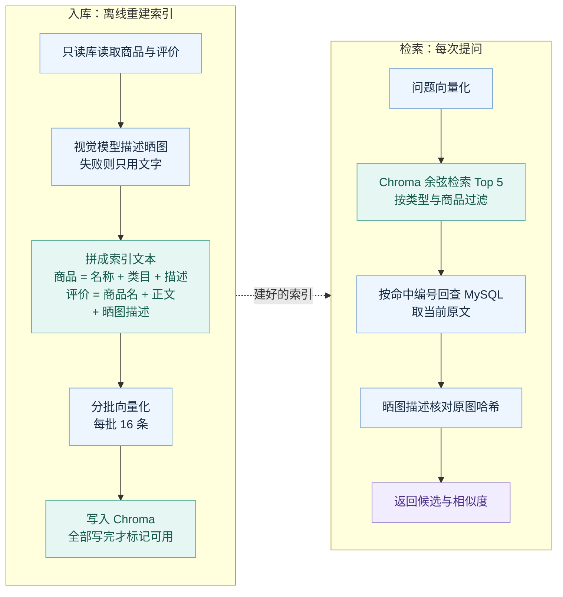

源码：`backend/app/services/semantic_service.py`：`rebuild_index`、`search_ids`、`search_records`、`DETAIL_SQL`；`backend/app/vectorstore/chroma_store.py`；`backend/app/multimodal/image_caption.py`。

商品索引文本包含名称、类目和描述；评价索引文本包含商品名、评价正文及可用的晒图描述。每条文档用 `doc_type` 区分商品或评价，`business_id` 保存原记录编号，`product_id` 保存所属商品；有效图片另存 `image_caption`、`image_path` 和 `image_sha256`。

集合级元数据保存向量模型、服务地址、维度、余弦度量和 `ready` 标记。所有向量生成并校验后才替换集合，全部写入后才标记可查询；模型配置变化需要重建。这里不是新旧索引的原子切换：替换开始后若写入失败，新集合可能保持不可用，不能声称任意重建失败都保留旧索引。索引没有增量更新入口，只能整体重建；重建之前新增的商品和评价检索不到，回查 MySQL 能取到当前原文、跳过已删除记录，但补不回索引里没有的记录。

正常对话检索使用 `semantic_service.TOP_K=5`，返回数还受实际记录和过滤范围限制。相似度按 `1-distance` 得到；`search_records` 用 `DETAIL_SQL` 回查 MySQL，跳过已删除记录并保留候选顺序。0.35 的相关性过滤发生在后面的证据整理节点。

晒图描述会再次核对当前图片路径和内容哈希，图片改变后不沿用旧描述。单张图描述失败时保留评价文字。回答引用 `image_caption` 时应说明来自晒图描述，它既不是用户评价原文，也不能证明画面外的故障原因或责任。

**图 8：SQL 结果触发深挖——什么情况下补充语义检索**

SQL 返回评价相关字段，还不足以说明它是逐条评价明细。`_review_fields` 要确认直接输出了 `reviews` 的 `id`、`product_id`、`rating`、`content`，并且没有聚合、分组、`DISTINCT` 或子查询；`reviews` 表实例必须恰好一个，但允许关联其他表。

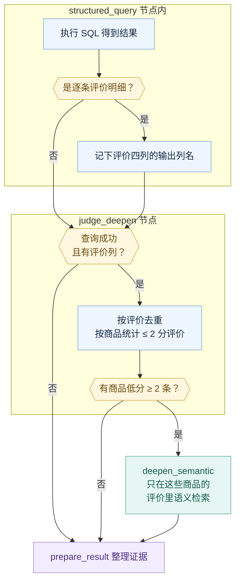

源码：`backend/app/agent/nodes.py`：`_review_fields`、`node_judge_deepen`、`select_after_judge`、`node_deepen_semantic`。

列来源确认在 `structured_query` 内完成，输出列名映射保存在 `review_fields`。`judge_deepen` 读取这个映射，对返回结果按评价编号去重，再分别统计各商品评分不超过 2 分的评价。某个商品达到 2 条，才把它加入 `target_product_ids`。

假设 SQL 返回商品 A 的两条低分评价、商品 B 的一条低分评价，则只补查商品 A；A、B 各一条时都不补查。这些条数来自本次返回的明细，不代表数据库中全部低分评价。

补充检索沿用本轮问题，并限制目标商品；它不会自动继承 SQL 中所有日期、评分或订单条件。因此补充片段可以提供现象线索，却不能直接加进原 SQL 的统计结果。

**图 9：证据合并——同一条评价怎样避免重复计算**

`prepare_result` 先保留 SQL 行并标记 `sql` 来源；能确认评价身份时，按评价编号去重。随后处理语义候选，过滤非有限相似度及低于 0.35 的候选；SQL 补充检索还要检查回查后的商品归属。

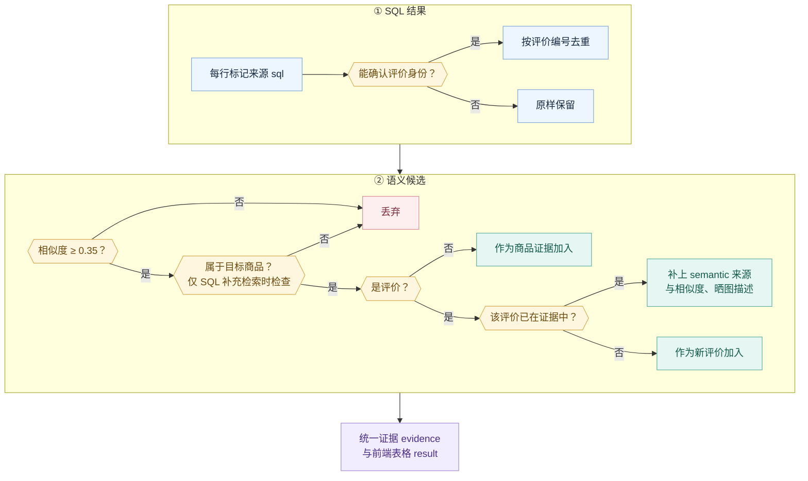

源码：`backend/app/agent/nodes.py`：`node_prepare_result`；`backend/app/multimodal/image_caption.py`：`verified_caption`。

例如评价 37 同时出现在 SQL 和语义结果中，合并后只有一条证据，`sources` 包含 `sql` 与 `semantic`，并补充相似度及有效的晒图描述。两个来源不会变成两条评价。外连接中评价编号为空的 SQL 行仍可保留为查询结果，但不能据此认定存在一条评价。

统一后的 `evidence` 供回答和动作规划读取；`result` 则组织 SQL、列、行及截断标记，供前端表格展示。商品、订单或聚合结果可以作为回答依据，但不会因为进了表格就自动获得“逐条评价”的身份。

## 3. 从分析到行动

**图 10：完整执行图——三个角色怎样交接**

系统架构图展示组件，下面的状态图展示一次分析的执行顺序。图中共有 12 个业务节点，不把 `START` 和 `END` 算作业务节点；紫色是调度，蓝色是查询分析，绿色是报告决策。

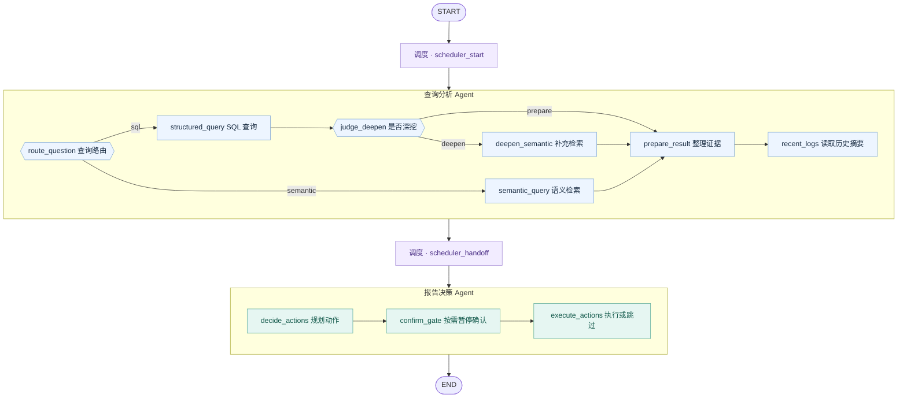

源码：`backend/app/agent/graph.py`：`build_analysis_graph`；`backend/app/agent/scheduler.py`、`backend/app/agent/analysis_agent.py`、`backend/app/agent/decision_agent.py`。

查询的两条入口是 SQL 和直接语义检索，最终都汇入 `prepare_result`。之后先执行 `recent_logs` 读取本人历史运行摘要，再由 `scheduler_handoff` 交给动作决策。历史摘要只供回看，不混入本轮证据，也不增加动作计数。

这几个角色共享同一份状态。角色包装函数添加当前角色标识，调度节点负责交接，并不意味着每个角色都另开一个模型会话。图暂停或结束后，`chat_service` 才根据同一份证据生成回答；因此图执行结束、回答完成和动作执行成功，需要分别判断。

**表 11：共享状态——哪些节点写入、哪些节点读取**

`AgentState` 把输入、查询结果、证据和动作结果分开保存。深挖写入 `semantic_rows` 时不会覆盖 `structured_rows`，SQL 的截断标记也能继续传给回答服务。

| 字段组 | 字段 | 写入 | 读取 |
| --- | --- | --- | --- |
| 输入 | `question`、`product_names`、`user_id`、`run_id` | 对话服务创建初始状态 | 路由与查询节点读问题和商品名；`execute_actions`、`recent_logs` 读用户；`recent_logs` 用 `run_id` 排除本轮，记录运行步骤时也读 `run_id`；确认服务核对 `user_id` |
| 路由 | `route`、`kind`、`route_reason` | `route_question` | 条件边按 `route` 分支；`semantic_query` 按 `kind` 检索；`prepare_result` 按两者筛选候选；对话服务展示路由理由 |
| 查询结果 | `sql`、`structured_rows`、`semantic_rows`、`truncated`、`query_failed`、`aggregate_intent`、`review_fields` | `structured_query` 或 `semantic_query`；`deepen_semantic` 写入 `semantic_rows` | `judge_deepen`、`prepare_result`；`decide_actions` 读 `query_failed`；对话服务按 `query_failed`、`aggregate_intent` 给出失败提示 |
| 深挖判断 | `need_deepen`、`target_product_ids` | `judge_deepen`（语义分支由 `semantic_query` 置空） | 条件边按 `need_deepen` 分支；`deepen_semantic` 只查目标商品；`prepare_result` 核对候选归属 |
| 证据 | `evidence`、`result` | `prepare_result` | `scheduler_handoff` 统计条数；`decide_actions` 规划动作；对话服务生成回答并下发表格 |
| 动作计划 | `pending_actions`、`risk_level`、`need_human_confirm`、`low_rating_counts`、`decide_reason` | `decide_actions` | `confirm_gate` 判断是否暂停；`execute_actions` 执行；确认服务展示待确认内容；对话服务随结束事件下发计划 |
| 确认与执行 | `human_approved`、`actions_executed` | `confirm_gate` 写批准结果；`execute_actions` 写执行结果 | `execute_actions` 读批准结果；确认服务据此把运行记为成功或取消 |
| 过程展示 | `current_agent`、`agent_label`、`status_message` | 各角色包装函数和 `recent_logs` 节点；调度、确认、执行节点写 `status_message` | 对话服务推送 SSE 进度；记录运行步骤时读 `agent_label` |
| 历史摘要 | `recent_logs` | `recent_logs` 节点 | 对话服务随结束事件下发，只用于回看，不计入本轮证据 |

节点只返回要更新的字段，由 LangGraph 合并进共享状态；`thread_id` 放在调用配置 `configurable` 中，不属于 `AgentState`。

源码：`backend/app/agent/state.py`：`AgentState`；`backend/app/agent/nodes.py`；`backend/app/services/chat_service.py`；`backend/app/services/confirmation_service.py`。

`thread_id` 用于定位图的检查点（LangGraph 按 `thread_id` 保存的图状态，暂停后据此恢复），`run_id` 用于数据库中的运行记录，两者用途不同。恢复确认继续使用原线程和原运行编号；用户归属仍要核对状态中的 `user_id`，仅知道线程编号不代表有确认权限。状态里不传递数据库会话，由执行节点在需要时创建和关闭会话。

**图 12：动作规划——根据本轮相关评价决定做什么**

动作规划只处理有效的 `review` 证据。编号必须有效，评分须为 1～5 的整数；没有 SQL 来源的证据还必须有 `semantic` 来源，且相似度有限并达到 0.35。查询失败时不使用残留证据生成计划。

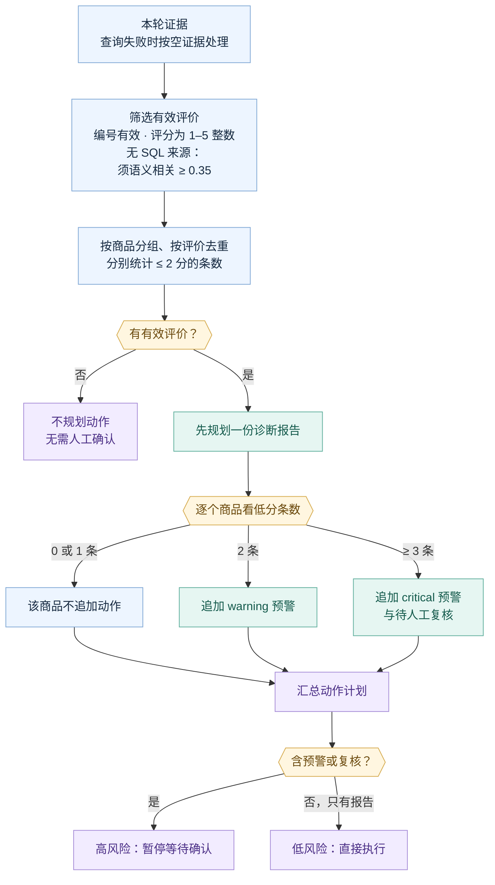

源码：`backend/app/services/action_decision.py`：`decide_actions`、`LOW_RATING_ALERT_THRESHOLD`、`LOW_RATING_REVIEW_THRESHOLD`。

有有效评价时，先规划一份诊断报告；涉及多个商品也不是每个商品各生成一份。随后按商品分别计数：评分 ≤ 2 为低分，2 条触发 `warning` 预警，达到 3 条则规划 `critical` 预警和待人工复核。各商品独立判断，同一评价的两个来源也只计一次。

比如商品 A 有三条、商品 B 有一条低分证据，计划是一份报告、A 的一条严重预警和 A 的待复核动作。B 不触发预警。这里描述的是当前证据中的低分条数，不能写成“数据库里只有这些差评”。

只生成报告或没有动作时，无需人工确认，风险为 `low`；动作列表包含预警或复核时，风险为 `high`，需要暂停确认。`decide_actions` 只生成计划，不访问数据库执行这些动作。

**图 13：人工确认——暂停后如何回到原计划**

`confirm_gate` 在需要确认时调用 `interrupt`，把动作、风险和理由保存在检查点中，等待本人选择。无需确认时自动批准，随后仍进入同一个执行节点；空动作列表会被跳过。

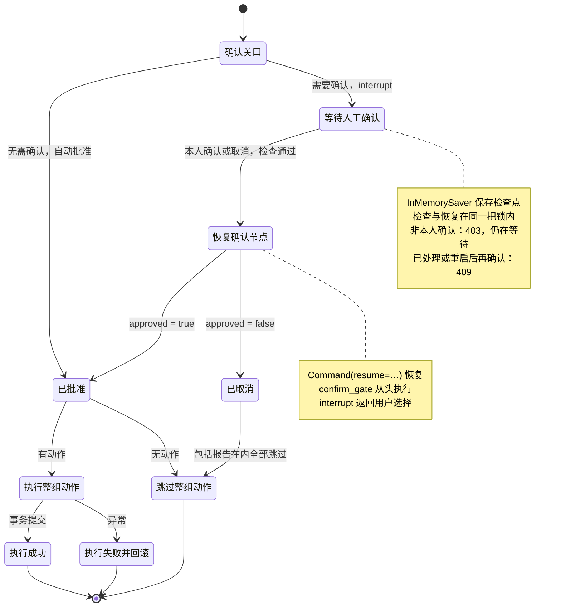

源码：`backend/app/agent/nodes.py`：`node_confirm_gate`、`node_execute_actions`；`backend/app/services/confirmation_service.py`：`resume_actions`；`backend/app/services/action_service.py`：`execute_actions`。

确认服务检查待确认状态和用户归属后，用 `Command(resume={"approved": ...})` 恢复原线程。`confirm_gate` 会从头执行，执行到原 `interrupt` 时取得用户选择，再返回批准结果。正因节点会重跑，`interrupt` 前只组织数据，不写报告、发预警或修改商品。

批准后按动作列表执行；取消则整组跳过，包括报告。不能把取消理解成“只是不发预警，报告照常保存”。图中的执行失败出口表示本次调用异常结束，不代表图已成功到达 `END`。执行失败后，检查点停在 `execute_actions`，不再处于 `confirm_gate`，再次提交原来的确认会得到业务码 409；原计划不能原地重试，需要重新提问生成新计划。

图使用 `InMemorySaver` 保存检查点，检查与恢复受同一进程锁保护。图中 403、409 均指业务码，即响应体中的 `code`，HTTP 状态仍为 200：非本人不能处理，已完成、已取消或重启后失效的检查点也不能再次确认。运行日志能持久化回看，并不意味着内存检查点可以跨重启恢复。

## 4. 工程边界

**图 14：SSE 事件时序——前端在什么时刻拿到什么**

`status` 展示准备、节点进度和完成信息；`token` 追加回答片段；`done` 表示本轮完整回答结束并携带结果；`error` 表示异常终止。图节点的 `custom` 进度经对话服务转成 `status`，`updates` 则同时用于合并节点状态。

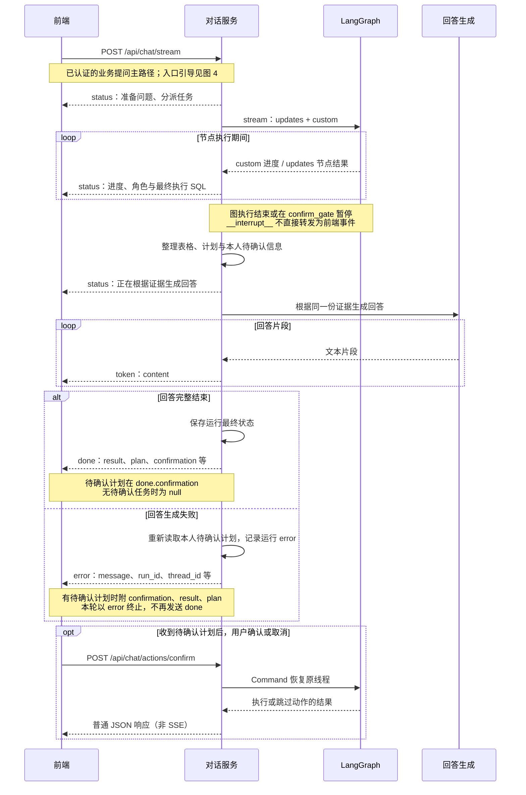

源码：`backend/app/services/chat_service.py`：`_sse`、`stream_chat`、`_stream_chat`、`_answer_pieces`；`backend/app/agent/nodes.py`：`_progress`；`backend/app/api/chat.py`；`frontend/src/api/chat.js`。

待确认计划通常随 `done.confirmation` 下发，无待确认任务时为 `null`。如果回答中途失败，但本人原计划仍可确认，`error` 也会附上 `confirmation`、`result` 和 `plan`，前端可以保留确认或取消入口；本轮仍以 `error` 结束，不再补发 `done`。

SQL 两次执行失败被转换成 `query_failed` 时，失败说明也能完整输出并以 `done` 结束，但该运行仍记为 `error`。因此收到 `done` 不能单独证明查询成功；连接关闭也不能代替 `done` 或 `error`。入口引导和进入图前的异常则可能更早结束，不必经过图中全部步骤。

低风险动作可能在生成回答之前已经执行，回答失败不会撤销已经提交的动作；高风险原计划仍待确认时，也不会因回答失败自动执行或重新规划。人工选择通过独立的确认接口提交，其响应是普通 JSON，不接回原 SSE 流。

**图 15：MCP 调用时序——工具调用跨过哪些边界**

同步图节点调用 `mcp_client` 的查询函数，Client 启动 Server 子进程并初始化会话，然后发出工具调用。查询模块在子进程内运行，返回后由 Client 检查协议和业务结构，再交回节点。

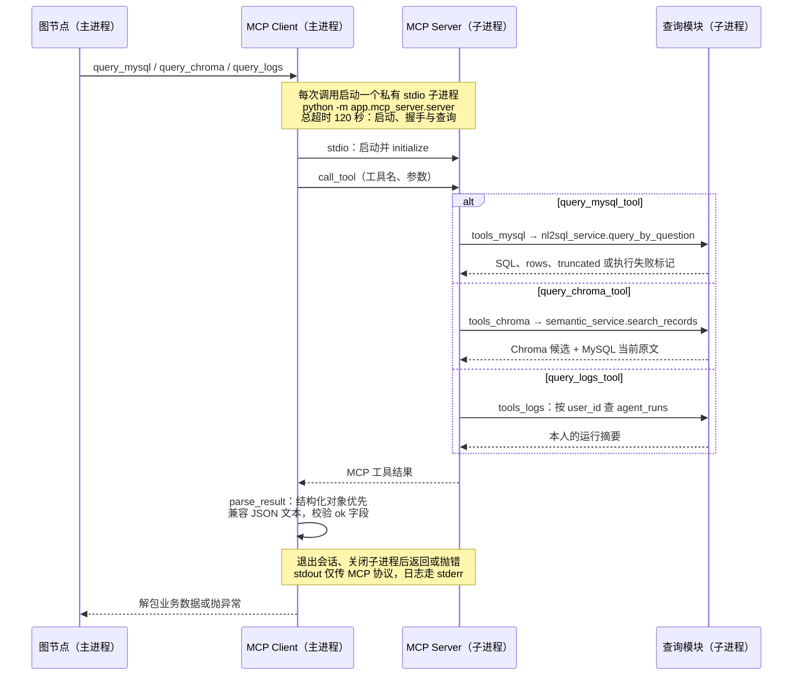

源码：`backend/app/mcp_client/client.py`：`call_tool`、`_call_async`、`parse_result`、三个查询包装函数；`backend/app/mcp_server/server.py`；`backend/app/mcp_server/tools_mysql.py`、`backend/app/mcp_server/tools_chroma.py`、`backend/app/mcp_server/tools_logs.py`。

三个工具分别是 `query_mysql_tool`、`query_chroma_tool`、`query_logs_tool`。前两个复用 NL2SQL 和语义检索服务；日志工具直接按受信任调用方传来的用户编号查询 `AgentRun`。它不会从用户问题里猜用户身份。

120 秒超时覆盖子进程启动、握手和查询；正常返回或异常时都要退出上下文并关闭资源。Server 的标准输出只用于 MCP 协议，日志走标准错误，避免普通打印破坏通信。`parse_result` 优先读取结构化对象，兼容 JSON 文本响应，并要求 `ok` 为布尔值。

SQL 修复后仍执行失败时，工具用 `error_type="query_execution"` 区分这类业务失败，Client 再恢复为 `QueryExecutionError`，让图节点继续按 `query_failed` 处理。协议错误或其他工具异常不能一律当成正常的空结果。

**图 16：数据模型——业务数据与分析记录怎样关联**

九张表可分为共享业务数据、报告与预警、运行观测三部分。图中只列关键字段，`PK` 表示主键、`FK` 表示外键、`UK` 表示唯一键；关系线的圆圈端表示允许零条或关联为空，虚线表示外键不参与子表主键的非标识关系。

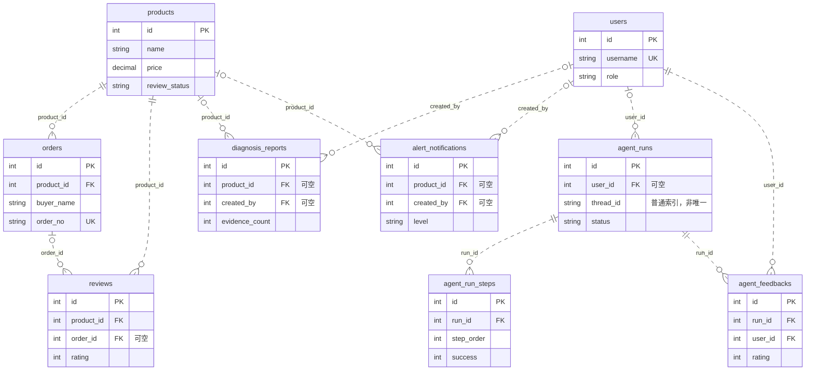

源码：`backend/app/models/product.py`、`backend/app/models/order.py`、`backend/app/models/review.py`、`backend/app/models/user.py`、`backend/app/models/diagnosis_report.py`、`backend/app/models/alert_notification.py`；`backend/app/observability/models.py`；`backend/app/database.py`：`Base`。

`orders.product_id` 和 `reviews.product_id` 都关联商品；`reviews.order_id` 可空，不能假设每条评价都有订单。`orders.buyer_name` 是买家昵称文本，订单、评价并没有指向 `users` 的买家外键，不能根据昵称建立站内用户归属。

报告和预警通过 `created_by` 关联触发用户；`agent_runs.user_id` 记录提问用户，步骤和反馈再关联运行。数据表有这些关联，不代表外键会自动执行权限过滤，接口和服务仍要限制本人记录。`agent_feedbacks` 对 `(run_id, user_id)` 设置联合唯一约束，同一用户对同次运行的反馈更新原记录。

各表还继承 `create_time`、`update_time`。`agent_runs.thread_id` 只有普通索引，不是唯一键，更不是完整检查点的存储位置。

**图 17：失败、并发与运行边界——哪些保证已经实现**

一次确认请求先取得进程内锁，再检查是否停在 `confirm_gate`、是否属于当前用户。通过后恢复原线程；批准且有动作时，逐条校验动作白名单并按列表顺序执行，整组共用一个事务。

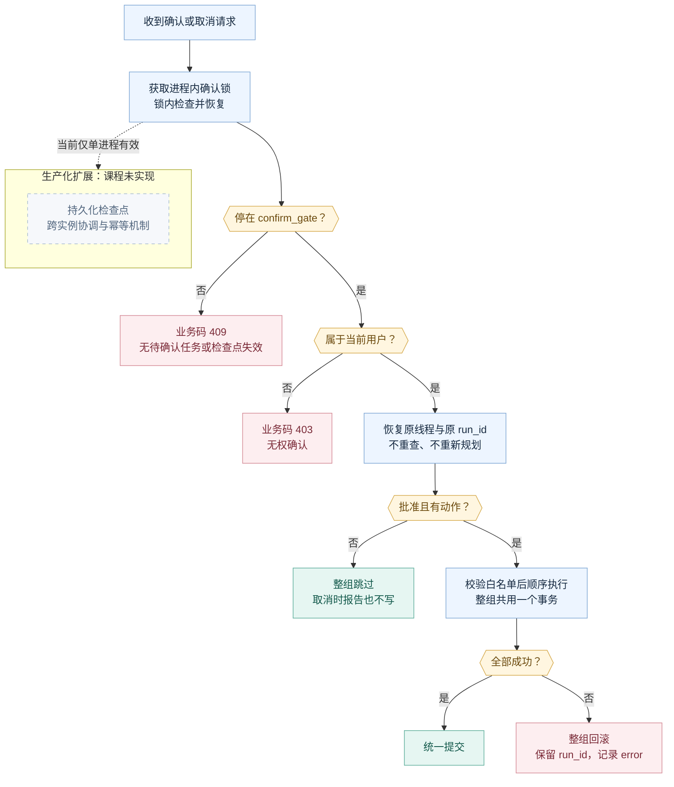

源码：`backend/app/services/confirmation_service.py`：`resume_actions`；`backend/app/services/action_service.py`：`execute_action`、`execute_actions`；`backend/app/common/exceptions.py`：`business_exception_handler`；`backend/app/agent/graph.py`：`build_analysis_graph`。

前端确认接口同时检查 HTTP 是否成功以及 `payload.code` 是否为 200，不能只凭 HTTP 200 就认为动作已确认。正常和异常出口都会在离开临界区时释放锁。

| 边界 | 课程代码的处理 | 源码依据 |
| --- | --- | --- |
| 客户端断开 | 服务端未写终止状态时，运行记为 `interrupted`；前端读到流结束但没收到 `done` 或 `error`，按连接提前结束处理 | `backend/app/services/chat_service.py`：`stream_chat`；`frontend/src/api/chat.js`：`chatStream` |
| 重复或并发确认 | 进程内锁覆盖检查与恢复；不在待确认状态返回 409，非本人返回 403 | `backend/app/services/confirmation_service.py`：`resume_actions` |
| 动作范围 | 只允许 `write_report`、`send_alert`、`mark_pending_review`；复核只改 `review_status`，不改订单状态、价格、库存或上下架 | `backend/app/services/action_service.py`：`ALLOWED_ACTION_TYPES`、`_mark_pending_review` |
| 动作事务 | 整组顺序执行后统一提交，任一动作失败整组回滚；失败后检查点停在 `execute_actions`，原确认返回 409，需要重新提问 | `backend/app/services/action_service.py`：`execute_actions`；`backend/app/services/confirmation_service.py`：`resume_actions` |
| 检查点与部署 | `InMemorySaver` 和确认锁只在当前进程有效，重启后无法从运行日志恢复图；持久化检查点、跨实例协调与幂等属于生产化扩展，课程未实现 | `backend/app/agent/graph.py`：`build_analysis_graph`；`backend/app/services/confirmation_service.py`：`_confirmation_lock` |

进程锁使同一进程中的确认检查与恢复串行执行，但不覆盖多个实例；事务保护这一组业务写入，也不等于任意崩溃、重试场景下都保证只执行一次。生产化需要进一步设计持久化检查点、跨实例协调与幂等机制，图中虚线区域已经标出这些能力在课程中尚未实现。

对照源码回看一次提问时，可以依次确认：页面展示的 SQL 是否为实际成功执行的语句，证据里的评价编号是否去重，预警条数是否按单个商品计算，取消后是否整组未执行，以及最终事件、运行状态和检查点状态是否各自符合对应条件。
